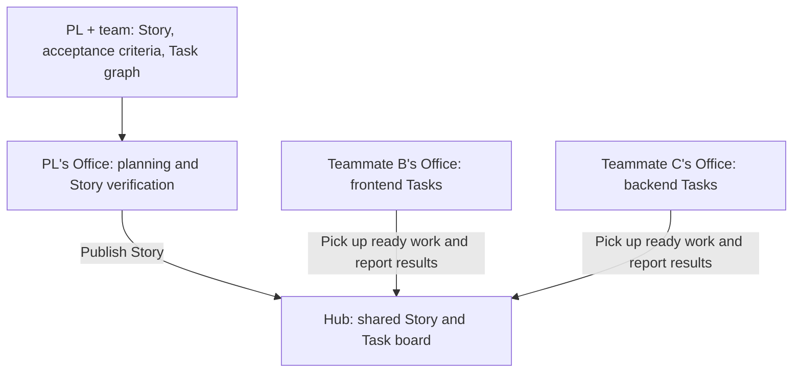

<div align="center">

# Pazmo Agent Office

### Publish the work. Let each Office pick it up.

**People define the problem, design the solution and make decisions. AI agents implement and verify the Tasks.**


**English** · [한국어](README_ko.md)

[Why](#why-we-are-building-this) · [How it works](#how-it-works) · [Current status](#current-status) · [Run locally](#run-locally) · [Roadmap](#roadmap)

</div>

**Organization:** Checkout Engineering · **Created by:** 김종건

Pazmo Agent Office is a team collaboration environment built around shared Stories and Tasks, together with [AI Workflow Kit](https://www.npmjs.com/package/@pazmo/ai-workflow-kit). We are building a workflow where a PL publishes a Story and its Task graph to a shared Hub, and each teammate's local Office picks up work for their repositories.

> **Local alpha, under active development.** Local agent execution and the first Hub Story-board backend are implemented. Automatic Task pickup, automatic merging into Story base branches and the full team workflow below are still being built. See [current status](#current-status) for the boundary between available features and the target design.

## Why we are building this

AI coding tools help individual developers, but a team still needs a common way to divide work, manage dependencies and see where decisions are needed. While applying Agile, DDD and SDD, we encountered four recurring problems:

| Problem | What the team experiences |
|---|---|
| Individual AI workflows | Each developer runs agents separately, making coordination and progress sharing difficult. |
| Design competes with implementation time | Discussing requirements and refining the design leaves less time to build. |
| Inconsistent collaboration | Story writing, Task breakdown and AI usage differ between teammates. |
| Limited visibility | Parallel agent work is hard to follow, including where it is blocked or needs a decision. |

Our goal is to give people more time for requirements, domain design and acceptance criteria, while agents handle clearly defined implementation and verification work.

## How it works

AI Workflow Kit provides the common Story contract, Task graph and verification workflow. Agent Office connects that workflow to local execution and a shared view of the team's work.

| Part | Responsibility |
|---|---|
| **People / PL** | Agree on requirements and acceptance criteria, approve the Story and inspect the final result. |
| **AI Workflow Kit** | Turn the agreed Story into executable Tasks with dependencies and verification steps. |
| **Hub** | Store shared projects, Stories, Tasks and progress. The Hub does not execute code. |
| **Agent Office** | Run on each teammate's PC, pick up eligible work and coordinate implementation, review and verification. |
| **Agent** | Work inside an isolated VM environment with the repository assigned to its Task. |

The target arrangement is **one Office per person, with one engine per repository**. PL planning can read the relevant repositories together; a Task agent sees only its own repository.



This diagram describes the target design. Multi-repository Office support and automatic pickup are follow-up stages.

### A Story from design to completion

The target workflow moves from manually sending and accepting work to publishing Tasks that each Office picks up when ready.

| Step | What happens | Owner |
|---|---|---|
| 1. Define and break down | Agree on the Story and acceptance criteria; identify each Task's repository, files, dependencies and verification commands. | PL + team, assisted by Kit |
| 2. Story G1 | Inspect and approve the scope, Task graph and verification commands. High-risk work also retains the G3 design gate. | Human / PL |
| 3. Publish to Hub | Register the Story and Tasks; create a Story base branch in each repository. | PL's Office |
| 4. Pick up work | An idle Office claims one ready Task from its assigned repositories. A dependent Task becomes eligible after its prerequisites are merged. | Each Office |
| 5. Implement, review, verify | Run the Task in isolation; record the agent's decisions and assumptions. | Agents |
| 6. Merge into Story base | Push the Task branch, open a PR, revalidate against the latest Story base and merge after review and checks pass. | Office, using the person's Git login |
| 7. Story verification → G4 | Verify the integrated Story and collect Task summaries and decision records for the PL's understanding check. | PL's Office + human / PL |
| 8. Test and merge to main | Test the Story base and merge it into main/master. Add feedback as new Tasks in the same Story. | Human |

Routine human checkpoints are at the Story's beginning and end. Individual Tasks merge into the Story base after review and verification; high-risk design decisions retain G3.

### Branches and recovery

```text
main / master
└── feature/story-111/base         ← Task results collect here
    ├── feature/story-111/task-112
    ├── feature/story-111/task-113
    └── feature/story-111/task-116 ← Feedback on the same Story

Story base → main/master: a person tests and merges
```

In this design, Office writes only within `feature/story-<N>/*`. It does not write to main/master or unrelated branches, or force-push. Merges for the same Story and repository run one at a time.

| Situation | Intended behavior |
|---|---|
| A laptop closes or an Office disconnects | Keep the claimed Task on hold; the PL releases it or cancels it after checking. |
| The retry limit is exceeded | Notify the assignee and PL; the assignee records the cause before rerunning. |
| A teammate wants to limit usage | Pause new pickups or set a daily Task limit; an in-progress Task finishes. |

The Hub backend already implements claim limits, hold detection and merge locks. Office-side recovery, usage controls and Git automation are follow-up work.

## Current status

As of **2026-10-30**, on `main`:

| Area | Implemented and verified | Remaining work |
|---|---|---|
| Local execution | PM, Lead, Developer and Reviewer workflows using installed codex or claude CLIs; real tasks reached human G4 and delivery on one Mac. | Other people's PCs and longer-term operation. |
| Minimal Office (default) | Tasks, task detail, Decisions and Agents; separate work/review runner settings; a real task completed on 2026-10-27. Made the default on 2026-10-30, when the Claw-based Office and its source were removed (D33). | Team Hub UI; a real task through the new default in app-be. |
| Existing team Hub | Hub server with invites, repositories and owners. Sending, accepting and cancelling requests was checked with two Offices on one Mac; those Office screens went with the Claw-based Office (D33). | Replacing manual handoffs with automatic Story Task pickup; cross-PC validation. |
| Hub Story board, phase 1 | Project/Story/Task storage, graph validation, exclusive claims, holds, merge locks and result reporting. | End-to-end use from Office; live validation with two Offices and two test repositories. |
| One Office, several repositories | Target design agreed. | Repository engines, Task execution mode, PL flow and Project → Story → Task Kanban screens. |
| Story branch integration | Branch rules and review/verification requirements agreed. | Automated branch creation, push, PRs, revalidation and merge into Story base. |
| Distribution | Source-based local startup on Apple Silicon macOS. | Publishing and installation-testing `@pazmo/agent-office` on npm. |

Since 2026-10-30 (D33) the default launcher opens the minimal Office, and the earlier Claw-based Office, its source and the chat bridge are removed. The new Hub Story-board backend has automated test coverage, but writes through its new API on the deployed Hub remain unverified. The backend alone does not yet provide the complete team workflow.

See [status and next steps](docs/STATUS.md), [the team Story design](docs/understanding/team-story-board-decision.md), [Hub verification](docs/verification/2026-10-22-team-story-board-hub.md) [minimal Office verification](docs/verification/2026-10-21-lean-office-phase1.md) and [default switch verification](docs/verification/2026-10-30-lean-office-default.md).

## Run locally

Live execution currently supports **Apple Silicon macOS**. Prepare Node **24.19+ within 24.x**, Git, Python 3, Colima, Docker and at least one installed, logged-in codex or Claude Code CLI. Follow the [setup and login guide](docs/LOCAL-PREVIEW.md) first.

From this repository, select an existing Git project outside the Office installation folder:

```bash
./office --project /absolute/path/to/project
```

`--lean` from older commands is still accepted and starts the same Office; `--claw` was removed. Use `./office --team` for the team Office. See the [Office guide](docs/LOCAL-PREVIEW.md#새-office) and [team Hub guide](docs/LOCAL-PREVIEW.md#팀-허브).

### Updating from a Claw version

1. Before pulling: finish or cancel the Claw Office's running tasks and any team hub requests you accepted, then stop that Office (`node bin/pazmo-office.mjs stop --project /absolute/path/to/project`). The same command still stops it after pulling.
2. After pulling: run `./office` once (`./office --team` for the team Office). The first run installs the root dependency (`ws`), so it needs the npm registry, and the runners are qualified once more before the first role runs. An Office that is already running gets the dependency through this run too.
3. If several Offices run from one checkout (per project, or the team Office), update while no task is running: the install briefly removes `node_modules`, so another Office's claude jobs can fail meanwhile.
4. The leftover `vendor/` folder (the old install and build) can be deleted. The old task data (`claw/`) is kept as it is; the new Office does not read it.

Agent Office is not yet published on npm. The AI Workflow Kit package linked here is a separate project.

## What this enables

We are building and validating this collaboration model. These are intended benefits; team productivity and time savings have not yet been measured.

- **Team productivity:** connect individual AI use through shared Stories, Tasks and dependencies.
- **More time for design:** delegate repeatable implementation work so people can focus on requirements, domain modeling and acceptance criteria.
- **Visible progress:** bring Task status, agent activity, results and decisions into one workflow.
- **Consistent development:** share the same workflow and templates across teammates.

Early exploration included character-based agent visualization and manual Task delivery. The current direction prioritizes Kanban, shared Stories and automatic Task execution.

## Roadmap

The next stages connect the Hub Story backend to multi-repository Offices, implement Task pickup and Story base integration, and add the PL flow and team Kanban UI.

Checkout work also includes night/weekend incidents and issues that must be handed to other domains. A future extension would connect **NOC, existing Teams incident alerts and MCP** to collect and analyze incident information and create response Tasks in Agent Office. This integration is not implemented yet.

The goal is an environment where opening Office lets an agent pick up shared work, while people focus on design, decisions and final verification.

## Links

- [AI Workflow Kit — npm](https://www.npmjs.com/package/@pazmo/ai-workflow-kit)
- [Agent Office — GitHub](https://github.com/syjkim0125/pazmo-agent-office)
- [Shared concepts](CONCEPTS.md) · [Story contract](docs/understanding/pazmo-agent-office-contract.md) · [Current status](docs/STATUS.md)

## Contributing and license

Keep changes small, connect them to Story acceptance criteria and record verification evidence. Distinguish automated checks from live workflow checks, and keep the documentation clear about what is implemented.

Original Pazmo code and documentation use [PolyForm Shield 1.0.0](LICENSE): any purpose is allowed, including use inside a company, except providing a product that competes with Pazmo, even for free. Versions published up to 2026-10-30 (commit `610169e`) were MIT. Third-party files in the repository (the Codex model entry in `assets/codex`) are **Apache-2.0**, with their license and notice retained. Claw-Empire code (Apache-2.0), where the project started, is only in versions before its removal on 2026-10-30; its provenance and notices stay on record. Pazmo is source-available, not OSI open source. See [license boundaries](LICENSING.md) and [third-party notices](THIRD_PARTY_NOTICES.md).
