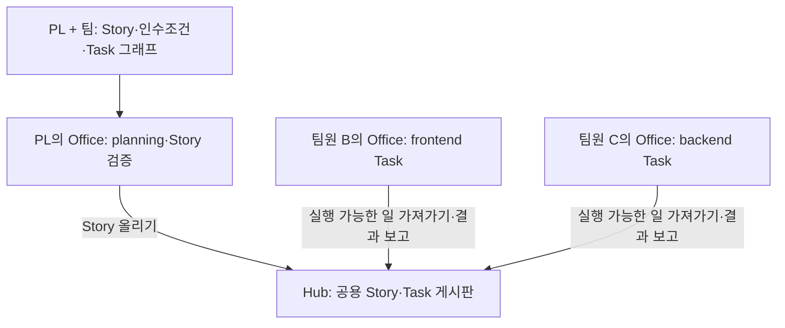

<div align="center">

# Pazmo Agent Office

### 보내지 않는다. 올려 두면 각자 가져간다.

**사람은 문제 정의·설계·의사결정에, AI Agent는 Task의 구현과 검증에 집중합니다.**


[English](README.md) · **한국어**

[문제](#문제--무엇이-불편했나) · [적용](#적용--ai를-어떻게-쓰나) · [현재 상태](#현재-상태) · [로컬 실행](#로컬-실행) · [확장 목표](#향후-확장-목표)

</div>

**조직:** Checkout Engineering · **만든 사람:** 김종건

Pazmo Agent Office는 [AI Workflow Kit](https://www.npmjs.com/package/@pazmo/ai-workflow-kit)과 함께, 공통 Story와 Task를 중심으로 팀이 AI Agent와 협업하는 개발 환경입니다. PL이 Story를 Task로 쪼개 공용 Hub에 올리면, 팀원의 로컬 Office가 자기 repo의 일을 가져가 수행하는 흐름을 만들고 있습니다.

> **현재는 개발 중인 로컬 알파입니다.** 로컬 Agent 실행과 Hub의 Story 보드 백엔드 1단계를 구현했습니다. Task 자동 가져가기, Story base 자동 병합과 아래의 전체 팀 협업 흐름은 후속 단계입니다. [현재 상태](#현재-상태)에서 구현된 기능과 목표를 구분해 확인할 수 있습니다.

## 문제 — 무엇이 불편했나

기존 AI 코딩 도구는 개인 개발자의 생산성을 높이는 데 효과적이지만, 여러 팀원이 AI Agent로 하나의 목표를 함께 달성하기 위한 협업 구조는 부족했습니다. Agile, DDD, SDD를 적용하면서 다음 문제를 겪었습니다.

| 문제 | 팀이 겪는 어려움 |
|---|---|
| 개인 중심의 AI 활용 | 개발자가 개별적으로 Agent를 운영해 작업 분배, 의존성 관리, 진행 상황 공유가 어렵습니다. |
| 설계와 구현의 시간적 충돌 | 함께 요구사항을 논의하고 설계를 구체화하는 만큼 실제 구현 시간이 부족해집니다. |
| 협업 방식의 비일관성 | Story 작성, Task 분해, AI 활용 방식이 팀원마다 다릅니다. |
| 작업 가시성 부족 | 여러 Agent가 병렬로 일할 때 진행 상황과 의사결정이 필요한 지점을 파악하기 어렵습니다. |

이를 해결하기 위해 사람이 요구사항·도메인 설계·인수조건에 더 많은 시간을 쓰고, Agent가 명확하게 정의된 작업의 구현과 검증을 맡는 구조를 연구하고 있습니다.

## 적용 — AI를 어떻게 쓰나

AI Workflow Kit은 공통 Story 계약, Task 그래프와 검증 절차를 제공합니다. Agent Office는 이 절차를 로컬 실행과 팀의 공유 작업 화면으로 연결합니다.

| 구성 | 역할 |
|---|---|
| **사람 / PL** | 요구사항과 인수조건을 합의하고 Story를 승인하며 최종 결과를 확인합니다. |
| **AI Workflow Kit** | 합의한 Story를 실행 가능한 Task로 분해하고 의존관계와 검증 절차를 정리합니다. |
| **Hub** | 프로젝트·Story·Task와 진행 상황을 공유하는 게시판입니다. 코드를 실행하지 않습니다. |
| **Agent Office** | 각 팀원의 PC에서 자기 repo의 실행 가능한 일을 가져와 구현·리뷰·검증을 조율합니다. |
| **Agent** | 격리된 VM 환경에서 자기 Task에 지정된 repo를 대상으로 작업합니다. |

목표 구조는 **한 사람에 Office 하나, Office 안에는 repo별 엔진**입니다. PL의 planning은 관련 repo를 함께 읽고, Task를 수행하는 Agent는 자기 repo 하나만 봅니다.



위 그림은 목표 구조입니다. Office의 여러 repo 지원과 자동 가져가기 연결은 후속 단계입니다.

### Story 하나가 흘러가는 길

목표는 Task를 사람에게 보내고 수락을 기다리는 방식에서, Hub에 올려 두면 각자의 Office가 준비된 일을 가져가는 방식으로 전환하는 것입니다.

| 단계 | 하는 일 | 담당 |
|---|---|---|
| 1. Story 설계·Task 분해 | Story와 인수조건을 합의하고 Task마다 repo·파일·의존관계·검증 명령을 정합니다. | PL + 팀, Kit 활용 |
| 2. Story G1 | 범위, Task 그래프와 검증 명령을 보고 승인합니다. 고위험 작업은 G3 설계 승인도 유지합니다. | 사람 / PL |
| 3. Hub에 올리기 | Story와 Task를 등록하고 repo마다 Story base 브랜치를 만듭니다. | PL의 Office |
| 4. 가져가기 | 한가한 Office가 자기 담당 repo의 ready Task 하나를 가져갑니다. 선행 Task가 병합돼야 뒤 Task가 준비됩니다. | 각자 Office |
| 5. 구현·리뷰·검증 | 격리된 환경에서 작업하고 Agent의 판단과 가정을 기록합니다. | Agent |
| 6. Story base에 자동 병합 | Task 브랜치 push·PR 생성 후 최신 Story base로 재검증하고, 리뷰·검증 통과 시 병합합니다. | Office, 각자의 Git 로그인 사용 |
| 7. Story 검증 → G4 | 통합 결과를 검증하고 Task별 요약과 판단 기록을 모아 PL이 결과를 이해했는지 확인합니다. | PL의 Office + 사람 / PL |
| 8. 직접 테스트·main 병합 | 사람이 Story base를 테스트하고 main/master에 병합합니다. 피드백은 같은 Story의 새 Task로 추가합니다. | 사람 |

일반적인 사람 확인은 Story의 처음과 끝에 모읍니다. Task마다 사람 승인을 반복하지 않고 리뷰·검증 후 Story base에 합치되, 고위험 설계 결정에는 G3를 유지합니다.

### 브랜치와 막혔을 때의 처리

```text
main / master
└── feature/story-111/base         ← Task 결과가 모이는 곳
    ├── feature/story-111/task-112
    ├── feature/story-111/task-113
    └── feature/story-111/task-116 ← 같은 Story의 피드백 수정

Story base → main/master: 사람이 직접 테스트 후 병합
```

이 설계에서 Office는 `feature/story-<N>/*`에만 씁니다. main/master나 다른 브랜치에 쓰거나 강제 push하지 않습니다. 같은 Story·같은 repo의 병합은 한 번에 하나씩 진행합니다.

| 상황 | 목표 동작 |
|---|---|
| 노트북을 닫거나 Office 연결이 끊김 | 가져간 Task를 보류로 유지하고, PL이 확인한 뒤 풀거나 취소합니다. |
| 재시도 한도를 넘김 | 담당자·PL에게 알리고, 담당자가 실패 원인을 확인해 메모를 남긴 뒤 다시 실행합니다. |
| 토큰 사용량·작업량을 조절하고 싶음 | 새 작업의 가져가기를 멈추거나 하루 최대 Task 수를 설정합니다. 진행 중인 Task는 끝까지 수행합니다. |

Hub 백엔드에는 동시 가져가기 제한, 보류 감지와 병합 잠금이 구현돼 있습니다. Office의 복구 흐름·사용량 설정·Git 자동화 연결은 후속 작업입니다.

## 현재 상태

**2026-10-30, main 기준**입니다.

| 항목 | 구현·확인된 범위 | 남은 범위 |
|---|---|---|
| 로컬 실행 | 설치된 codex·claude CLI로 PM·Lead·Developer·Reviewer 실행. Mac 한 대에서 실제 작업을 사람 G4·인도까지 완료했습니다. | 다른 팀원의 PC와 장기간 운영 확인. |
| 최소 Office (기본) | Tasks·작업 상세·Decisions·Agents, 작업·리뷰 실행기 분리. 2026-10-27 실제 작업 완료를 확인했습니다. 2026-10-30에 기본이 됐고, 기존 Claw 기반 Office와 그 소스를 지웠습니다(D33). | 팀 Hub 화면, app-be에서 새 기본으로 실제 작업 하나 확인. |
| 기존 팀 Hub | 초대·레포·담당자를 관리하는 허브 서버. Office 사이의 요청 보내기·수락·취소를 Mac 한 대의 Office 두 개로 확인했고, 그 Office 화면은 Claw 기반 Office와 함께 지웠습니다(D33). | 수동 전달을 Story Task 자동 가져가기로 전환, 여러 PC 검증. |
| Hub Story 보드 1단계 | 프로젝트·Story·Task 저장, 그래프 검사, 중복 가져가기 방지, 보류, 병합 잠금, 결과 보고. | Office와 전체 흐름 연결, 실제 Office 두 개·시험 repo 두 개로 확인. |
| Office 하나에 여러 repo | 목표 설계 합의. | repo별 엔진, Task 실행 모드, PL 흐름, 프로젝트 → Story → Task 칸반 화면. |
| Story 브랜치 통합 | 브랜치 규칙과 리뷰·검증 조건 합의. | 브랜치 생성·push·PR·재검증·Story base 병합 자동화. |
| 배포 | Apple Silicon Mac에서 소스를 받아 로컬 실행. | npm `@pazmo/agent-office` 게시·설치 시험. |

2026-10-30부터 기본 실행은 최소 Office이며, 기존 Claw 기반 Office와 그 소스, 채팅 bridge는 지웠습니다(D33). Hub Story 보드 백엔드는 자동 검사로 확인했고, 배포된 Hub의 새 API로 데이터를 쓰는 실제 확인은 남아 있습니다. 백엔드만으로 전체 팀 협업 흐름을 사용할 수 있는 상태는 아닙니다.

자세한 근거는 [현재 상태와 다음 단계](docs/STATUS.md), [팀 Story 설계](docs/understanding/team-story-board-decision.md), [Hub 검증 기록](docs/verification/2026-10-22-team-story-board-hub.md), [최소 Office 검증 기록](docs/verification/2026-10-21-lean-office-phase1.md), [기본 전환 검증 기록](docs/verification/2026-10-30-lean-office-default.md)을 참고하세요.

## 로컬 실행

실제 Agent 실행은 현재 **Apple Silicon macOS**를 지원합니다. Node **24.19 이상 24.x**, Git, Python 3, Colima, Docker와 설치·로그인된 codex 또는 Claude Code CLI가 필요합니다. 먼저 [준비·로그인 안내](docs/LOCAL-PREVIEW.md)를 따릅니다.

Office 저장소에서, 설치 폴더와 별도인 기존 Git 프로젝트를 지정해 실행합니다.

```bash
./office --project /absolute/path/to/project
```

예전 명령의 `--lean`은 받아들이고 같은 Office를 켭니다. `--claw`는 지웠습니다. 팀 Office는 `./office --team`으로 켭니다. [Office 안내](docs/LOCAL-PREVIEW.md#새-office) · [팀 Hub 안내](docs/LOCAL-PREVIEW.md#팀-허브)

### Claw 버전에서 업데이트

1. 받기 전에: Claw Office의 진행 중인 작업과 수락한 팀 허브 요청을 끝내거나 취소하고, 그 Office를 멈춥니다(`node bin/pazmo-office.mjs stop --project /절대/프로젝트/경로`). 받은 뒤에도 같은 명령으로 멈출 수 있습니다.
2. 받은 뒤: `./office`(팀 Office는 `./office --team`)를 한 번 실행합니다. 첫 실행은 루트 의존성(`ws`)을 설치하느라 npm 레지스트리 접속이 필요하고, 첫 역할 실행 전에 실행기 자격 검사가 한 번 다시 돕니다. 이미 켜져 있던 새 Office도 이 실행으로 의존성을 받습니다.
3. 한 checkout에서 Office를 여러 개(프로젝트별, 팀 Office) 켜 두었다면 진행 중인 작업이 없을 때 업데이트합니다. 설치는 `node_modules`를 잠깐 지우므로, 그동안 다른 Office의 claude 작업이 실패할 수 있습니다.
4. 남은 `vendor/` 폴더(예전 설치물·빌드물)는 지워도 됩니다. 예전 작업 기록(`claw/`)은 지우지 않고 그대로 두며, 새 Office는 읽지 않습니다.

Agent Office는 아직 npm에 게시되지 않았습니다. 아래의 AI Workflow Kit npm 패키지는 별도 프로젝트입니다.

## 결과 — 무엇이 달라지나

현재는 팀 단위 AI 협업 구조를 구축하고 검증하는 단계입니다. 아래는 지향하는 변화와 기대 효과이며, 팀 생산성·시간 절감 수치를 측정한 결과는 아직 없습니다.

- **개인 생산성에서 팀 생산성으로:** 개인별 AI 활용을 공통 Story·Task·의존관계로 연결합니다.
- **설계에 더 많은 시간 투자:** 반복적인 구현 작업을 Agent에 위임해 사람이 요구사항·도메인 설계·인수조건에 집중합니다.
- **작업 진행 상황의 가시성:** Task 상태, Agent 실행, 결과와 판단이 필요한 지점을 한 흐름에서 확인합니다.
- **개발 프로세스 표준화:** 공통 Workflow와 Template으로 팀원 간 AI 활용 방식의 일관성을 높입니다.

초기에는 캐릭터 기반 Agent 시각화와 수동 Task 전달도 검토했습니다. 현재는 실제 업무에 필요한 칸반, 공유 Story와 자동 Task 실행에 집중하는 방향입니다.

## 향후 확장 목표

우선 Hub의 Story 백엔드를 여러 repo를 가진 Office에 연결하고, Task 가져가기와 Story base 통합, PL 흐름과 팀 칸반 화면을 완성합니다.

Checkout 도메인에는 야간·주말 장애 대응과 타 도메인으로의 이슈 전달도 있습니다. 이후에는 **NOC, 기존 Teams 장애 알림과 MCP**를 연동해 장애 정보를 수집·분석하고 Agent Office에 대응 Task를 생성하는 흐름으로 확장하려 합니다. 이 연동은 아직 구현되지 않았습니다.

궁극적인 목표는 팀원이 Office를 열면 Agent가 공유된 작업을 스스로 가져가 수행하고, 사람은 설계·의사결정·최종 검증에 집중하는 개발 환경입니다.

## 링크

- [AI Workflow Kit — npm](https://www.npmjs.com/package/@pazmo/ai-workflow-kit)
- [Agent Office — GitHub](https://github.com/syjkim0125/pazmo-agent-office)
- [공통 개념](CONCEPTS.md) · [Story 계약](docs/understanding/pazmo-agent-office-contract.md) · [현재 상태](docs/STATUS.md)

## 기여와 라이선스

변경을 작게 나누고 Story의 인수조건과 검증 근거를 연결합니다. 자동 검사와 실제 실행 확인을 구분하고, 구현된 범위가 문서에서 분명하게 드러나도록 합니다.

Pazmo 독자 코드·문서는 [PolyForm Shield 1.0.0](LICENSE)이고, 저장소에 들어 있는 제3자 파일(`assets/codex`의 Codex 모델 항목)은 **Apache-2.0**입니다. 출발점이던 Claw-Empire 코드(Apache-2.0)는 2026-10-30에 지우기 전 버전에만 들어 있습니다. Pazmo 코드는 회사 안에서 쓰는 것을 포함해 어떤 목적으로든 쓸 수 있지만, Pazmo와 경쟁하는 제품을 내놓는 데는 무료라도 쓸 수 없습니다. 2026-10-30(커밋 `610169e`)까지 공개된 버전은 MIT였습니다. Pazmo는 소스 공개형이며 OSI 오픈소스가 아닙니다. 원 저작권·출처·고지는 유지합니다. [범위별 라이선스](LICENSING.md) · [제3자 고지](THIRD_PARTY_NOTICES.md)
