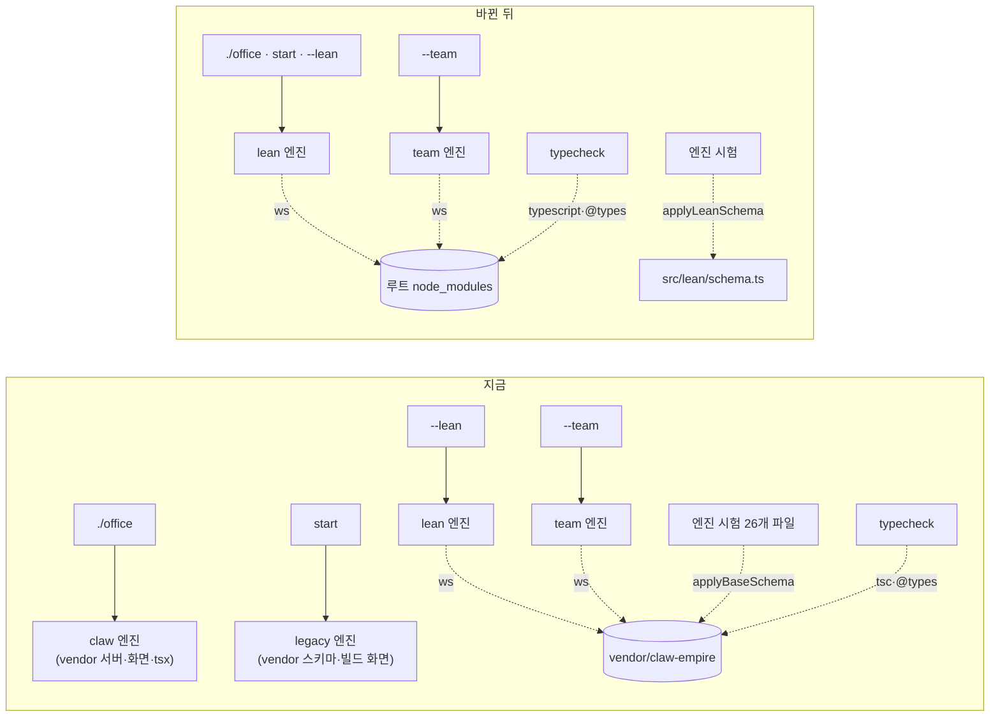

# 새 Office 기본 전환과 Claw Empire 삭제 (D23 3단계, A안) Implementation Plan

**Goal:** `./office`와 `start`가 새 최소 Office(lean)를 켠다. `vendor/claw-empire`와 그것에만 기대던 것(claw 엔진, legacy 엔진, 채팅 bridge, operator CLI, Claw 전용 시험)을 PR 하나에서 지운다. lean·team 엔진의 동작은 바꾸지 않는다.

**Architecture:**

- 실행 엔진은 lean·team 둘만 남는다. 둘 다 `createLeanOffice` → `createNativeOffice`를 쓰고, 이 경로는 바꾸지 않는다.
- vendor에서 빌리던 셋(`ws`, 타입 검사, 시험용 DB 모양)은 루트 의존성과 lean 스키마로 옮긴다.
- 엔진 안의 Claw용 코드(`native-office.ts`의 채팅·`hub*`·`officeRoles`·`handle`, `operator.ts`, `runner-settings.ts`의 역할별 경로, `hub-link.ts`·`hub-outgoing.ts`의 옛 요청 흐름)는 남긴다(결정 2). vendor를 부르지 않으므로 지울 필요가 없고, 지우면 D24 3단계와 충돌한다.

**Tech Stack:** Node 24(`node:sqlite`, `node:test`, 타입 제거 실행). 루트 의존성은 `ws` 하나, 개발 의존성은 `typescript`·`@types/node`·`@types/ws`.

**Spec:** `docs/understanding/lean-office-default-decision.md`(G3 2026-10-30, A안). Story D30, M1·M2·M3·M8·M12·M15, V1·V8·V9·V10·V14·V17.

## Global Constraints

- **작업 위치:** worktree `.worktrees/lean-phase3-g3`, 브랜치 `codex/lean-phase3-g3`(origin/main `3926ee2` 위). 푸시·PR은 사용자 요청 시에만 한다.
- **Node 24와 OpenSSL 3:** `export PATH="$HOME/.nvm/versions/node/v24.19.0/bin:/opt/homebrew/bin:$PATH"`. 셸 기본 Node는 22.3이라 `node:sqlite`가 없다. 전체 `npm test`는 한 번에 하나만 돌린다(다른 세션 포함).
- **기준선:** 바꾸기 전에 이 worktree에서 vendor 설치·화면 빌드 뒤 전체 시험을 한 번 돌려 파일별 시험 수를 남긴다. 지우거나 옮긴 시험은 이 기준선에 대어 설명한다.
- **사용자 데이터:** `<dataDir>/claw/`, `lean/`, `team/`, 허브 DB를 읽거나 지우거나 옮기는 코드를 더하지 않는다.
- **이력:** 이력 재작성·강제 push 없음. 로컬 브랜치 `codex/local-original-claw-v2.0.4`는 건드리지 않는다.
- **공개 레포:** 사내 호스트 이름을 커밋하지 않는다.

## 판정 (구현자에게 맡긴 것, 이 계획에서 정함)

| 판정 | 이유 |
|---|---|
| 루트 의존성은 정확한 버전: `ws` 8.19.0, `typescript` 5.9.3, `@types/node` 24.10.13, `@types/ws` 8.18.1. `package-lock.json`을 커밋한다 | 지금 vendor가 시험을 통과시킨 버전과 같다. 범위 지정은 lock이 있어도 다음 설치에서 바뀔 수 있다 |
| `up` 1단계는 루트 `ws`가 lock과 같은 버전으로 풀릴 때 설치를 건너뛰고, 아니면 `npm ci --omit=dev`를 한다 | 매번 `npm ci`를 하면 개발 checkout의 TypeScript가 지워진다. 버전 비교로 오래된 설치는 다시 설치한다 |
| 시험용 스키마는 `src/lean/schema.ts`가 내보내는 함수(`openLeanDb`가 쓰는 같은 SCHEMA)다 | 실제로 도는 스키마와 시험 스키마가 하나가 된다 |
| 남은 엔진 코드가 Claw 전용 칸(`agents.cli_provider`, 부서 등)을 읽는 시험은, `runner-settings.test.mjs`처럼 시험 안에서 필요한 칸만 더한다 | vendor 없이 남은 코드를 계속 시험한다. 엔진 정리 때 같이 지운다 |
| `scripts/`의 vendor 스키마 import 6개는 lean 스키마로 바꾸고 `node --check`만 한다 | 수동 탐침(VM·실제 CLI 필요)이라 이 PR에서 돌리지 않는다. 지우면 옛 검증 기록의 재현 경로가 끊긴다 |
| `--claw`는 `CLAW_REMOVED` 오류: "The Claw Office was removed. Start the Office with ./office (or start)." | 이유와 새 명령을 한 줄로 준다 |
| `--lean`은 받아들이고 무시한다 | 문서·습관 호환. 도움말에는 "기본값"으로 적는다 |
| 지우는 CLI 명령: `bridge`, `contracts`, `contract`, `verification`, `delivery`, `deliver`, `intake-create`, `intake`, `intake-answer`, `intake-cancel`, `intake-publish`, `approval-request`, `approval-decide`. 남는 것: `up`, `setup-runtime`, `monitor`, `hub`, `hub-link`, `hub-unlink`, `init`, `doctor`, `start`, `status`, `stop`, `remove`, `team` | 지우는 명령은 operator API(legacy·claw)에만 있었다. lean에서는 이미 `UNSUPPORTED`다 |
| `doctor`는 `uiBuilt` 대신 루트 의존성 설치 여부를 보인다 | 화면 빌드 단계가 없어진다 |
| `upstream/claw-empire.lock.json`·`CHANGES.md`는 남기고 "삭제" 항목을 더한다. `package.json` license는 `MIT AND Apache-2.0` 그대로 | 출처 기록. `assets/codex`가 Apache-2.0이다 |

## Review Focus

- lean·team 실행 경로가 바뀌지 않았는가: `src/lean/*`, `src/team/*`, `native-office.ts`, `src/core/*`의 diff는 스키마 함수 추출과 import 경로뿐이어야 한다.
- 지운 시험마다 이유가 Claw·legacy·bridge 전용인가. 엔진과 무관한 경계 시험은 lean으로 옮겼는가.
- 시험 단언을 lean 모양에 맞게 고친 곳(부서 없는 agent 등)이 시험의 뜻을 바꾸지 않았는가.
- `up`의 의존성 설치가 개발 checkout을 망가뜨리지 않고, 설치 실패 시 엔진을 켜지 않는가.

---

### U1. 루트 의존성: `ws`와 타입 검사

**Goal:** lean·team·시험·타입 검사가 vendor 없이 `ws`와 TypeScript를 찾는다.

**Requirements:** M1, V1(소스·패키지 설정에 vendor 경로 없음)

**Dependencies:** 없음

**Files:**
- 고침: `package.json`(dependencies·devDependencies, `typecheck` 스크립트), `tsconfig.json`(`typeRoots` 삭제), `src/runners/exec-relay.ts`, `src/runners/claude-tool-bridge.mjs`
- 새로: `package-lock.json`
- 시험: `tests/claude-tool-bridge.test.mjs`, `tests/exec-relay*.test.mjs`(있으면)

**Approach:**
- `exec-relay.ts`와 `claude-tool-bridge.mjs`는 `ws`를 패키지 이름으로 import한다. `claude-tool-bridge.mjs`는 claude CLI가 원래 자리에서 띄우므로(`src/runners/claude-controller.ts`의 `new URL("./claude-tool-bridge.mjs", …)`) 루트 `node_modules`에서 풀린다.
- `typecheck`는 루트 `tsc`를 쓴다.

**Test scenarios:**
- 기존 `claude-tool-bridge` 시험이 루트 `ws`로 통과한다(vendor 경로 대신).
- VM 중계를 쓰는 기존 시험(실행기·컨트롤러 시험)이 그대로 통과한다.
- 타입 검사 exit 0.

**Verification:** vendor `node_modules`가 없는 상태에서도 위 시험과 타입 검사가 통과한다(U4 뒤 확인).

---

### U2. 시험용 lean 스키마

**Goal:** 엔진 시험이 vendor의 Claw 스키마 대신 실제 lean 스키마로 돈다.

**Requirements:** M4(시험 유지), V4, V17

**Dependencies:** 없음(U1과 독립)

**Files:**
- 고침: `src/lean/schema.ts`(SCHEMA를 메모리 DB에도 쓰는 함수로 내보내고 `openLeanDb`가 그것을 씀)
- 고침(시험): `budgets`, `completion`, `dispatch`, `handoffs`, `hub-link`, `hub-outgoing`, `hub-snapshot`, `intake-publication`, `intake`, `native-office-hub`, `native-office`, `planning-coordinator`, `planning-execution`, `planning`, `reviewer`, `store`, `verification`의 `.test.mjs`, `tests/coordinator-fixture.mjs`
- 고침(스크립트): `scripts/probe-live-planning.mjs`, `test-codex-workspace.mjs`, `test-container-verifier.mjs`, `test-container-workspace.mjs`, `test-planning-coordinator.mjs`, `test-verification-dispatch.mjs`
- 시험: `tests/lean-schema.test.mjs`

**Approach:**
- 각 시험의 `applyBaseSchema(db)`(+`applyDefaultSeeds(db)`)를 lean 스키마 적용으로 바꾼다. 시험 안의 프로젝트 경로를 lean 소유 프로젝트로 넘긴다.
- Claw seed(부서, 역할 agent, `cli_*` 칸)에 기대던 단언은 두 가지로 나눈다.
  - lean에서도 일어나는 동작: lean 모양(부서 없는 agent, `agent_id`)으로 단언을 고친다.
  - 남은 엔진 코드만의 동작(역할별 실행기 등): 시험 안에서 필요한 칸만 더한다.
- 고친 단언은 diff에서 따로 보이게 한다(리뷰 초점).

**Execution note:** 파일 하나씩 바꾸고 그 파일 시험을 바로 돌린다. 기준선과 시험 수가 같아야 한다.

**Test scenarios:**
- 스키마 함수: 메모리 DB에 적용하면 `openLeanDb`가 만드는 것과 같은 표·칸이 생긴다. 다른 프로젝트 소유 확인 규칙은 `openLeanDb`에 그대로 있다.
- 옮긴 17개 파일: 기준선과 같은 시험 수가 통과한다.

**Verification:** 옮긴 파일들에 vendor import가 없고, 각 파일의 통과 수가 기준선과 같다. 스크립트 6개는 `node --check` 통과.

---

### U3. 엔진 선택과 CLI

**Goal:** 엔진은 lean·team뿐이다. `./office`·`start`의 기본은 lean이고 `--claw`는 안내 오류다. legacy·claw·bridge·operator CLI가 사라진다.

**Requirements:** M2, M6, M15, V2, V8, V17

**Dependencies:** U1(설치 확인이 루트 `ws`를 봄)

**Files:**
- 고침: `src/cli/lifecycle.ts`(`Engine`, `SERVICE`, `STARTUP_MS`, 설치 확인, 기본 엔진, `operatorSession`·`operatorKey`·`operatorRequest`·`monitor`), `src/cli/index.ts`(옵션·명령·도움말·`doctor`), `src/cli/launcher.ts`(기본 엔진, 의존성 설치, 화면 빌드 삭제)
- 지움: `src/runtime/claw-service.ts`, `src/runtime/service.ts`, `src/runtime/operator-page.ts`, `src/runtime/observation.ts`, `src/cli/bridge.ts`
- 시험 고침: `tests/launcher.test.mjs`, `tests/lean-lifecycle.test.mjs`, `tests/team-lifecycle.test.mjs`, `tests/team-registry.test.mjs`, `tests/lean-schema.test.mjs`, `tests/live-runtime.test.mjs`
- 시험 다시 씀: `tests/lifecycle.test.mjs`(엔진과 무관한 경계만 lean으로)
- 시험 지움: `tests/chat-bridge.test.mjs`

**Approach:**
- `monitor`는 lean 로컬 세션 주소만 준다. team은 지금처럼 `UNSUPPORTED`.
- `start`의 상태 파일에 옛 `engine: "claw"`나 `"legacy"`가 남아 있으면(옛 버전이 켠 Office) `status`·`stop`은 지금처럼 동작해야 한다. 켜진 옛 Office를 이 버전이 멈출 수 있는지 확인하고, 안 되면 "옛 버전으로 멈추세요" 안내로 거부한다.
- 의존성 설치는 판정 표대로. 설치 실패면 엔진을 켜지 않고 `NOT_INSTALLED`와 `npm ci` 안내를 준다.

**Execution note:** `--claw`·기본 엔진·옛 상태 파일 처리는 시험을 먼저 쓴다.

**Test scenarios:**
- `start`(옵션 없음)가 lean 엔진을 `lean/office.sqlite`로 켜고, `claw/` 폴더를 만들지도 읽지도 않는다.
- `start --lean`은 옵션 없음과 같다. `start --claw`·`up --claw`는 `CLAW_REMOVED`이고 아무것도 켜지 않는다.
- `--team`은 `--lean`과 함께 쓰면 지금처럼 거부한다. `--claw` 조합은 `CLAW_REMOVED`가 먼저다.
- 지운 명령(`bridge`, `contract` 등)은 알 수 없는 명령 오류를 낸다. 도움말에 지운 명령과 `--claw`가 없다.
- `up`: 루트 `ws`가 lock 버전이면 설치를 건너뛰고, 없거나 다르면 `npm ci --omit=dev`를 한 번 부른다. 설치 실패면 Office를 켜지 않는다. 화면 빌드를 부르지 않는다.
- `up`(옵션 없음)은 켜진 lean Office를 다시 쓴다. 켜진 team Office가 있는 데이터 루트에서는 지금 규칙대로 거부한다.
- 옛 버전 상태 파일(`engine: "claw"`): `status`가 그 상태를 보이고, `start`는 덮어쓰지 않는다.
- 옮긴 경계 시험(lean): 포트 충돌은 남의 서버를 멈추지 않는다, 남의 SQLite는 거부·보존한다, 시작 중 `stop`은 unknown이고 `remove`되지 않는다, 인증 안 된 상태 파일이 남의 프로세스를 멈추지 않는다, 재시작은 같은 데이터를 다시 쓴다.
- `doctor`가 루트 의존성 설치 여부를 보인다.

**Verification:** lifecycle·launcher·lean·team 시험 통과. 지운 시험 목록과 이유가 검증 기록에 있다.

---

### U4. vendor와 Claw 전용 시험 지우기

**Goal:** 저장소에 Claw 코드·gitlink·빌드 단계가 없다.

**Requirements:** M1, V1

**Dependencies:** U1, U2, U3(아무것도 vendor를 import하지 않음)

**Files:**
- 지움: `vendor/claw-empire/`(gitlink 2개 포함), `.gitmodules`
- 고침: `package.json`(`build:office` 삭제)
- 시험 지움: `tests/claw-lifecycle.test.mjs`, `tests/claw-host.test.mjs`, `tests/claw-host-hub.test.mjs`, `tests/claw-host-runners.test.mjs`, `tests/claw-cli-usage.test.mjs`, `tests/agent-runner-patch.test.mjs`, `tests/oauth-client-defaults.test.mjs`

**Approach:** 지우기 전 `git grep`으로 `vendor/claw-empire` 참조가 문서 밖에 없음을 확인한다.

**Test scenarios:** `Test expectation: none -- 삭제만 한다. U6의 전체 시험·grep·pack 확인이 증거다.`

**Verification:** `git ls-files vendor`가 0개, `.gitmodules` 없음, vendor 폴더 없이 전체 시험 통과.

---

### U5. 문서·라이선스·Story 반영

**Goal:** 문서가 바뀐 기본값과 사라진 기능을 정확히 말한다.

**Requirements:** M6(README·라이선스가 실제 상태 반영), S1

**Dependencies:** U3, U4

**Files:**
- 고침: `README.md`, `README_ko.md`(Claw 원본 그림 삭제, 기본 Office, 표의 "Claw-Empire 없는 최소 Office" 줄), `docs/LOCAL-PREVIEW.md`, `AGENTS.md`("Chat-controlled Office" 절 삭제), `docs/CHAT-CONTROL.md`(폐기 안내만), `CONCEPTS.md`, `LICENSING.md`, `THIRD_PARTY_NOTICES.md`, `upstream/CHANGES.md`, `upstream/claw-empire.lock.json`(삭제 커밋 기록), `docs/STATUS.md`
- 새로: `docs/verification/2026-10-30-lean-office-default.md`

**Approach:** 옛 검증 기록(`docs/verification/*`)과 결정 문서는 이력이라 고치지 않는다. `AGENTS.md`의 kit 관리 블록(`<!-- BEGIN ai-workflow-kit -->`)은 건드리지 않는다.

**Test scenarios:** `Test expectation: none -- 문서. U6의 grep과 Story 검사기가 증거다.`

**Verification:** Story 검사기 exit 0. README·LOCAL-PREVIEW에 `--claw`·`build:office`·vendor 설치 안내가 없다.

---

### U6. 전체 검증

**Goal:** 승인된 검증 계획(결정 문서 "검증 계획" 3걸음)을 증거로 남긴다.

**Requirements:** V1, V17, V8

**Dependencies:** U1–U5

**Files:** `docs/verification/2026-10-30-lean-office-default.md`, `.ai-workflow/runs/U25-lean-office-default*.{json,md}`

**Approach:**
- 새 worktree(vendor 없음)에서 루트 `npm ci`만으로 전체 시험·타입 검사·Story 검사기.
- `git grep -i claw -- src tests bin scripts package.json tsconfig.json`에 `CLAW_REMOVED` 안내와 남긴 엔진 코드의 이름만 남는다.
- `npm pack --dry-run` 목록에 vendor가 없다.
- 시험 수 대조표: 기준선 → 지운 시험(이유) → 옮긴 시험 → 새 시험 → 결과.
- 가짜 실행기로 `start` 기본 lean을 한 번 켜서 `claw/` 해시가 그대로임을 본다.

**Verification:** 위 결과를 검증 기록에 X/X로 적는다. eevee-be 실제 확인(V17)과 사전 확인 두 개는 사용자 몫으로 G4에서 묻는다.

---

## 범위 밖

### Deferred to Follow-Up Work

- 엔진 정리: `native-office.ts`의 Claw용 API, `operator.ts`, `runner-settings.ts`의 역할별 경로, `hub-link.ts`·`hub-outgoing.ts`의 옛 요청 흐름과 그 시험. D24 3단계 머지 뒤.
- `docs/solutions`의 오래된 문서 세 개는 `/ce-compound-refresh`로 정리한다(머지 뒤).
- 4단계(npm 설치), 새 Office의 operator API·채팅 조작(원하면 별도 G3).

## Risks

| 위험 | 대응 |
|---|---|
| Claw 스키마로만 통과하던 엔진 시험이 lean 스키마에서 깨져 실제 lean 버그가 드러남 | 이 PR에서 엔진 동작은 고치지 않는다. 드러난 것은 기록하고 사용자에게 묻는다(범위 변경) |
| 사용자가 옛 버전으로 켠 Claw Office가 켜진 채 업데이트 | 옛 상태 파일 처리 시험(U3). 사전 확인 1 |
| `npm ci`가 네트워크 없는 PC에서 실패 | 설치 실패 시 엔진을 켜지 않고 안내. vendor 때도 같은 제약이었다 |
| 허브에서 수락돼 진행 중인 요청이 멈춤 | 사전 확인 2(G4에서 사용자) |
