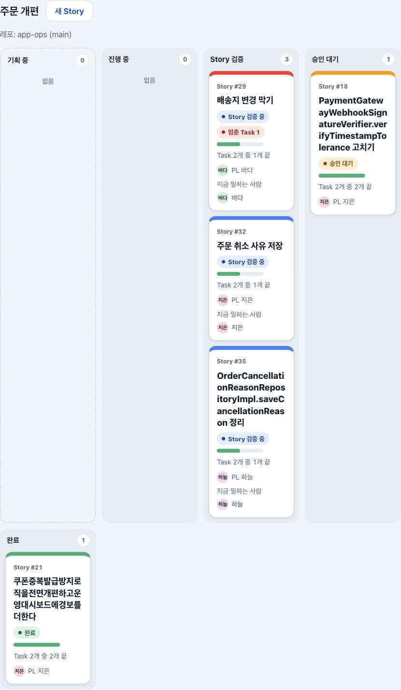
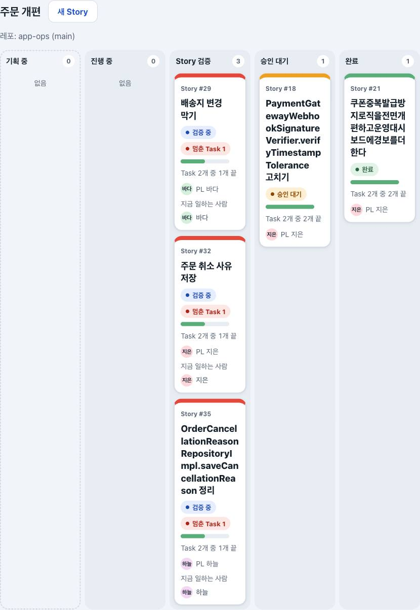
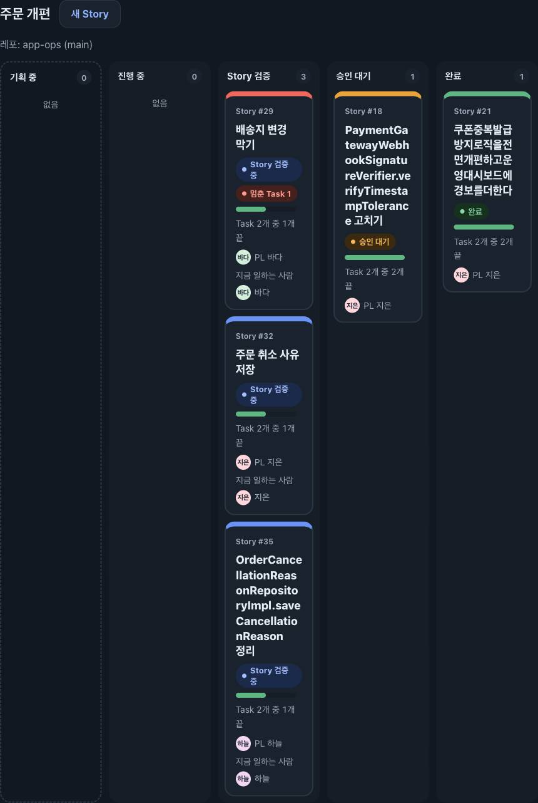
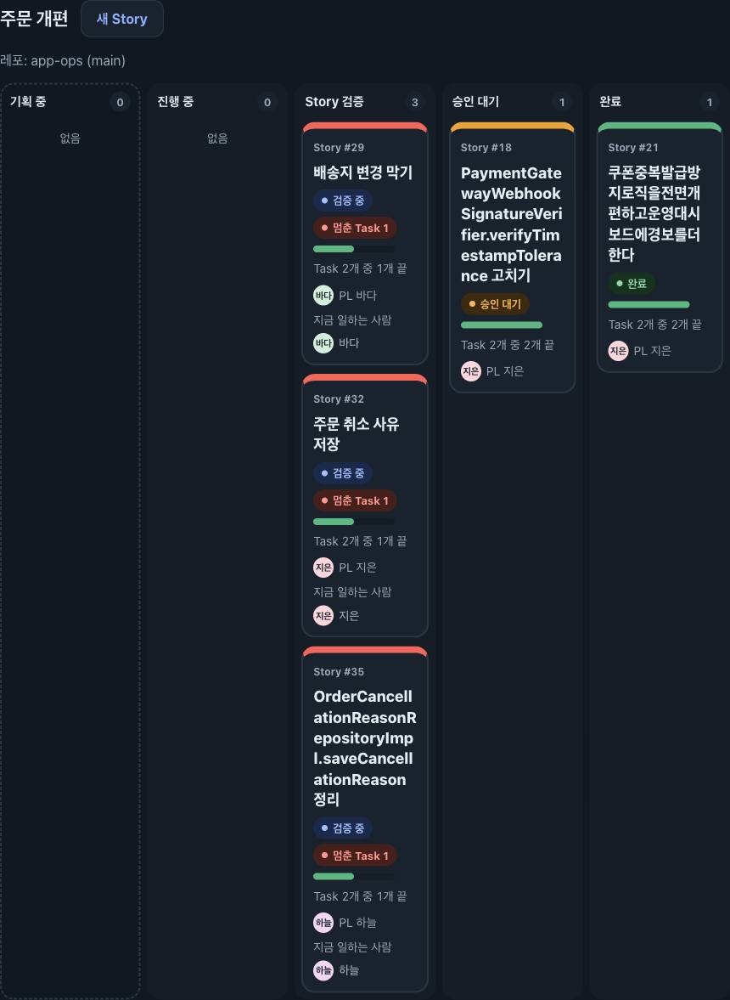
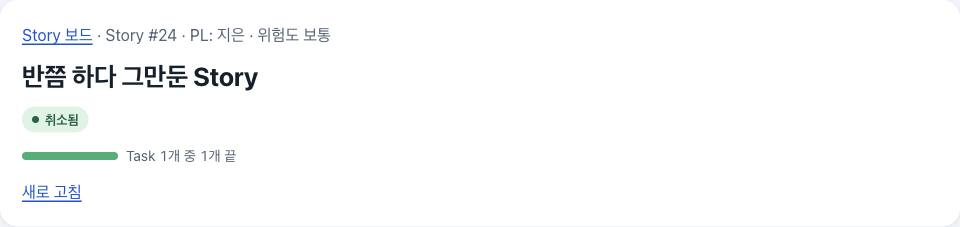
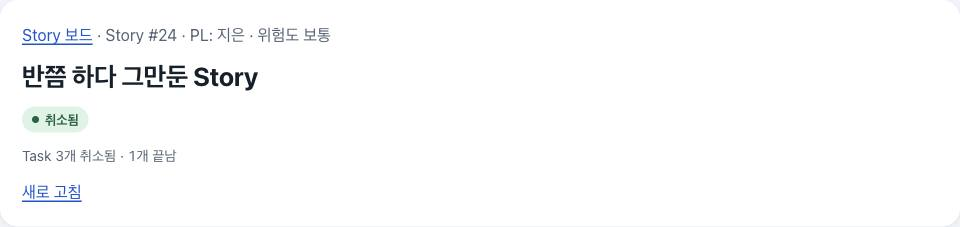
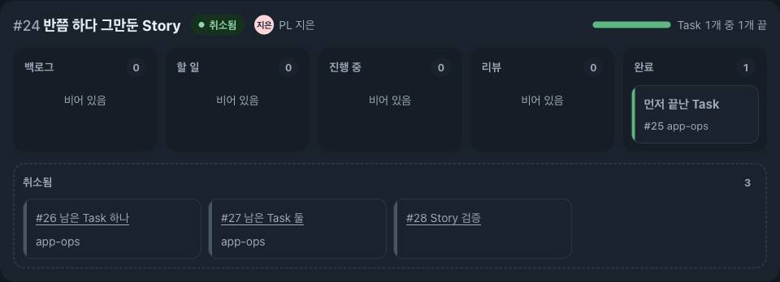
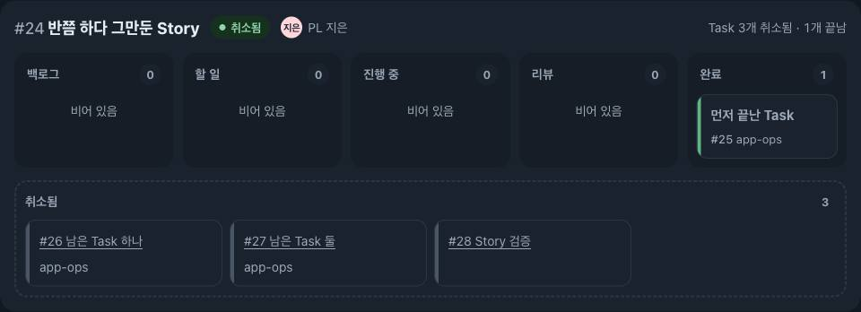

# 검증 기록: Hub 화면 다듬기의 남은 작은 것 세 가지 (U41)

Story: D43 · M16 · V20. kit 실행은 `.ai-workflow/runs/U41-hub-polish-leftovers.json`(작은 변경의 기본 계획: 구현 → 리뷰 → 검증)이다. U40([변경 기록](2026-11-11-hub-polish.md))의 마지막 리뷰가 머지를 막지 않는 Minor로 남긴 것을 고쳤다. Story는 바꾸지 않았다: D42가 정한 것은 단계 이름(기획 중·진행 중·Story 검증·승인 대기·완료)이고, 그 이름은 칸과 단계 표시에 그대로 있다.

이 기록은 kit 증거가 아니라 변경 기록이다. kit 리뷰 1차(Ready, Minor 4)의 고침까지 적었고, 리뷰 2차부터는 고치지 않는다.

## 바뀐 것

버튼이 하는 일, 주소, 권한, 승인의 해시·revision 확인, CSRF·Origin 확인, 스크립트 없이 쓰기는 그대로다. 저장소와 연결 경로는 건드리지 않았다.

1. **완료 칸이 혼자 다음 줄로 내려가던 것(861–887px).** 단계 칸을 `repeat(auto-fit,minmax(160px,1fr))`에서 "보이는 단계마다 한 칸"(`grid-auto-flow:column; grid-auto-columns:minmax(0,1fr)`)으로 바꿨다. 폰(860px 이하)은 전처럼 한 줄에 한 칸씩 쌓는다. 칸이 가장 좁은 861–960px(`(width > 860px) and (width <= 960px)`, 확대로 생기는 860–861px 사이 너비도 빠지지 않게)에서는 단계 칸의 여백을 조금 줄였다: 칸 사이 12→8px, 칸 안 10→8px(제 테두리 2px가 있는 점선 기획 중 칸은 6px), 단계 칸 안의 Story 카드 안 16→12px(아래 취소됨 줄의 카드는 그대로). 그래서 861px에서도 모든 칸의 카드 글자 칸이 114px이고, 가장 긴 카드 글자 "설계 승인 대기"(107px, 기획 중의 웹 기획 카드)와 "멈춘 Task 12"(107px)가 7px 남기고 한 줄에 들어간다.
2. **"Story 검증 중"이 두 줄로 나뉘던 것(888–910px쯤).** Story의 상태 글자를 "검증 중"으로 줄였다. 다른 상태 글자(진행 중·승인 대기·완료)처럼 "Story"를 붙이지 않는다. Story 보드 카드, Story 화면, 모든 Task의 Story 줄에서 같다. 칸 이름과 Story 화면의 단계 표시는 "Story 검증" 그대로다. 위의 여백만으로도 861px의 Story 검증 칸(114px)에 "Story 검증 중"(109px)이 5px 남기고 들어가지만, 다른 상태 글자처럼 짧게 해 여유를 크게 하고 이름을 고르게 했다.
3. **취소한 Story의 숫자.** Story 화면과 `/tasks`의 Story 줄도 보드 카드처럼 센다. 취소한 Story는 막대 없이 "Task N개 취소됨 · M개 끝남"(취소된 것이 없으면 "Task M개 끝남"), 살아 있는 Story는 전처럼 막대와 "Task N개 중 M개 끝"이다. 리뷰 1차가 찾은 같은 종류의 차이도 고쳤다: 열리기 전 Story는 초안 카드처럼 Story 화면에서도 막대 없이 "Task N개 준비됨"이다(전에는 "Task N개 중 0개 끝"과 빈 막대). 카드·Story 화면·`/tasks` 줄이 `board-pages.ts`의 `progressOf` 하나를 쓴다.

## 시험

- **RED**(고치기 전): 바꾼 시험 두 파일에서 3/68 실패. 취소한 Story 화면의 문구(`a cancelled Story's page and Task-board lane say what it had, like its card`), 단계 칸 CSS(`... the stages stay one row on every window wider than a phone`), 상태 글자(`state words ...`). 셋 다 의도한 이유로 실패했다.
- **RED 2**(리뷰 1차 고침 전): 같은 두 파일 2/68 실패 — 열리기 전 Story 화면의 "Task N개 준비됨", 범위 문법의 미디어 쿼리. 화면 세 곳의 "검증 중" 알약을 통째로 확인하는 줄도 더했다(옛 "Story 검증 중"이면 실패).
- **GREEN**: 같은 두 파일 68/68. 단계 칸이 줄바꿈하던 것과 "Story 검증"을 확인하던 기존 시험 두 줄은 새 규칙에 맞게 고쳤다(긴 낱말이 칸을 넓히지 못한다는 확인은 `minmax(0,1fr)`로 남겼다). Hub 시험 파일 전부 559/559, `npm run typecheck` exit 0.
- 전체 `npm test`와 kit 검증 결과는 kit 실행의 검증 증거와 STATUS에 적는다.

## 화면을 잰 것

확인용 허브(18444)와 그 데이터 폴더는 건드리지 않았다. 그 DB의 `VACUUM INTO` 복사본과 scratchpad의 시험 데이터(검증 중 Story 셋, 그중 하나는 멈춘 검증 Task, 승인 대기·완료의 긴 영어 낱말 제목, Task 하나는 끝나고 셋은 취소된 Story)를 고치기 전 코드(`a3ef064`)와 고친 코드로 각각 띄워, 저장한 화면을 Chromium으로 쟀다.

| | 고치기 전 | 고친 뒤 |
|---|---|---|
| 단계 칸 줄 수(861·870·887px) | 2 | 1 |
| 단계 칸 줄 수(888–1360px) | 1 | 1 |
| 두 줄이 된 Story 카드 글자 | 888·900px에서 "Story 검증 중" | 없음 |
| 가로 넘침(페이지·카드·칸·판) | 0 (41화면 × 10너비, 밝은 테마) | 0 (41화면 × 10너비 × 두 테마 = 820, 리뷰 1차 고침 뒤 다시 잼) |
| 다섯 칸이 한 줄인 가장 좁은 창의 카드 글자 칸 | 888px: 기획 중 99px쯤, 다른 칸 104px | 861px: 모든 칸 114px |

너비는 390·861·870·887·888·900·920·950·1000·1360px이다. 가장 긴 Story 카드 글자("설계 승인 대기"·"나누기 대기"는 기획 중 카드, "멈춘 Task 12"·"Story 검증 중"은 다른 칸 카드)를 861·870·900·923·960·961·1000px에서 넣어 모두 한 줄(26px)인지 쟀다. 글자 칸은 861px 114px, 961px 115–119px다.

| 고치기 전 | 고친 뒤 |
|---|---|
|  |  |
|  |  |
|  |  |
|  |  |

폰(390px, 고친 뒤): [after-board-390-light.jpg](2026-11-11-hub-polish-leftovers/after-board-390-light.jpg).

## 확인하지 않은 것과 남은 것

- Safari·Firefox·Windows 글꼴. 글자 폭은 macOS Chromium의 시스템 글꼴로만 쟀다. 다른 글꼴이 7px 넘게 넓으면 861px 근처에서 "설계 승인 대기"가 다시 두 줄이 될 수 있다. 실제 "설계 승인 대기" 웹 기획 카드는 시험 데이터에 없어 같은 글자를 카드에 넣어 쟀다.
- **Task 카드의 상태 글자는 이번에 고치지 않았다(고치기 전과 같음).** Task 칸은 Story 칸보다 좁아서 "멈춤(Mac 소식 없음)"이 Story 화면의 Task 보드에서는 1360px에서도, `/tasks`에서는 1000px까지 두 줄이 되고, "진행 중(구현)·(리뷰)"는 861–870px에서 두 줄이 된다.
- 취소한 Story의 상태 글자 "취소됨"은 보드 카드에서는 회색이지만 Story 화면과 `/tasks` 줄에서는 끝남 색(초록)이다. 이번 범위(숫자)에 넣지 않았다.
- U40에서 넘어온 "이전 완료 보기" 접힘 옮겨 감과 올리기 시험 `ECONNRESET`은 이 변경과 무관하고 따로 다룬다.
