# 검증 기록: Hub 화면 다듬기 (차분한 신호등, 두 보드)

Story: D41·D42·D43 · M16 · V20. kit 실행은 `.ai-workflow/runs/U40-two-boards.json`이다. 앞의 `.ai-workflow/runs/U40-hub-polish.json`은 D43으로 Story가 바뀌기 전의 실행으로, 구현 1회·리뷰 1회의 증거로 남겼다. 사용 안내는 [LOCAL-PREVIEW.md의 "칸반 보드와 로컬 올리기"](../LOCAL-PREVIEW.md#칸반-보드와-로컬-올리기)이다.

이 기록은 kit 증거가 아니라 변경 기록이다. kit 리뷰 전에 끝냈고 그 뒤 고치지 않는다.

## 왜, 무엇을 골랐나

사용자는 D42 보드가 아직 밋밋하다며 "다섯 살도 바로 쓸 만큼" 쉽고 예쁘게 바꾸자고 했다. 결정은 두 번 했고, 둘 다 [설명 페이지](https://claude.ai/artifact/KXM76dpF5j3PCBwUdikMeS)를 보고 골랐다(2026-11-11).

1. **얼굴: A 차분한 신호등**(1판). 다른 후보는 B 그림책, C 촘촘한 작업판이었다. 웹 화면의 모양과 문구는 D41이 만드는 사람에게 맡긴 범위라 Story를 바꾸지 않았다.
2. **Story와 Task 나누기: 가 두 보드**(2판). 다른 후보는 나 한 보드, 두 층이었다. 첫 화면은 Story 단계 칸의 Story 보드이고, Story 화면에 그 Story의 Task 보드가, `/tasks`에 모든 Task 보드가 있다. D42의 첫 화면을 바꾸므로 Story에 D43을 더하고 M16·V20에 한 문장씩 더했으며, G1을 다시 받았다(사용자 답 "맞아, 진행해").

- 디자인 스킬: Anthropic 스킬 저장소의 `frontend-design`. 같은 저장소의 `theme-factory`는 웹 글꼴을 쓰는 슬라이드·문서용 테마라 맞지 않았다(Hub CSP가 `default-src 'none'`이라 웹 글꼴·이미지를 못 쓴다). 캡처는 `webapp-testing` 방식(Playwright)으로 했다.
- 얼굴 조사(2026-11): 상태는 연한 바탕에 진한 글자와 점, 색만으로 전하지 않음, 빨강은 멈춤에만(GOV.UK Tag, Atlassian Lozenge, Fluent 2 Badge). 끝난 일은 조용히(GOV.UK Complete multiple tasks). 카드 덧붙임은 셋까지와 칸에 머문 시간(Jira Customize cards). 나를 기다리는 일은 제목 아래 상자 하나(GOV.UK Notification banner). 누르는 곳 44px(WCAG 2.2 SC 2.5.8, Apple HIG). 한글 본문 16px·줄 간격 1.6(KRDS). 빈 곳에는 다음 할 일(NN/g, Primer empty states). 테두리를 줄인 차분한 화면(Linear 2026-03), 반투명 효과 쓰지 않음(NN/g Liquid Glass).
- 두 단계 조사: Linear(Project 화면과 상태, 프로젝트 안의 Issue 탭), Asana(Portfolio에서 프로젝트 상태 → 눌러서 Task), Jira(에픽 줄은 선택지, 자식 없는 에픽은 줄 없음, Plans의 부모 진행 막대), GitHub Projects(보기 여러 개, 부모의 자식 진행), Notion(프로젝트마다 끝난 작업 비율). NN/g 점진적 공개(두 단계까지)와 "색은 보조 신호". 두 방법을 직접 비교한 연구는 찾지 못했다.

## 바뀐 것

버튼이 하는 일, 권한, 승인의 해시·revision 확인, CSRF·Origin 확인, POST 뒤 다시 읽기, 스크립트(`/copy.js`·`/live.js`)는 그대로다. 모든 값은 지금처럼 `esc()`를 거친다. 새 주소는 `/tasks` 하나이고 옛 주소(`/`, `/board`, `/stories/<id>`, `/tasks/<id>`, `/me`, `/team`)는 모두 그대로 열린다.

- **스타일(`src/hub/pages.ts`의 `STYLE`)**: 옅은 회색 바탕과 흰 판, 테두리 대신 그림자, 네 상태 색(답해 주세요 주황·진행 중 파랑·멈춤 빨강·끝남 초록)의 연한 바탕·진한 글자·띠 색을 밝은·어두운 테마 모두 정했다. 본문 16px/1.6, 단어 단위 줄바꿈, 버튼·입력 칸·메뉴·토글·스위치·Mac 표시 44px, 3px 포커스 테두리, `prefers-reduced-motion`이면 움직임 없음. 웹 글꼴·이미지 없이 시스템 한글 글꼴만 쓴다.
- **머리글**: 이름은 링크 `Pazmo 팀 허브`, 메뉴는 지금 보는 쪽에 `aria-current="page"`(두 보드와 Story·Task·기획 화면은 보드 쪽), 내 이름 앞 이름 동그라미, 자동으로 일하기는 스위치 모양(글자 그대로), 내 Mac은 점과 글자.
- **Story 보드(`/`, `/board`, D43)**: 프로젝트마다 단계 다섯 칸. Story 카드는 위 띠 색(진행 파랑, 승인 대기 주황, 멈춘 Task가 있으면 빨강, 완료 초록), 상태 글자, "멈춘 Task N", "Task N개 중 M개 끝"과 막대, PL, 지금 일하는 사람. 기획 중의 웹 기획과 열리기 전 Story는 점선·줄 노트 모양의 초안 카드다. 완료는 최근 5개와 "N개 더 보기" 접힘. 취소한 것도 보기를 켜면 취소한 Story가 아래 흐린 줄에 모인다. 두 보드는 "Story 보드 / 모든 Task" 탭으로 오가며 토글이 유지된다.
- **모든 Task(`/tasks`)**: D42의 보드 그대로(Story 줄과 Task 다섯 칸), A 모양으로. 카드는 왼쪽 상태 띠, 제목 링크(카드 전체가 눌린다), 맡은 사람·Mac 점·머문 시간, 멈춘 이유 상자, 번호·레포 줄.
- **Story 화면**: 단계 표시(지금 단계 `aria-current="step"`)와 진행 줄, 그 Story만의 Task 보드(합쳐진 카드 전부, 취소한 카드 줄), "표로 보기(앞 Task 포함)"와 "Story 글" 접힘, 승인 대기 안내.
- **나를 기다리는 일**(두 보드 맨 위): 내가 PL인 Story의 결과 승인 대기, 내가 맡았거나 내 Story의 멈춘 Task(어느 Story인지 함께), 내 웹 기획의 질문·초안·설계 승인·멈춤. 보드가 이미 가진 정보만 쓰고 링크만 있다.
- **팀·Task·기획·내 할 일**: 팀은 이름 동그라미·Mac 점·켜짐/꺼짐 글자, 폰에서는 줄마다 한 덩어리. 멈춘 이유는 붉은 상자, 할 일 폼은 연한 판. 인증서 지문·요청 diff·설계 JSON은 고정폭 글꼴(`pre.mono`).
- **저장소(`StoryBoard.board`)**: `story` 옵션을 더해 Story 하나의 카드를 모두(취소·합쳐진 것 전부) 읽는다. 읽기만 한다.

## 리뷰 1차(U40-hub-polish 실행)에서 고친 것

리뷰어 둘(화면·접근성, 동작·보안)이 `0f5a46f`를 봤다. 동작·보안은 "준비됨", 화면·접근성은 "고칠 것 있음"(Important 3)이었다. 기록은 `.ai-workflow/runs/U40-review-1.md`.

- 폰에서 표가 찌그러짐: 몸글의 `overflow-wrap:anywhere`를 `break-word`로 바꾸고 `anywhere`는 카드·Story 카드·나를 기다리는 일·`.wrap`에만 둔다.
- 승인 대기 줄이 어디서 승인하는지 말하지 않음: "모든 Task가 끝났습니다. 결과 승인은 Hub가 아니라 PL의 Mac(claude 대화)에서 합니다."를 그 줄과 Story 화면에 쓴다(D42 (6)).
- 숫자 배지 대비 2.15:1: 토큰(`--need` 글자 on `--need-bg`)으로.
- 작은 것: 멈춘 웹 기획도 상자에, Task 줄에 Story 번호, `:has()` 없는 브라우저에서도 카드 링크의 포커스, 포커스 때 모서리 그대로, 고정폭 `pre`, 44px, 멈춘 이유 글을 고를 수 있게, 움직임 줄이기가 스위치 손잡이에도, Mac 표시 시험에 `href="/mac"`, 보류 줄 문장을 Task 화면과 한 곳에서.

## 시험

- **RED**: 얼굴 단계에서 73개 중 15개, 두 보드 단계에서 126개 중 22개가 새 화면·주소가 없어 실패했다.
- **GREEN**: Hub 시험 파일 전부 552/552. 전체 `npm test` **1855/1855**(exit 0, 201초). `npm run typecheck` exit 0. Story 검사 exit 0.
- 새 시험(`tests/hub-board-page.test.mjs` 끝): 카드의 상태 색·이름 동그라미·Mac 점·머문 시간·번호, 나를 기다리는 일(PL·맡은 사람·관계없는 사람·내 Story만, 보류 줄, 멈춘 기획, Story 번호), 진행 막대, 지금 메뉴 표시(`/tasks`, `/plans/<id>` 포함), 머리글, 빈 프로젝트 안내, 스타일 바닥선과 리뷰 고친 것, Story 보드의 다섯 단계와 카드(초안·멈춤·사람), Story 보드의 토글·탭·취소 줄, 완료 5개와 접힘, Story 화면의 단계 표시와 그 Story만의 Task 보드, 저장소의 Story 하나 읽기.
- 좁게 고친 기대값과 이유(같은 사실을 새 주소·마크업으로 확인한다):
  - `hub-board-page`: Task 카드를 보던 시험들은 `/`에서 `/tasks`로(D43). 팀 화면의 이름 동그라미와 켜짐/꺼짐 글자. 진행 글이 "Task N개 중 M개 끝".
  - `hub-story-pages`: 스위치 글자 앞 `track`, 팀 화면의 타일 목록, Story 줄 머리를 `/tasks`에서, 이스케이프 시험에 `/tasks` 더함.
  - `hub-mac-pages`: 머리글 Mac 표시가 점 달린 `macchip`(`href="/mac"` 포함).
  - `hub-plan-pages`: 새 프로젝트·새 Story 버튼 모양, `/board`의 기획은 Story 보드의 초안 카드, 기획을 취소한 빈 프로젝트는 안내 문장, 설계 JSON은 `pre.mono`.
  - `hub-upload-office`: 카드는 `/tasks`에서, 제목 링크에는 제목만.

## 미리보기와 캡처

사용자가 흐름을 확인 중인 확인용 허브(`https://127.0.0.1:18444`, 데이터 `~/Documents/pazmo-midcheck/b3/`)는 멈추지도 쓰지도 않았다. 그 DB를 읽기 전용 연결의 `VACUUM INTO`로 복사해 이 worktree 코드와 바뀌기 전 코드(`git archive a72a57b`)를 각각 다른 포트에서 띄웠다([Preview new web code on real data with a copy](../solutions/workflow-issues/real-check-mac-paired-features-on-a-router-mode-hub.md)). 실데이터는 Story 하나뿐이라 모든 상태가 들어간 시험 데이터(가짜 이름 지은·민준·서연·도현, `app-be`·`app-fe`)도 따로 만들었다. 두 데이터 모두 Chromium(Playwright)으로 1360px·390px, 밝은·어두운 테마를 찍었고 어느 화면도 가로로 넘치지 않았다(`scrollWidth` 확인).

| 화면 | 전 | 후 |
|---|---|---|
| 첫 화면 · 데스크톱 · 밝은 | 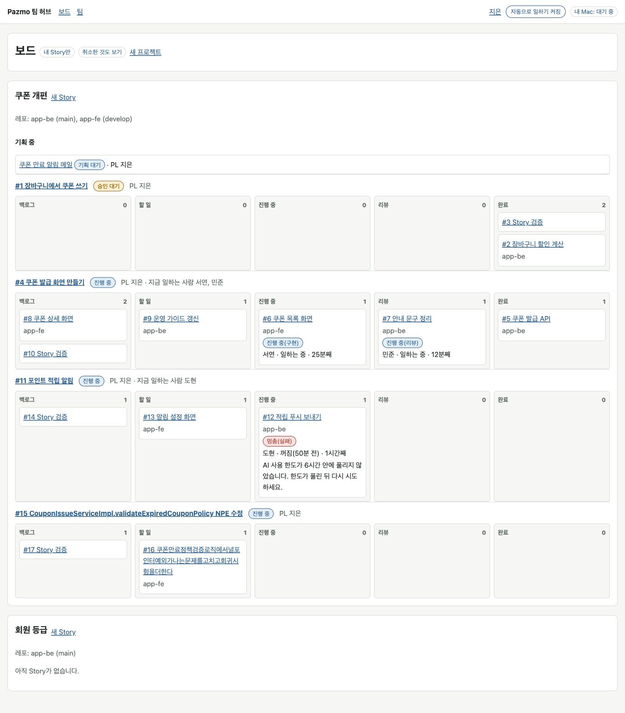 | 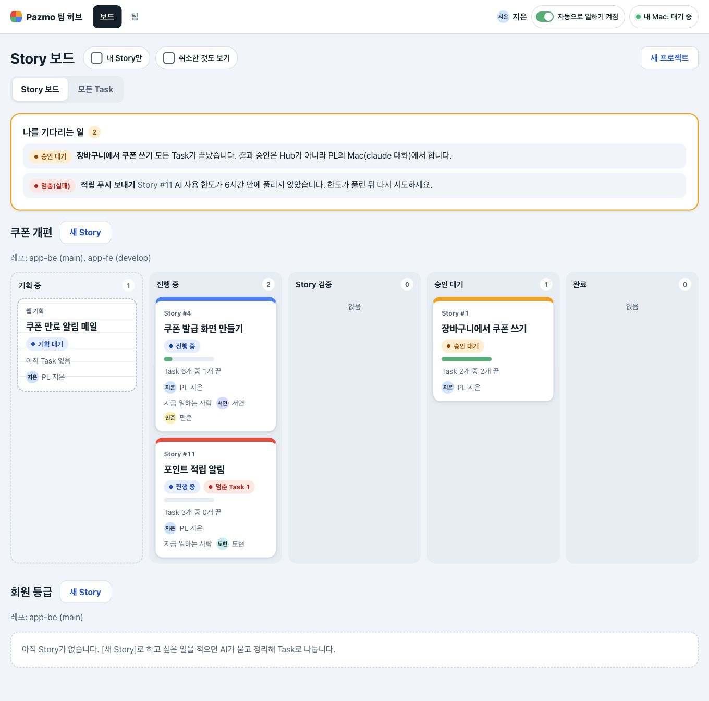 |
| 첫 화면 · 폰 · 어두운 | 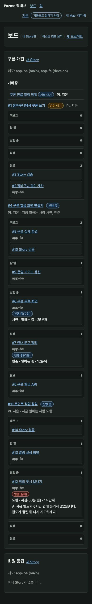 | 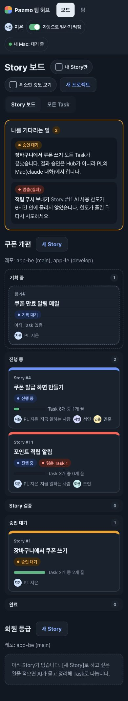 |
| Story 화면 · 데스크톱 · 밝은 | 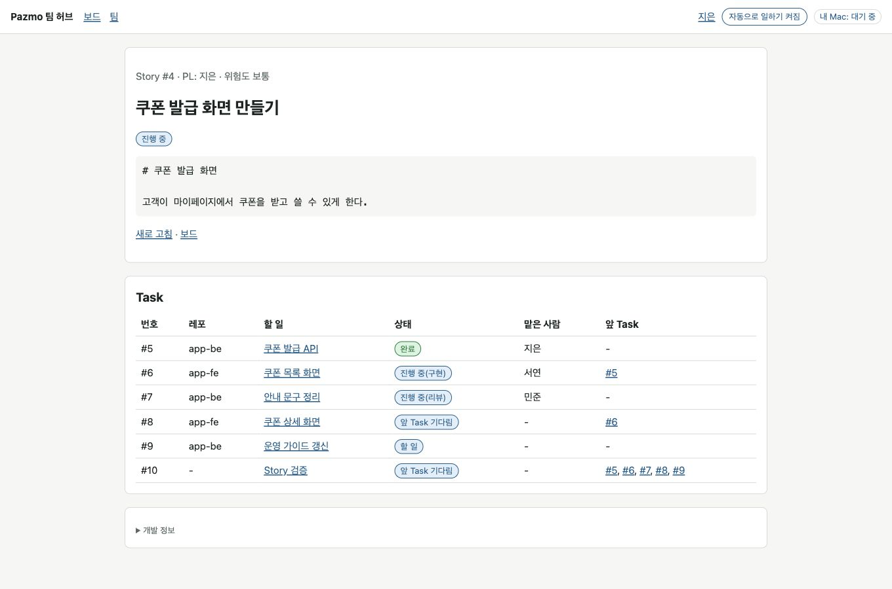 | 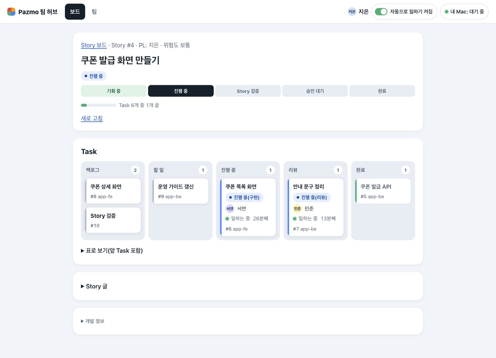 |
| 모든 Task · 데스크톱 · 밝은 | (없음, 전의 첫 화면) | 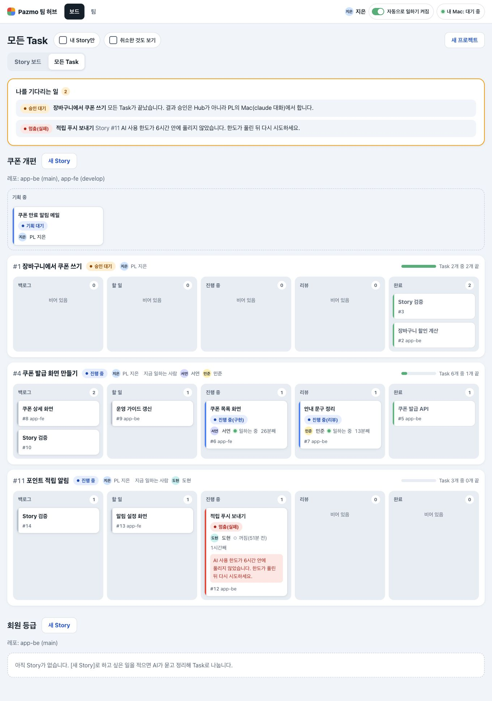 |
| 멈춘 Task · 폰 · 밝은 | 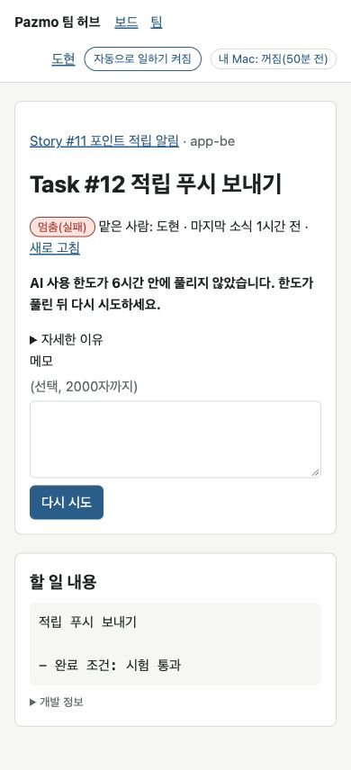 | 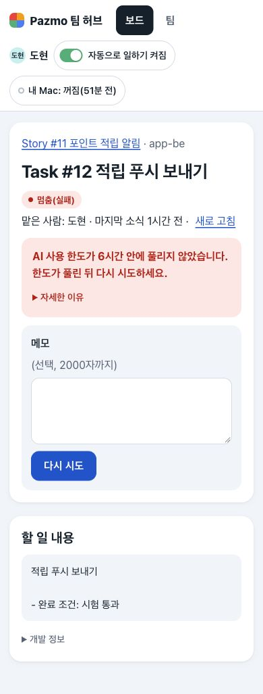 |
| 팀 · 데스크톱 · 어두운 | 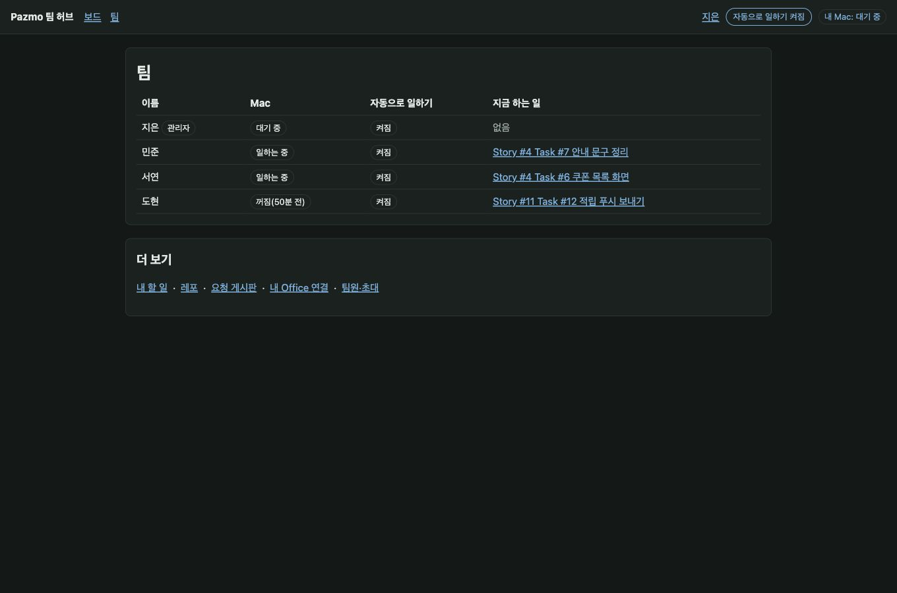 | 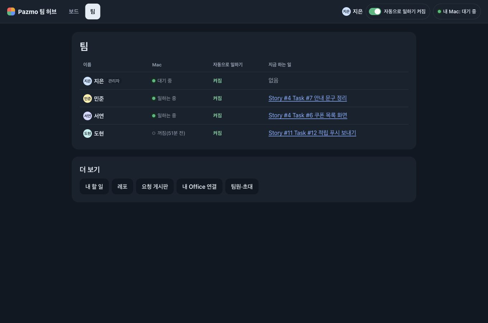 |

## 확인하지 않은 것

- 실제 브라우저에서 `/live.js`가 새 화면을 바꿔 끼우는 모습(캡처는 저장한 HTML이라 "새로 고침" 링크가 보인다). 바꿔 끼우는 `<main>`의 모양은 그대로라 동작은 바뀌지 않는다.
- Safari·Firefox·Windows(맑은 고딕). `:has()`를 모르는 옛 브라우저에서는 폰의 빈 칸이 접히지 않고, 카드에는 테두리 대신 링크 자체의 포커스만 보인다.
- 색 대비는 리뷰어가 글자 토큰을 두 테마에서 계산했다(가장 낮은 것 5.26:1). 화면 전체를 도구로 재지는 않았다.
- Story가 아주 많을 때(완료 수십 개, 진행 중 열 개 이상)의 Story 보드 길이.
- 사내 Hub 재배포와 실제 팀원의 화면. 결과 승인(묶음 4)이 아직 없어 승인 대기 Story는 Hub에서 끝낼 수 없다.
