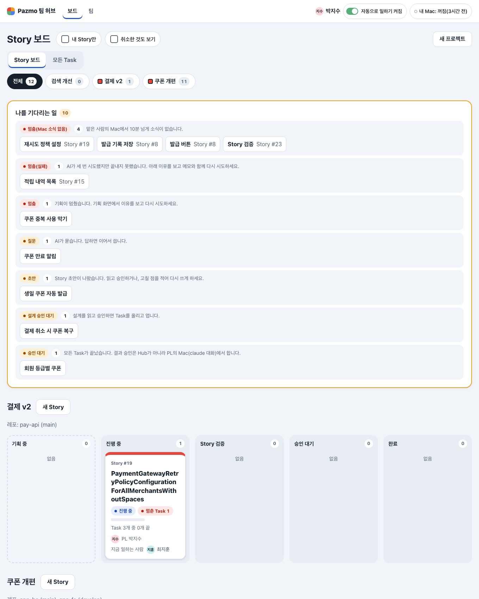
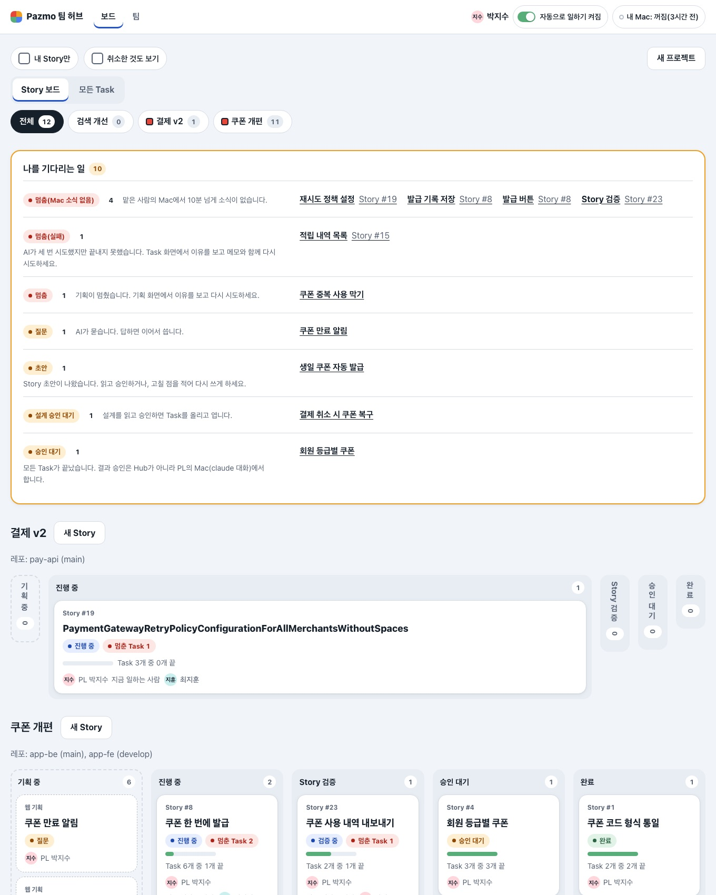
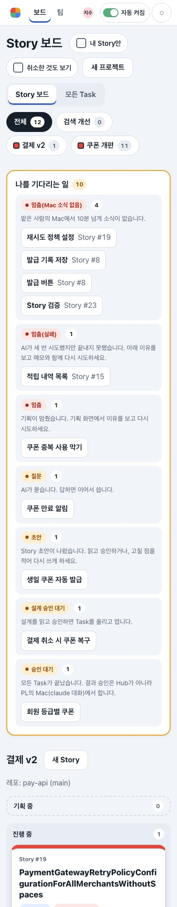
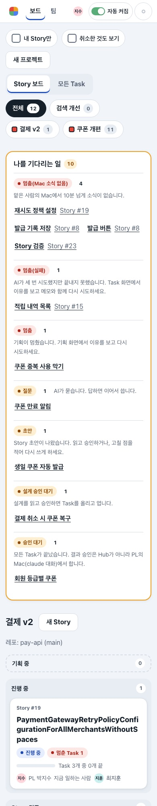
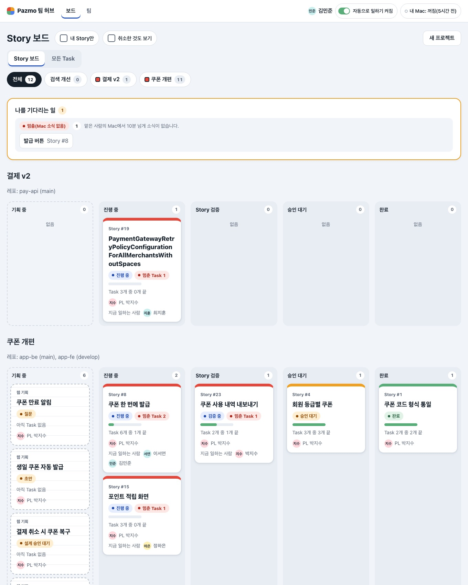
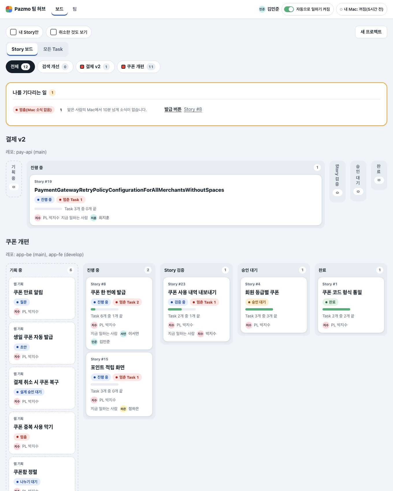
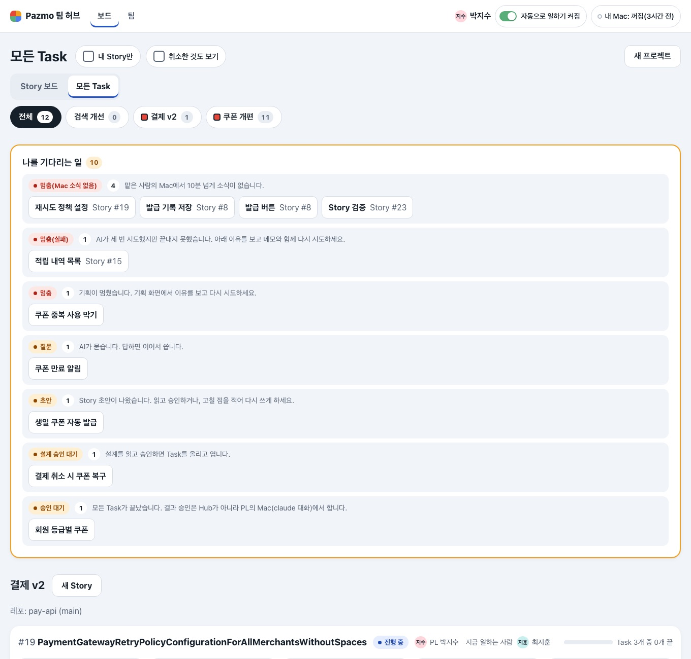
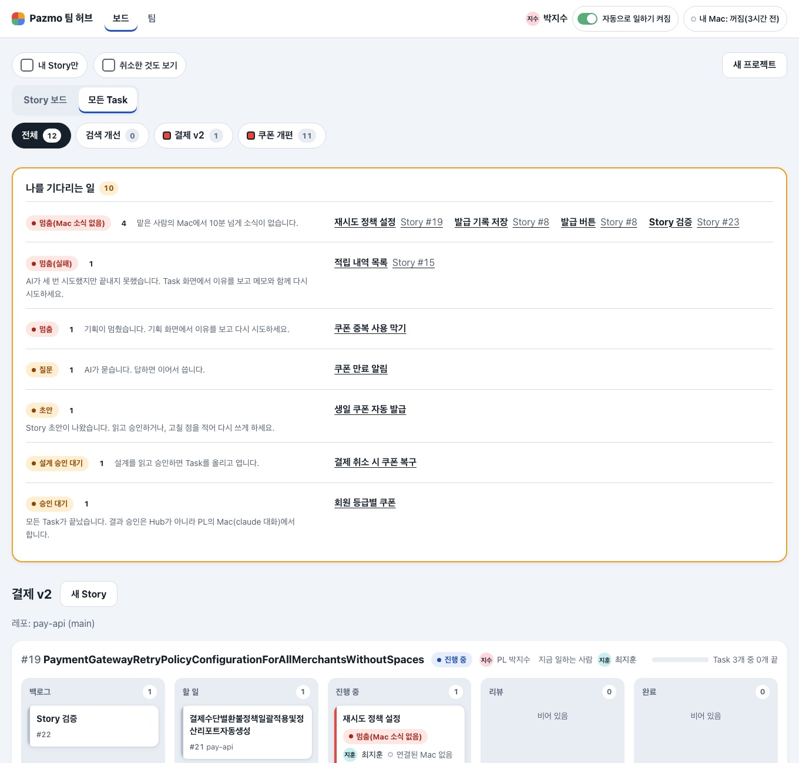
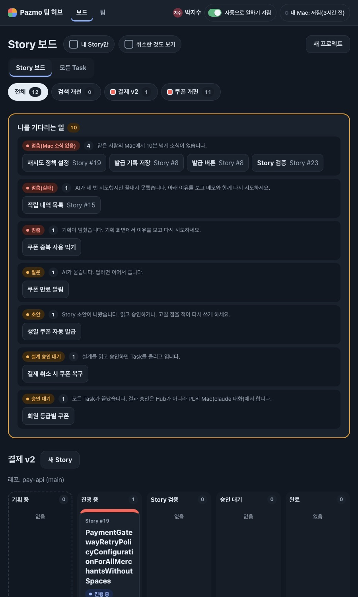
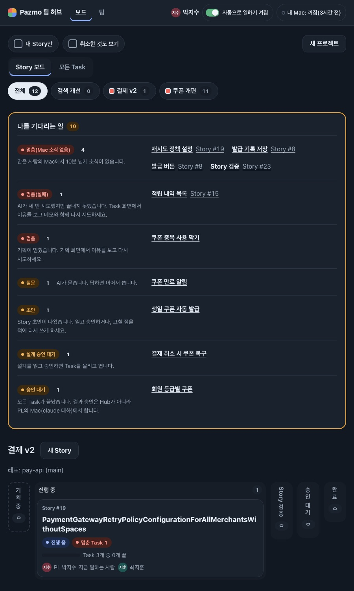

# 변경 기록: Hub 화면 다시 디자인 "나 결정 카드" PR 2 — 두 보드 (U46)

kit 실행은 `.ai-workflow/runs/U46-hub-boards.json`(작은 변경의 기본 계획: 구현 → 리뷰 → 검증)이다. 이 기록은 kit 증거가 아니라 변경 기록이다.

사용자가 [설명 페이지](https://claude.ai/artifact/KXM76dpF5j3PCBwUdikMeS) 7판에서 고른 "나 결정 카드"의 두 번째 PR이다. 처음에는 PR 세 개(공통 틀 / 보드·Story·Task·내 할 일 / Story 만들기)로 나눴는데, 두 보드만으로도 리뷰 한 번 분량이라 넷으로 나눴다: ① 공통 틀과 관리(U45, PR #88) ② 두 보드(이 기록) ③ Story·Task 화면과 내 할 일의 "지금 할 일" 카드 ④ Story 만들기 흐름.

Story는 바꾸지 않았다(D41 범위). D43(첫 화면은 Story 보드, 칸은 Story 단계, 카드는 단계·PL·끝난 Task 수·지금 일하는 사람·멈춘 Task 수), D44(나를 기다리는 일은 줄이거나 접지 않고 같은 상태끼리 한 줄, 칩), U41(860px보다 넓으면 보이는 단계마다 한 칸, 한 줄)은 그대로 지킨다. 주소, 버튼이 하는 일, 권한, 거르개와 칩, 저절로 업데이트, 스크립트 없이 쓰기는 그대로다.

## 바뀐 것

1. **나를 기다리는 일: 판 안의 상자를 걷었다.** 줄마다 회색 판과 테두리 단추가 겹치던 것(3겹)을 가는 줄로 나눈 한 판으로 바꿨다. 제목은 테두리 없는 밑줄 링크(누르는 높이는 그대로 44px)이고, 860px보다 넓으면 한 줄이 두 칸이다: 왼쪽에 상태 글자·개수·이유, 오른쪽에 제목들. 묶음·순서·개수(D44)는 그대로다.
2. **보드에서 멈춘 Task의 이유는 "Task 화면에서".** 기본 실패 안내 "아래 이유를 보고 …"는 Task 화면의 말이라, 보드의 줄에서는 "Task 화면에서 이유를 보고 메모와 함께 다시 시도하세요."로 읽는다. Task 화면은 그대로다.
3. **Story 카드의 굵은 윗줄을 뺐다.** 둥근 카드 위의 8px 색 띠(자동 검사기가 짚은 것)를 없애고 1px 테두리 하나로 했다. 상태는 카드의 상태 글자와 "멈춘 Task N" 글자가 말한다. hover는 테두리 전체가 강조색이다.
4. **기획 카드:** 공책 줄무늬 배경을 걷고 점선 테두리만 남겼다. 웹 기획 카드의 "아직 Task 없음"(웹 기획은 늘 Task가 없다)을 뺐다. 열리기 전 Story 카드의 "Task N개 준비됨"은 그대로다.
5. **남의 기획은 내 차례로 보이지 않게.** 질문·초안·설계 승인 대기 기획은 그 PL에게만 주황(답해 주세요)이고, 다른 사람에게는 파랑(진행 중)으로 보인다. 글자(질문, 초안 …)는 같다. 모든 Task 보드의 기획 카드도 같다.
6. **빈 단계는 얇은 띠.** 860px보다 넓으면 비어 있는 단계 칸이 56px 띠(이름은 세로, 개수)가 되고 나머지 칸이 넓어진다. 칸은 단계마다 하나, 한 줄 그대로다(그리드 대신 flex, `flex:1 1 0` + `min-width:0`이라 긴 낱말이 칸을 넓히지 못한다). 폰에서는 전처럼 단계가 쌓이고 빈 단계는 한 줄이다.
7. **보드 제목은 낭독기에.** "Story 보드"/"모든 Task" `h1`은 1px로 잘라 낭독기만 읽고, 화면에서는 같은 이름의 탭이 지금 보는 곳을 알린다(제목·탭으로 같은 말이 두 번 보이던 것).
8. **학습 문서:** [count-elements-drawn-past-the-edge-when-overflow-is-clipped.md](../solutions/ui-bugs/count-elements-drawn-past-the-edge-when-overflow-is-clipped.md) — U45 리뷰 2에서 배운 것(`overflow-x:clip`이면 `scrollWidth`로는 넘침이 안 보이니 접힘을 연 채 화면 끝을 넘어 그려진 요소를 센다).

## 확인

- 시험부터 썼다: RED 9/83(위 1–7과, 이 변경으로 바뀌는 옛 시험 셋) → GREEN 98/98(보드·기획 화면·불변 시험 파일). 그리드 형태를 그대로 적던 U41·U43 시험 두 곳은 같은 뜻의 flex 형태로 고쳤다(긴 낱말이 칸을 못 넓힘, 넓은 화면에서 한 줄, 폰에서 쌓임). Hub 시험 파일 43개 전부 **600/600**, 타입 검사 exit 0.
- 화면: 확인용 허브(18444)는 건드리지 않고 그 DB 복사본과 시험 데이터(40자 이름 포함)로, 고치기 전(main `c6b7ca7`을 `git archive`로 따로 띄움)과 후를 보드·내 것 아닌 사람의 보드·모든 Task·한 프로젝트 칩·복사본 보드 × 320·390·640·861·900·1000·1360px × 두 테마로 쟀다. 후 70가지: 가로 넘침 0, 접힘을 연 채 화면 끝 넘어 그려진 요소 0, 작은 누름 대상 0, 860px보다 넓은 창에서 단계가 두 줄로 나뉜 프로젝트 0.

| 숫자 (밝게) | 전 | 후 |
|---|---|---|
| 시험 데이터 보드 1360px 쪽 높이 | 3,065px | 2,600px |
| 같은 곳 나를 기다리는 일 높이 | 816px | 673px |
| 같은 곳 폰(390px) 첫 Story 카드 위치 | 1,863px | 1,732px |
| 복사본 보드 861px 가장 좁은 카드 제목 폭 | 115px | 265px |
| 빈 단계 칸 폭(1360px) | 251px | 56px |

| | 전 | 후 |
|---|---|---|
| 보드 · 1360 |  |  |
| 보드 · 390 |  |  |
| 남의 기획(김민준이 본 보드) · 1360 |  |  |
| 모든 Task · 1360 |  |  |
| 보드 · 900 어둡게 |  |  |

## 확인하지 못한 것 · 남긴 것

- Safari·Firefox, 실제 화면 낭독기.
- 폰에서 나를 기다리는 일은 여전히 길다(시험 데이터 10개면 1,115px). 줄이거나 접지 않는 것은 D44의 결정이다.
- Task 카드(모든 Task 보드)의 왼쪽 4px 상태 띠는 그대로다(D42의 Task 보드, 이번 범위 밖).
- "지금 할 일" 카드와 Story·Task 화면, 내 할 일은 PR 3, Story 만들기 흐름은 PR 4다.
