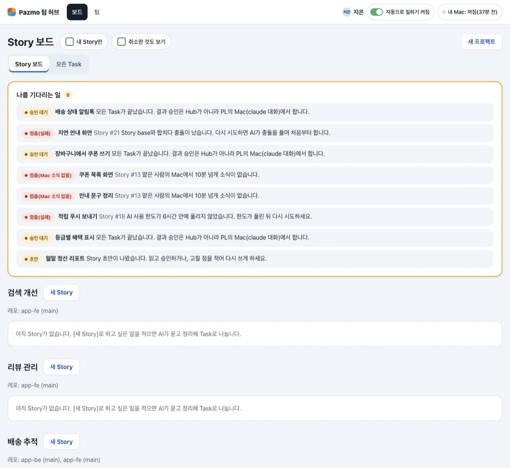
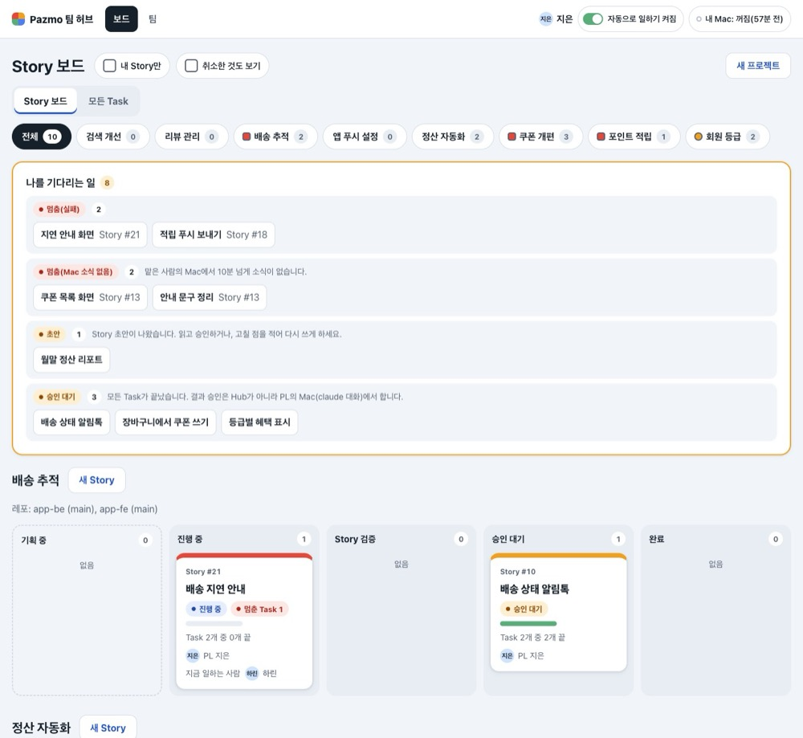
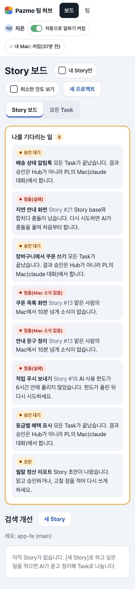
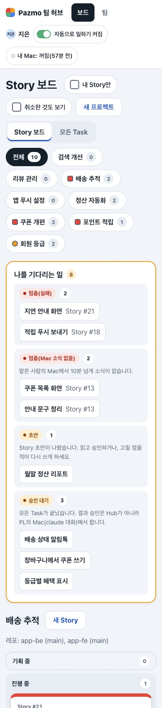

# 검증 기록: 일이 많아질 때의 보드 — 나를 기다리는 일 묶음, 프로젝트 칩, 빈 프로젝트 한 줄 (U43)

Story: D44 · M16 · V20. kit 실행은 `.ai-workflow/runs/U43-hub-many-projects.json`(작은 변경의 기본 계획: 구현 → 리뷰 → 검증)이다. 사용자는 [설명 페이지](https://claude.ai/artifact/KXM76dpF5j3PCBwUdikMeS) 4판을 보고 "1은 추천안인 (가)로 가고, 2는 (나)의 프로젝트 칩으로 골라보기로 가자"를 골랐고, 바뀐 Story에 "맞아, 진행해"로 G1을 줬다(`.ai-workflow/approvals/pazmo-agent-office-g1.json`, Story 해시 `edf0cb7a`).

이 기록은 kit 증거가 아니라 변경 기록이다.

## 바뀐 것

버튼이 하는 일, 권한, 승인의 해시·revision 확인, CSRF·Origin 확인, 스크립트 없이 쓰기, 저절로 업데이트는 그대로다. 저장소는 건드리지 않았다(프로젝트 거르기는 이미 읽은 보드에서 고른다).

1. **나를 기다리는 일 묶음.** 상자는 아무것도 자르거나 접지 않는다. 상태 글자가 같은 것(예: "승인 대기" 셋)은 한 줄이 되어 글자, 개수, 공통 설명을 한 번 쓰고, 그 아래 제목들을 링크로 늘어놓는다(Task는 "Story #N"과 함께). 설명은 모두 같을 때만 쓴다. 실패 이유가 서로 다른 "멈춤(실패)" 둘은 설명 없이 묶이고, 이유는 각 Task 화면에서 본다. 순서는 멈춘 것(Task·기획), 답을 기다리는 기획, 승인 대기다. 같은 종류 안에서는 보드 순서를 지킨다. 머리의 숫자는 전처럼 모든 항목 수다.
2. **프로젝트 칩.** 프로젝트가 2개 이상이면 두 보드(`/`·`/board`, `/tasks`)의 탭 아래에 칩 줄이 있다: **전체**와 프로젝트마다 칩 하나. 칩의 숫자는 지금 거르개에서 보이는 Story 수(웹 기획 포함, 취소한 것은 취소한 것도 보기를 켰을 때만)이고, 전체는 그 합이다. 멈춘 Task가 있으면 빨간 네모, 멈춘 것은 없고 승인 대기 Story가 있으면 주황 동그라미가 하나 붙는다. 둘은 색만이 아니라 모양으로도 다르고, 칩 글자색의 2px 테두리가 있어 어느 칩 위에서도 3:1을 넘는다(리뷰 1차). 표시는 `role="img"`와 "멈춘 Task 있음"·"승인 대기 있음" 이름·`title`이 있어 화면 낭독기가 읽고 마우스를 올리면 뜻이 나온다. 칩을 누르면 그 프로젝트만 보인다(`?project=<id>`). 내 Story만·취소한 것도 보기 링크와 두 보드의 탭이 고른 칩을 함께 넘긴다. 칩 목록은 거르개와 관계없이 모든 프로젝트라 토글을 눌러도 칩 줄 모양이 그대로다. 나를 기다리는 일은 고른 칩과 관계없이 모든 프로젝트의 것을 보이고, 칩을 고른 동안은 제목 아래에 "고른 프로젝트와 관계없이 모든 프로젝트의 일입니다."라고 쓴다(칩 바로 아래라 걸러진 것처럼 읽힌다는 리뷰 1차 지적). 폰에서는 칩이 여러 줄로 감긴다(옆으로 밀리지 않는다). 모르는 프로젝트 id는 전체로 보이고, 탭·토글 링크에도 넘기지 않는다. 주소에 넣는 id는 Hub가 아는 프로젝트의 것뿐이고 URL 인코딩한다.
3. **빈 프로젝트 한 줄.** 칩 줄이 있는 전체 보기에서 보이는 Story(웹 기획 포함)가 없는 프로젝트는 다섯 칸 대신 맨 아래 "보이는 Story가 없는 프로젝트" 점선 한 줄에 이름만 모인다. "보이는"인 까닭: 취소한 Story만 있는 프로젝트도 취소한 것도 보기가 꺼져 있으면 여기에 온다(리뷰 1차). 그 프로젝트의 칩 보기에 나오는 빈 안내 "아직 Story가 없습니다"는 전부터 있던 문구라 이번에 바꾸지 않았다. 이름은 같은 보드·같은 거르개의 그 프로젝트 칩 보기로 가고, 거기서 전처럼 빈 안내와 **새 Story**가 보인다. 프로젝트가 하나뿐이면 칩도 한 줄도 없이 전과 같다. 내 Story만을 켜면 내 것이 없는 프로젝트는 전처럼 아예 빠진다.
4. **새 프로젝트를 만든 뒤.** 전에는 `/board`로 갔다. 이제 새 빈 프로젝트는 전체 보기에서 이름 한 줄이므로, 만든 뒤 바로 그 프로젝트의 칩 보기(`/board?project=<id>`)로 가서 **새 Story**가 눈앞에 있다. Story에 따로 적지 않은 결과라 G4에서 확인받는다.
5. 문서: [LOCAL-PREVIEW.md](../LOCAL-PREVIEW.md)의 보드 읽는 법(나를 기다리는 일, 프로젝트 칩, 빈 프로젝트 한 줄, 새 프로젝트 뒤).

## 시험

- **RED**(`b54ea6e`, 고치기 전): `tests/hub-board-page.test.mjs`에서 6/42 실패, 모두 의도한 이유 — 기존 나를 기다리는 일 시험 둘(묶음 줄 모양으로 바꿈), 새 시험 넷(묶음·순서, 칩 거르개, 빈 프로젝트 한 줄, 칩 CSS). 칩 시험은 처음에 칩 줄이 없어서 TypeError로 났기에, 칩 줄이 있는지 먼저 확인하는 줄을 더해 단언으로 실패하게 했다.
- 바꾼 기존 시험(이유): 나를 기다리는 일 두 시험은 줄 모양이 바뀌었다(D44 (1)). "an empty project says what comes next"는 빈 프로젝트가 칩 보기에서 안내를 보이게 했다(D44 (3), 고치기 전 코드에서도 통과한다: `?project=`를 무시하고 그 프로젝트가 보였으므로). 새 프로젝트를 만든 뒤 가는 주소를 보는 시험 둘(`hub-plan-pages`의 `/projects/new ...`, `hub-plan-office`의 `newStory` 도우미)은 `/board?project=<id>`를 본다. 이 둘은 서버를 바꾸기 전에 고쳐 실패를 봤다(`'/board'` ≠ `'/board?project=…'`).
- 화면을 재다가 찾은 것: 공통 설명에 띄어쓰기 없는 긴 낱말이 들어가면 폰에서 쪽이 782px로 넓어졌다(지금 설명은 모두 띄어쓴 고정 문장이라 실제로는 안 생긴다). 묶음 줄 그리드에 `minmax(0,1fr)`, 설명에 `overflow-wrap:anywhere`를 주었다. CSS 시험에 먼저 넣어 실패를 본 뒤 고쳤다.
- **GREEN**: `tests/hub-board-page.test.mjs` 42/42, Hub 시험 파일 전부 563/563, `npm run typecheck` exit 0.
- **리뷰 1차**(독립 리뷰어 하나, [기록](../../.ai-workflow/runs/U43-hub-many-projects-review-1.md)): Ready, Critical 0, Important 1(칩 점이 색으로만 멈춤과 승인 대기를 가르고 몇 곳에서 3:1에 못 미침), Minor 6. 고친 것: 표시 모양(네모·동그라미)과 칩 글자색 테두리, 둘 다 있을 때 멈춤이 이기는 시험, LOCAL-PREVIEW 문구, 한 줄의 "보이는", 칩을 고른 동안 나를 기다리는 일의 안내 한 줄, 칩과 한 줄의 프로젝트 이름 이스케이프 시험, 시험 제목. 남긴 것: 숫자를 화면 낭독기용 단위 없이 읽는 것(Minor 5), 프로젝트가 하나인 Hub에서 새 프로젝트 뒤 `project=`가 보이지 않게 따라다니는 것(Minor 7, 리뷰어도 받아들일 만하다고 봄). RED 2: 같은 파일 3/42 실패(칩 표시 마크업, 한 줄 문구, 표시 CSS). 이스케이프 확인은 전에도 맞게 동작해 새로 더한 덮임이다. GREEN 2는 kit 실행 증거에 적는다.
- 전체 `npm test`와 kit 검증 결과는 kit 실행의 검증 증거와 STATUS에 적는다.

## 화면을 잰 것

확인용 허브(18444)와 그 데이터 폴더는 건드리지 않았다. 여러 프로젝트 시험 데이터(프로젝트 6개에 빈 프로젝트 2개를 더해 8개, 그중 빈 것 3개, 지은에게 기다리는 일 8개)를 고치기 전 코드(main `1fe9292`)와 고친 코드로 각각 띄우고, 확인용 허브 DB의 `VACUUM INTO` 복사본(프로젝트 2개, 하나는 빈 것)을 고친 코드로 띄워, 저장한 화면을 Chromium으로 쟀다.

| 지은의 Story 보드(전체) | 고치기 전 | 고친 뒤 |
|---|---|---|
| 쪽 높이 1360px / 390px | 3626 / 6013 | 3152 / 5466 |
| 나를 기다리는 일 상자 높이 1360px / 390px | 522 / 1093 | 498 / 820 |
| 첫 프로젝트 제목 위치 1360px / 390px | 766 / 1484 | 798 / 1474 |
| 다섯 칸으로 그린 프로젝트 | 8 | 5(빈 3개는 한 줄) |

- 폰에서 칩 줄은 8개 프로젝트와 전체로 다섯 줄(약 230px)이다. 묶음으로 아낀 상자 높이(273px)를 칩 줄이 거의 다 써서, 첫 프로젝트가 보이는 위치는 폰에서 같고 데스크톱에서는 32px 내려갔다. 쪽 전체는 빈 프로젝트가 접혀 짧아졌다.
- 가로 넘침과 누름 크기: 6개 화면(전체·한 프로젝트·빈 프로젝트 칩 보기·`/tasks` 전체·`/tasks` 한 프로젝트·내 Story만) × 320·390·861·1000·1360px × 두 테마 × (그대로, 긴 낱말을 칩·한 줄 이름·묶음 제목·공통 설명에 넣음) = 120가지에서 가로 넘침 0, 칩·묶음 링크·한 줄 이름 모두 44px 이상.
- 칩 표시(리뷰 1차 고침 뒤): 테두리(칩 글자색)와 칩 바탕의 대비가 밝은 테마 16.46:1, 어두운 테마 13.47:1이고 고른 칩에서도 같다. 안의 색은 칩에 따라 1.81–7.65:1이지만 표시의 경계는 테두리가 맡는다. 모양은 네모(모서리 2px)와 동그라미(50%)다. 고친 뒤 120가지 화면을 다시 재어 넘침 0, 44px 미만 0.
- 확인용 허브 복사본: 칩 3개(전체·realcheck·test 11111), 빈 프로젝트 test 11111은 한 줄, 기다리는 일 1개(질문)가 묶음 한 줄. 1360px 두 테마와 390px 밝은 테마에서 가로 넘침 0.

| 고치기 전 | 고친 뒤 |
|---|---|
|  |  |
|  |  |

고친 뒤 더: [한 프로젝트 칩](2026-11-12-hub-many-projects/after-board-one-project-1360-light.jpg), [빈 프로젝트 한 줄](2026-11-12-hub-many-projects/after-board-empty-line-1360-light.jpg), [어두운 테마](2026-11-12-hub-many-projects/after-board-1360-dark.jpg), [모든 Task 한 프로젝트](2026-11-12-hub-many-projects/after-tasks-one-project-1360-light.jpg).

## 확인하지 않은 것과 남은 것

- Safari·Firefox·Windows 글꼴, 실제 화면 낭독기. 칩 점의 이름은 마크업으로만 확인했다.
- 저절로 업데이트는 `location.href`(주소의 `?project=` 포함)를 다시 읽으므로 고른 칩이 유지된다고 코드로 보았고, 10초를 기다려 브라우저에서 따로 보지는 않았다.
- 칩 순서는 Hub의 프로젝트 순서(이름순)다. 멈춘 프로젝트를 앞으로 올리지는 않았다(점으로만 알린다).
- 프로젝트가 아주 많으면 폰의 칩 줄이 길어진다(8개에 다섯 줄). 설명 페이지 4판이 이 비용을 적었고, 사용자는 칩을 골랐다.
