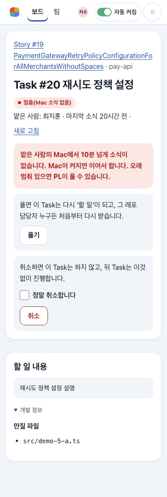
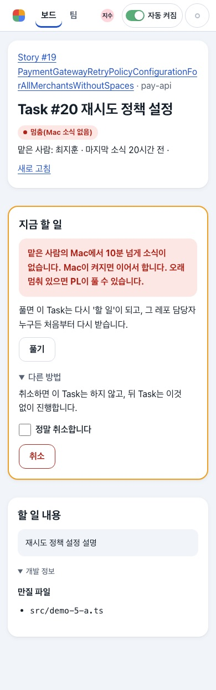
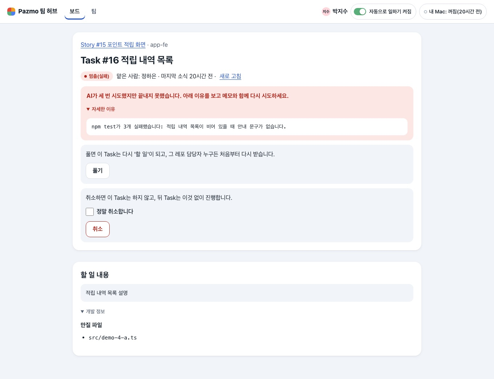
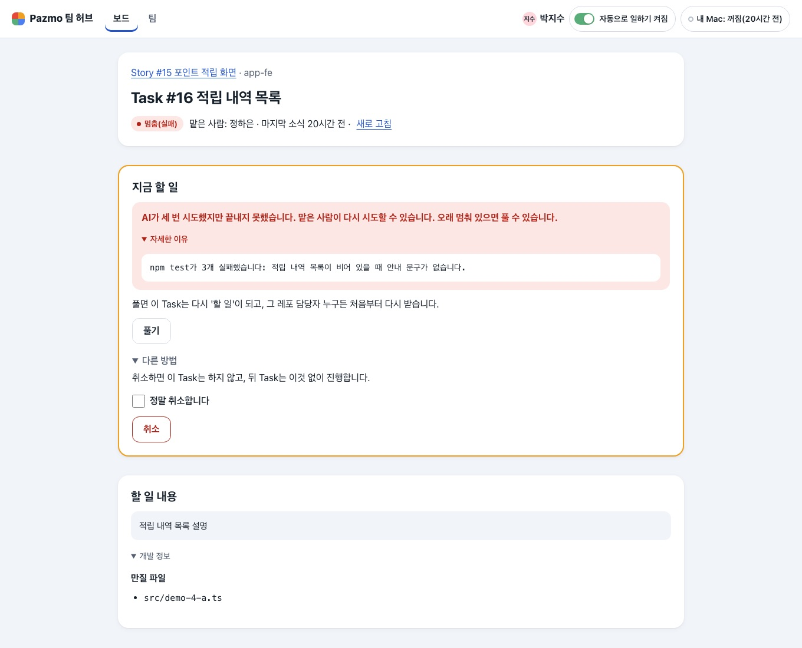
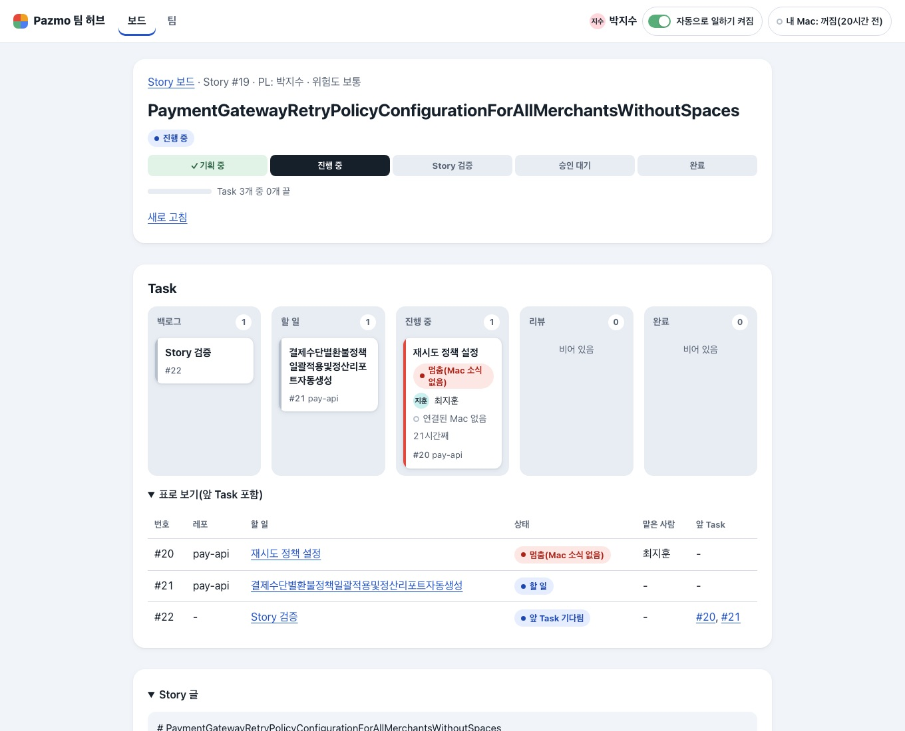
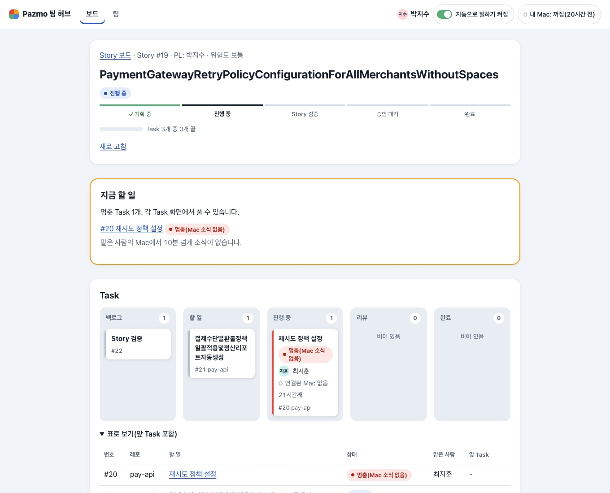
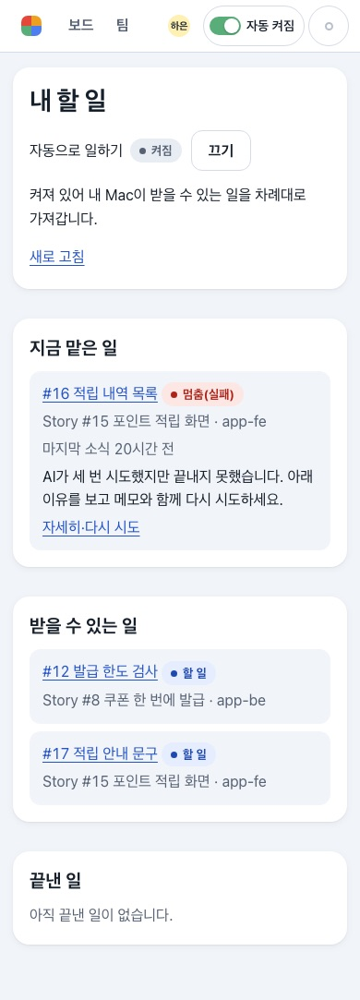
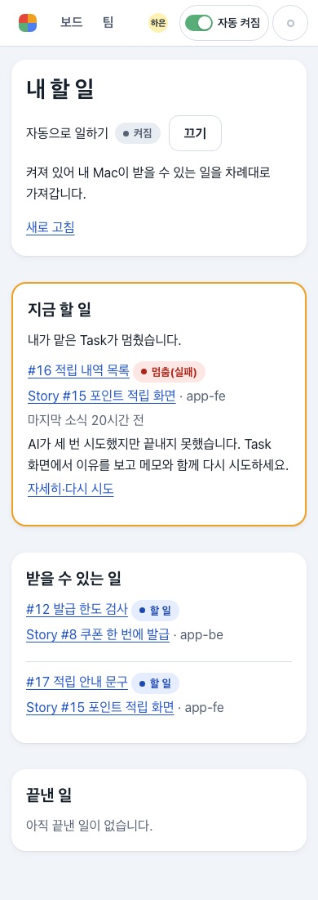
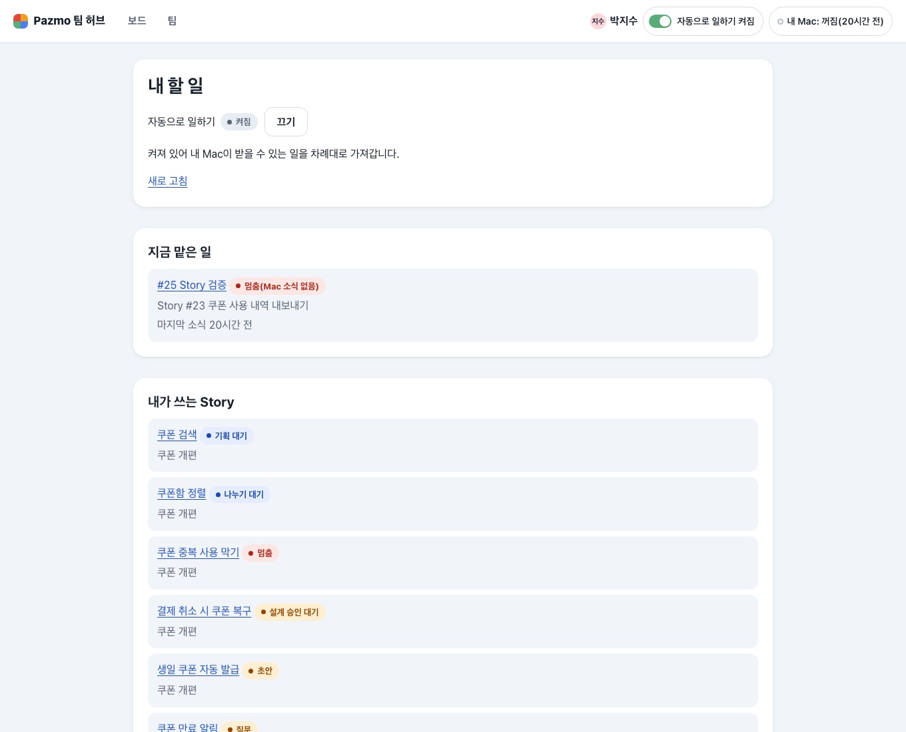
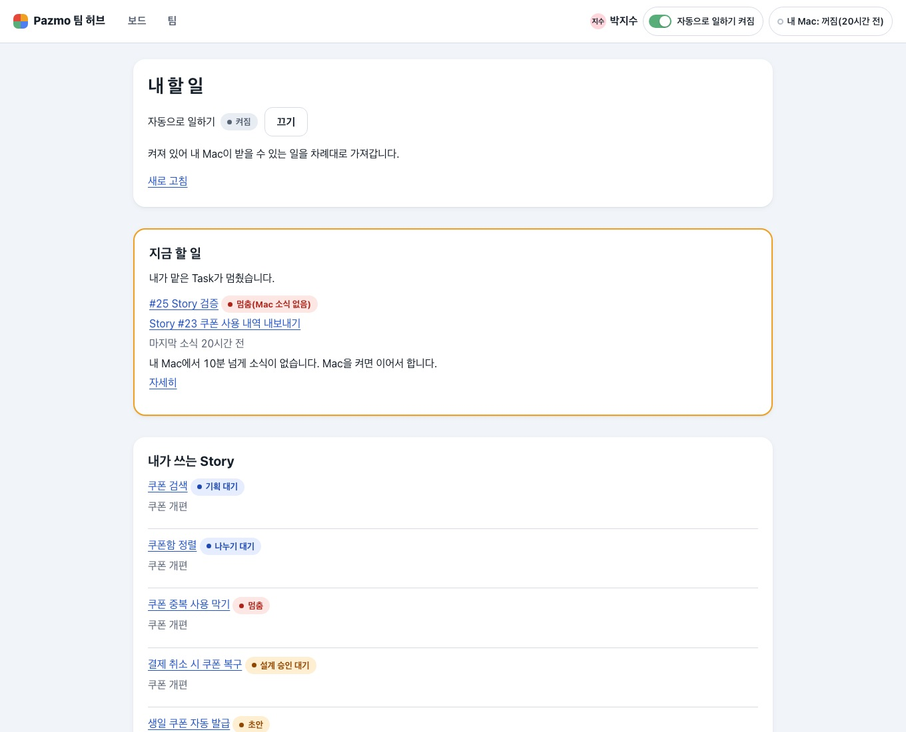

# 변경 기록: Hub 화면 다시 디자인 "나 결정 카드" PR 3 — Task·Story 화면과 내 할 일의 "지금 할 일" (U47)

kit 실행은 `.ai-workflow/runs/U47-hub-pages.json`(작은 변경의 기본 계획: 구현 → 리뷰 → 검증)이다. 이 기록은 kit 증거가 아니라 변경 기록이다.

사용자가 [설명 페이지](https://claude.ai/artifact/KXM76dpF5j3PCBwUdikMeS) 7판에서 고른 "나 결정 카드"의 세 번째 PR이다(① U45 공통 틀, ② U46 두 보드, ③ 이것, ④ Story 만들기 흐름). 원칙 그대로 "화면마다 맨 위에 지금 할 일 하나"를 Task 화면, Story 화면, 내 할 일(`/me`)에 넣었다.

Story는 바꾸지 않았다(D41 범위). 버튼이 하는 일·권한(`taskActions`)·확인 상자·주소·CSRF·Origin·POST 뒤 다시 읽기·스크립트 없이 쓰기·저절로 업데이트는 그대로다. 버튼이 보이는 조건도 그대로이고, 어디에 놓이는지만 바뀐다.

## 바뀐 것

1. **Task 화면의 "지금 할 일" 카드.** 보는 사람이 지금 할 수 있는 일이 있으면(다시 시도, 아니면 풀기, 아니면 작업하기 — 이 순서로 하나) 머리 아래에 "지금 할 일" 카드가 생긴다. 카드에는 왜 멈췄는지(실패 이유와 접힌 "자세한 이유", 또는 Mac 소식 없음), 그 Task에 대한 안내(Mac이 쉬는 이유, 연결 안 된 레포 등)와 그 행동 하나가 있고, 나머지 행동(풀기·취소 등)은 카드 안 접힌 "다른 방법"에 있다. 할 일이 없으면(돌아가는 Task를 PL이 볼 때) 카드 없이 취소가 머리 안 접힌 "이 Task 바꾸기"에 들어간다. 카드가 없으면 안내 문장(자동으로 일하기가 켜져 있음, 연결 안 된 레포, 합치는 중이라 취소 못 함)은 머리에 보인다.
   **읽는 사람에 맞춘 말:** 맡은 사람(내 Task)은 "… 아래 이유를 보고 메모와 함께 다시 시도하세요"를 읽는다(내 Mac이 그 레포를 가져가지 않아 지금은 풀기가 카드의 행동이어도). 다른 사람은 "무엇이 멈췄는지 + 맡은 사람이 다시 시도할 수 있습니다. 오래 멈춰 있으면 풀 수 있습니다."를 읽고, 풀 수 없는 사람에게는 "PL이 풀 수 있습니다"다. 실패한 Story 검증은 "Story 검증이 실패했습니다. 고칠 Task는 내 Mac(claude 대화)에서 더하세요(다른 사람에게는 PL이 더합니다)."이고, 풀 수 있는 사람에게만 "풀기는 고치지 않고 다시 검증합니다."가 붙는다. Mac 소식이 없는 Task를 맡은 사람이 보면 내 Mac의 일이다: 내 Mac이 없거나 꺼져 있으면 "내 Mac에서 10분 넘게 소식이 없습니다. Mac을 켜면 이어서 합니다.", 켜져 있거나 쉬는 중이면 "내 Mac은 켜져 있지만 10분 넘게 이 Task 소식이 없습니다. 오래 멈춰 있으면 PL이 풀 수 있습니다."
2. **Story 화면의 "지금 할 일".** PL에게만, 이 Story에 멈춘 Task가 있으면 "멈춘 Task N개. 각 Task 화면에서 풀 수 있습니다."(PL 자신의 실패한 Task가 있으면 "다시 시도하거나 풀 수 있습니다")와 그 목록(링크, 상태, PL에게 하는 이유 — 다른 사람의 실패는 "… 맡은 사람이 다시 시도할 수 있습니다.", 내 실패는 "Task 화면에서 이유를 보고 … 다시 시도하세요", 실패한 검증은 "고칠 Task는 내 Mac에서 더하세요", 내 Mac 소식 없음은 "내 Mac에서 10분 넘게 소식이 없습니다."), 결과 승인 대기면 그 안내(결과 승인은 PL의 Mac에서)가 카드로 보인다. 다른 사람에게는 카드가 없고 결과 승인 안내는 전처럼 단계 아래에 있다. 올린 Story를 열기 전 취소하는 양식은 접힌 "이 Story 취소" 안으로 옮겼다.
3. **Story 단계 표시는 막대와 이름.** 단추처럼 보이던 칸(회색 판, 지금 단계는 검은 덩어리) 대신 위에 4px 막대와 이름이다: 지난 단계 초록 막대와 ✓, 지금 단계 진한 막대와 굵은 글자(700, 다른 단계는 500), 남은 단계 회색 막대.
4. **내 할 일.** 각 Task의 "Story #N 제목"이 Story 화면 링크다. 멈춘 Task의 이유는 "Task 화면에서 이유를 보고 …"로 읽는다(아래에는 "자세히·다시 시도" 링크뿐이라서, U46 리뷰 2). 내가 맡은 Task가 멈추면 그 칸이 "지금 할 일" 카드("내가 맡은 Task가 멈췄습니다.")가 된다. 실패면 이유와 "자세히·다시 시도", Mac 소식이 없으면 위 1의 내 Mac 문장(머리의 "내 Mac" 상태를 따른다)과 "자세히". PL의 "내 Story에서 멈춘 일"도 Story 카드와 같은 말로 PL에게 말한다. 목록은 줄마다 회색 판 대신 가는 줄로 나눈다.
5. **보드 문구와 같은 함수.** 보드의 `boardFailure()`와 내 할 일·Story 카드가 같은 `failureElsewhere()`(story-pages)를 쓴다.
6. 카드의 모양: 나를 기다리는 일과 같은 2px 주황 테두리(그 사람을 기다린다는 표시, 점검표 규칙 5의 "상태" 색), 카드 안 양식은 회색 판 없음.

## 확인

- 시험부터 썼다: RED 6/6(U47 시험 여섯) → GREEN. 시험 셋을 이 변경의 뜻에 맞게 고쳤다: 내가 쓴 시험의 PL 행동(이 Task의 다시 시도는 맡은 사람의 연결이 있어야 해서 PL의 카드 행동은 풀기, 다른 방법은 취소), 내 할 일의 실패 문구 두 곳("Task 화면에서"), 멈춘 Task가 있을 때 내 할 일의 제목("지금 맡은 일" → "지금 할 일"). 고친 파일들 133/133, Hub 시험 파일 43개 전부 **606/606**, 타입 검사 exit 0.
- 화면: 확인용 허브(18444)는 건드리지 않고 그 DB 복사본과 시험 데이터로, 고치기 전(main `2a5c7d7`)과 후를 Task 화면(맡은 사람이 본 실패, PL이 본 실패, Mac 소식 없음), Story 화면(PL, 다른 사람), 내 할 일(정하은, 박지수), 복사본의 Story·Task 화면 × 320·390·861·1360px × 두 테마로 쟀다. 후 80번: 가로 넘침 0, 접힘을 연 채 화면 끝 넘어 그려진 요소 0. 작은 누름 대상으로 잡힌 하나는 "정말 취소합니다" 체크박스(22px)였고, 누르는 곳은 그 이름표(322×44px)라 점검표 규칙 3을 지킨다.
- **리뷰 1차(독립 리뷰어 하나): 머지 불가.** 1,080가지 행동 조합을 직접 그려 양식이 빠지거나 겹치는 일은 없다고 확인했지만 Important 3: 내 할 일에서 Mac 소식 없는 내 Task 카드가 할 말이 없음, 카드의 말이 읽는 사람과 맞지 않음(PL에게 "다시 시도하세요", 실패한 검증의 다음 할 일 없음), 이 PR이 지키는 것(멈춘 이유 한 번, 결과 승인 안내 한 번, 행동 순서, Story 카드의 Mac 소식 없음, 카드 하나, 지난 단계 색)을 시험이 지키지 않음 — 일부러 깨도 133개가 다 통과. Minor 3: 지금 단계가 더 굵지 않음, 안내가 카드보다 위, 카드가 생기는 곳이 고르지 않음. 위 둘과 Important 셋을 고치고 시험을 더했다: RED 3/12 → GREEN 139/139, Hub 시험 파일 전부 **612/612**, 타입 검사 exit 0, 다시 잰 80번 넘침·화면 끝 넘음 0. 시험 둘(실패 문구를 PL로 읽던 것)은 맡은 사람으로 읽게 하고 PL의 문장은 따로 확인한다.
- **리뷰 2차(같은 리뷰어): 머지 불가.** 리뷰 1차의 I2·I3·m1·m2는 고쳐졌고, 1,080 + 6,144가지 행동·읽는 사람 조합에서 양식이 빠지거나 겹치지 않고 이스케이프되지 않은 글자가 없으며 브라우저 64번이 깨끗하다고 확인했지만 Important 1: 내 할 일의 Mac 소식 없는 카드가 내 Mac이 켜져 있어도 "Mac을 켜면 이어서 합니다"라고 함(I1을 고치며 생김). Minor 5: 시험 빈틈 넷(문장을 고르는 조건, Story 화면의 카드 하나, 카드 안 Mac 쉬는 이유, 안내가 행동보다 먼저), 풀 수 없는 사람에게 "풀기는 …", 자기 Task를 읽는 PL에게 "맡은 사람이 다시 시도할 수 있습니다", 실패한 검증뿐인 Story 카드의 "다시 시도", 옮겨진 주석. 모두 고쳤고, 같은 잘못(읽는 사람과 맞지 않는 말)이 남은 곳 — 맡은 사람이 보는 Mac 소식 없음, B가 보는 실패, PL의 "내 Story에서 멈춘 일"과 Story 카드의 다른 사람 실패 — 도 같은 함수로 맞췄다: RED 6/18 → GREEN 145/145, Hub 시험 파일 전부 **618/618**, 타입 검사 exit 0, 다시 잰 80번 넘침·화면 끝 넘음 0. 예전 시험 둘(맡은 사람이 읽는 Mac 소식 없음, PL의 멈춘 일 목록)은 읽는 사람에 맞춘 문장을 기대하도록 고쳤다.
- 폰(390px)에서 PL이 Mac 소식 없는 Task를 열면 "지금 할 일" 카드가 383px, 풀기 단추가 620px에 있다(전에는 카드 없이 머리 안 회색 판 둘).

| | 전 | 후 |
|---|---|---|
| Task(Mac 소식 없음, PL) · 390 |  |  |
| Task(실패, PL) · 1360 |  |  |
| Story(PL) · 1360 |  |  |
| 내 할 일(정하은) · 390 |  |  |
| 내 할 일(박지수) · 1360 |  |  |

## 확인하지 못한 것 · 남긴 것

- Safari·Firefox, 실제 화면 낭독기.
- 시험 데이터에서 정하은은 자기 실패 Task를 다시 시도할 수 없게 나온다(다시 시도 상태가 연결을 따르고, 시험 데이터의 연결이 오래돼서로 보임). 고치기 전과 같은 화면이라 이번 범위 밖으로 두었다.
- 풀기는 카드의 행동이어도 보조 단추 모양이다(다른 사람의 일을 처음부터 다시 하게 하는 행동이라 채운 단추로 부추기지 않았다). 다시 시도·작업하기는 채운 단추다.
- 내 할 일의 "자동으로 일하기" 켜고 끄기는 머리의 스위치와 겹친 채 둔다(설정을 보는 곳).
- 카드가 생기는 곳이 고르지 않다(리뷰 1차 Minor, 의도): 관리자는 Task 화면에서는 카드를 받지만 Story 화면에서는 받지 않는다(Story 카드는 그 PL의 것). PL의 내 할 일은 "내 Story에서 멈춘 일"을 카드로 올리지 않는다(Story 화면과 보드의 기다리는 일이 그 자리).
- 보드(U46)의 실패 카드와 기다리는 일 줄은 아직 누가 읽든 맡은 사람에게 하는 말("Task 화면에서 이유를 보고 메모와 함께 다시 시도하세요")이다. 이 PR은 보드 문구를 바꾸지 않았다.
- 리뷰 2차 뒤 다시 잰 때는 시험 데이터가 하루 지나 "돌아가는 Task"도 Mac 소식 없음이 되어, 그 화면은 PL의 풀기 카드가 있는 채로 쟀다.
- Story 만들기 흐름(기획 화면의 보는 사람별 색 포함)은 PR 4다.
