# 변경 기록: Hub 화면 다시 디자인 "나 결정 카드" PR 1 — 공통 틀과 관리 (U45)

kit 실행은 `.ai-workflow/runs/U45-hub-shell.json`(작은 변경의 기본 계획: 구현 → 리뷰 → 검증)이다. 이 기록은 kit 증거가 아니라 변경 기록이다.

사용자가 [설명 페이지 7판](https://claude.ai/artifact/KXM76dpF5j3PCBwUdikMeS)에서 세 길(가 제자리 정돈, 나 결정 카드, 다 대화형 기획) 가운데 **나 결정 카드**를 골랐다(2026-11-12). 나는 PR 세 개로 나눈다: ① 공통 틀과 관리(이 기록) ② 두 보드·Story·Task·내 할 일 ③ Story 만들기 흐름. 사용자의 말에 따라 U44(디자인 점검표)가 머지되기 전 그 브랜치 끝(`74fc4e7`) 위에서 시작했고, U44가 main(`84e1171`, PR #87)에 머지된 뒤 그 위로 다시 맞췄다(충돌은 `/members` 한 곳).

Story는 바꾸지 않았다. 주소, 버튼이 하는 일, 권한, 승인의 해시·revision 확인, CSRF·Origin 확인, POST 뒤 다시 읽기(303), 스크립트 없이 쓰기, `/copy.js`·`/live.js`, 저장소는 그대로다. 메뉴는 D42대로 보드·팀 둘이다. 모든 값은 전처럼 `esc()`를 거친다.

## 바뀐 것

1. **머리가 폰에서도 한 줄.** 860px 이하에서는 짧은 글만 보인다: 로고(글자 "Pazmo 팀 허브"는 숨김), 보드·팀, 이름표(이름 숨김), 스위치 "자동 켜짐/꺼짐", Mac 점(글 숨김). 숨긴 글은 `display:none`이 아니라 1px로 잘라 두어 화면 낭독기는 전처럼 "Pazmo 팀 허브", "자동으로 일하기 켜짐", "내 Mac: 일하는 중"을 읽는다. 이름표와 Mac 점은 혼자서도 44×44px. 390px부터 한 줄(57px, 전에는 세 줄 165px)이고 320·360px에서는 두 줄(105px)로 감긴다.
2. **스위치 글자 한 덩어리.** 버튼의 flex 간격이 글자 사이에 끼어 "자동 으로 일하기 켜짐"으로 벌어지지 않게 글자를 `span.label` 하나에 담았다.
3. **지금 메뉴는 강조색 밑줄.** 검은 덩어리 대신 지금 탭(`.tabs`)과 같은 3px 강조색 밑줄. 점검표 규칙 5(강조색은 지금 고른 것)에 맞는다.
4. **입력 칸 테두리 대비 3:1 이상.** 새 토큰 `--field-line`: 밝게 `#7c8798`(흰 판 위 3.64:1, 바탕 위 3.30:1), 어둡게 `#64748a`(판 위 3.36:1, 바탕 위 3.74:1). 전에는 `--line`으로 1.38:1(밝게)·1.45:1(어둡게)이었다.
5. **양식의 단추는 제 폭.** `form>button{justify-self:start}`. 팀원 초대·레포 등록·초대 입장의 단추가 양식 폭 전체로 늘어나지 않는다.
6. **팀원·초대(`/members`): 표 대신 한 사람 한 줄.** 이름표·이름·관리자, "브라우저: 이름 · 2026. 12. 12.까지"(만료일은 U44의 `teamDay()`, 팀 시간대 `HUB_TIME_ZONE`의 날짜), "Mac: 이름 (상태)". 새 기기 링크·기기 회수·Mac 해제·팀원 회수는 줄마다 접힌 **관리** 안에 있고, 접힘 안 첫 줄이 회수의 결과(다시 들어오려면 새 기기 링크, 팀원 회수는 Office 연결과 Mac도 끊기고 되돌릴 수 없음)를 말한다. 기기 회수 단추는 "기기 회수: 기기 이름"처럼 대상을 적는다. 서버 동작은 그대로다(한 번 더 눌러야 보일 뿐 확인 상자는 더하지 않았다).
7. **레포(`/repos`): 표 대신 한 레포 한 줄.** 이름·원격 주소, "담당자: …", "연결된 Office: …"(내 Office 연결 링크 포함). 담당자 빼기("빼기: 이름")·담당자 추가·연결 해제("연결 해제: 이름")는 그 레포를 바꿀 수 있는 사람에게만 보이는 **관리** 접힘 안에 있다. Mac이 만든 연결의 "내 Mac에서 해제"/"팀원·초대에서 Mac 해제" 링크는 전처럼 연결 줄에 있다.

## 확인

- 시험부터 썼다. RED 9/71(머리 표시, 입력 테두리 토큰, 메뉴 밑줄, 팀원·레포 목록, 그리고 옛 표시를 읽던 시험 셋을 새 표시로 고침) → GREEN 81/81(보드·Mac·불변 시험 파일). Hub 시험 전부를 돌려 옛 표시를 읽던 다섯 개를 더 찾아 새 표시로 고쳤다(같은 뜻). 렌더를 보고 찾은 두 가지(스위치 글자 사이 간격, 늘어난 단추)는 다시 RED 5/84 → GREEN 84/84. U44 머지 뒤 main 위로 다시 맞춘 다음 Hub 시험 파일 전부 **590/590**, 타입 검사 exit 0(만료일을 U44의 `teamDay()`로 쓰면서 그 시험의 날짜 모양도 바꿨다).
- 내 새 시험 두 곳은 처음에 틀렸다: 담당자 순서(이름순), `--panel:#fff`의 세 자리 색. 시험을 고쳤고, U44 강조색 시험이 내 접힘 제목의 강조색을 잡아 코드에서 뺐다.
- 화면: 확인용 허브(18444)는 건드리지 않고 그 DB의 `VACUUM INTO` 복사본과 시험 데이터(프로젝트 3, Story 7, 기획 6개 상태)로, 보드·팀원·레포·새 Story·복사본 보드·복사본 팀원 6개 화면 × 320·360·390·640·861·1000·1360px × 두 테마 = 84가지를 쟀다. 가로 넘침 0, 머리 안 누름 대상은 마우스에서 32px·터치(860px 이하, 터치 흉내)에서 44×44px 아래 0, 입력 칸 테두리는 그린 색 `rgb(124,135,152)`.
- 전후 캡처(전은 main `84e1171`을 `git archive`로 따로 띄운 같은 데이터의 복사본, 후는 다시 맞춘 코드):

| | 전 | 후 |
|---|---|---|
| 보드 · 390 | 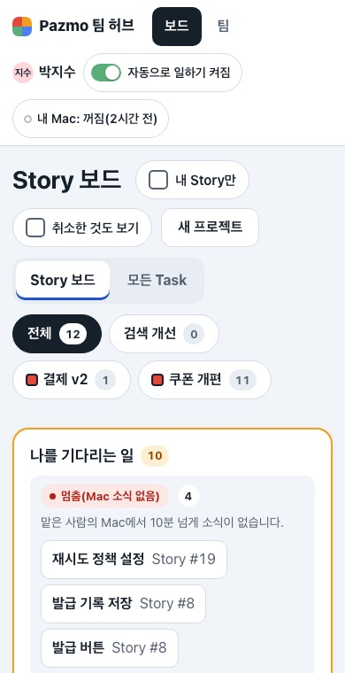 | 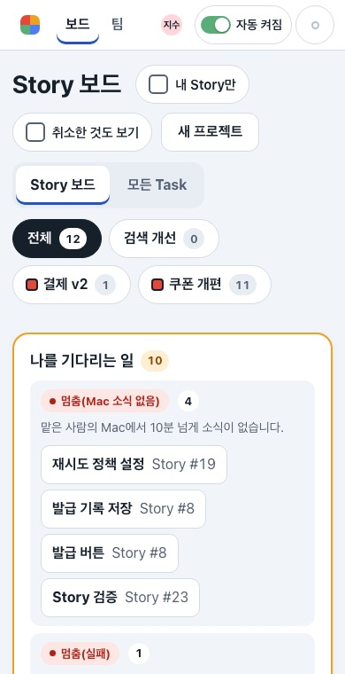 |
| 보드 · 1360 머리 | 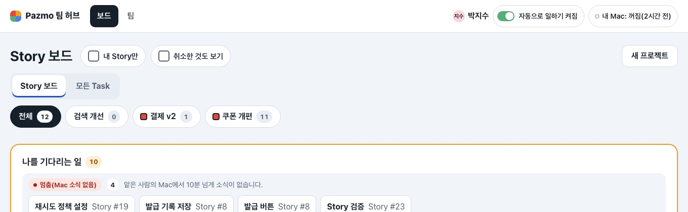 | 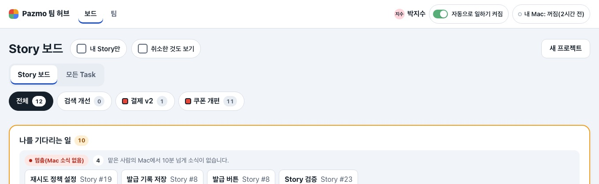 |
| 팀원 · 1360 | 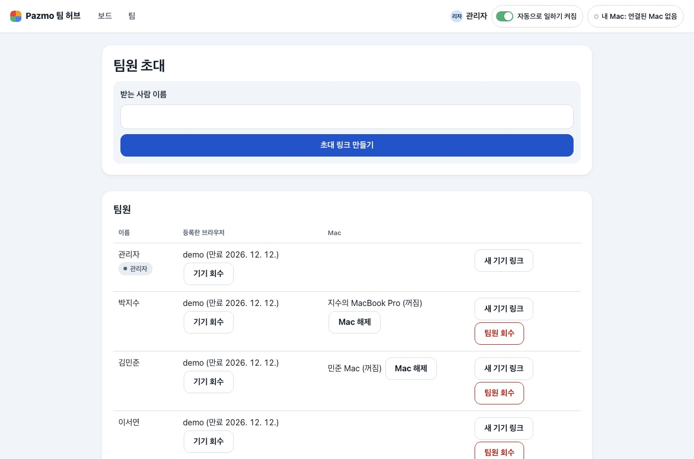 | 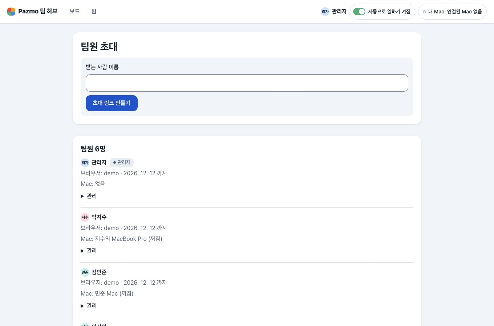 |
| 팀원 · 390 어둡게 | 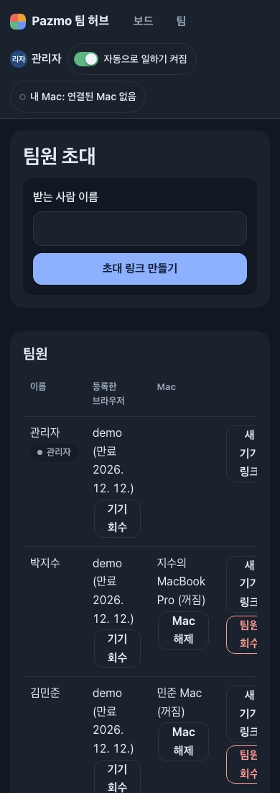 | 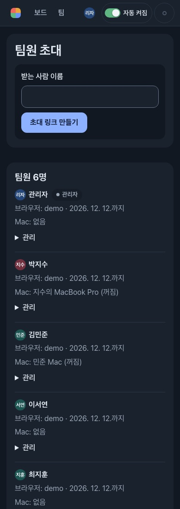 |
| 레포 · 390 | 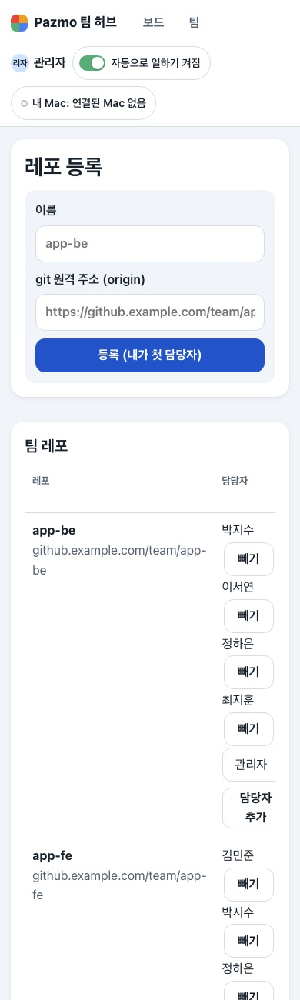 | 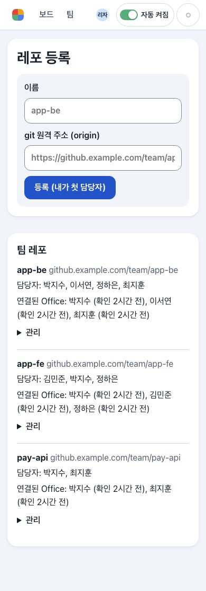 |
| 새 Story · 1360 (입력 테두리) | 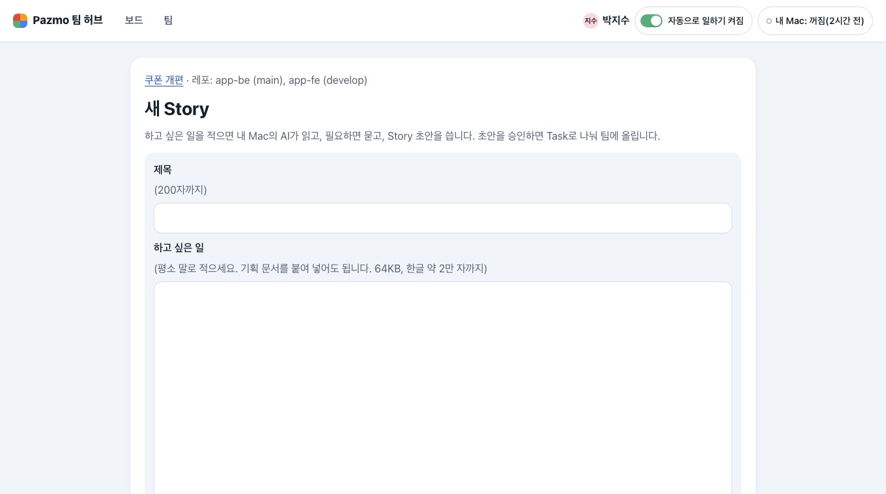 | 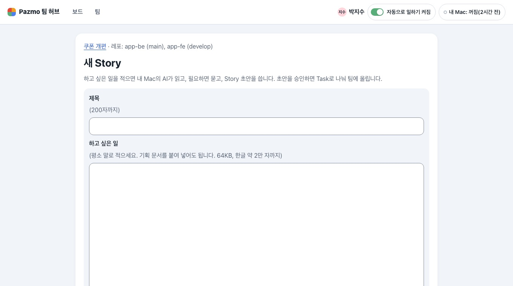 |
| 확인용 허브 복사본 보드 · 390 어둡게 | 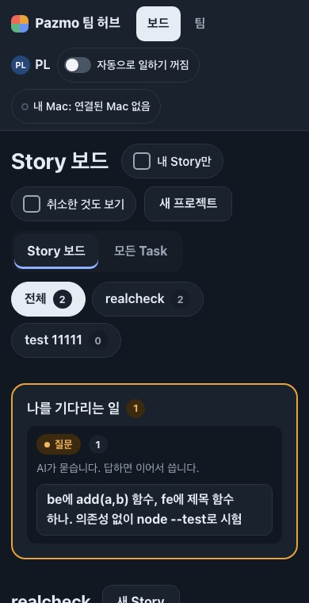 | 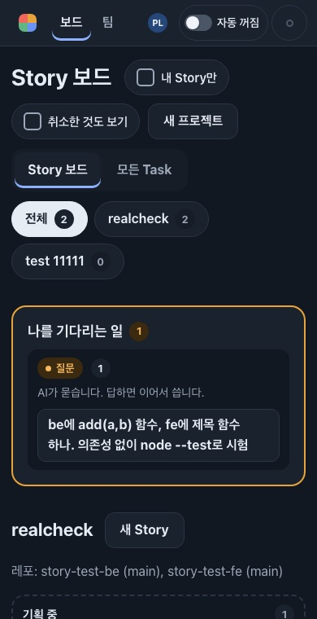 |

## 확인하지 못한 것 · 남긴 것

- Safari·Firefox·Windows 글꼴, 실제 화면 낭독기(숨긴 글을 읽는지는 표시 규칙으로만 확인).
- 320·360px에서는 머리가 두 줄이다(로고·메뉴와 스위치·이름표·Mac 점).
- 폰에서 Mac 상태는 점 모양(채움·속 빈 원)과 색으로만 보인다. 글은 낭독기와 `/mac`에 있다.
- "지금 할 일" 카드, 두 보드, Story 만들기 흐름은 PR 2·3이다. 그 사이 다른 화면의 양식은 전처럼 회색 판(tray) 안에 있다.
