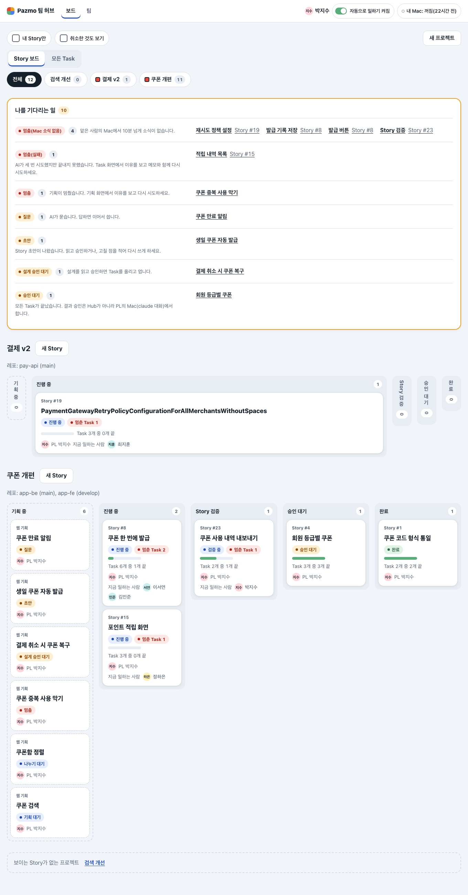
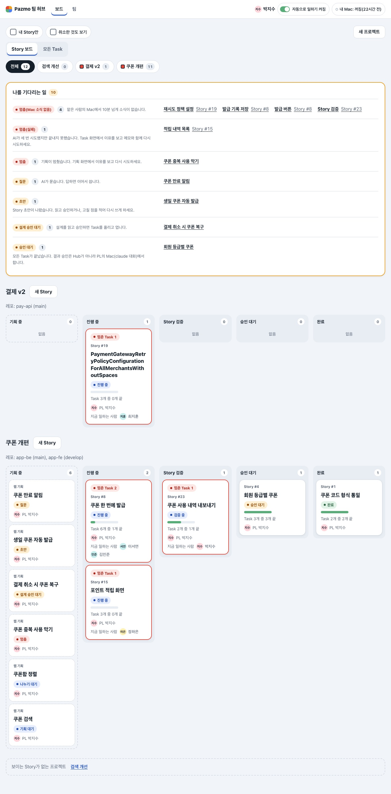
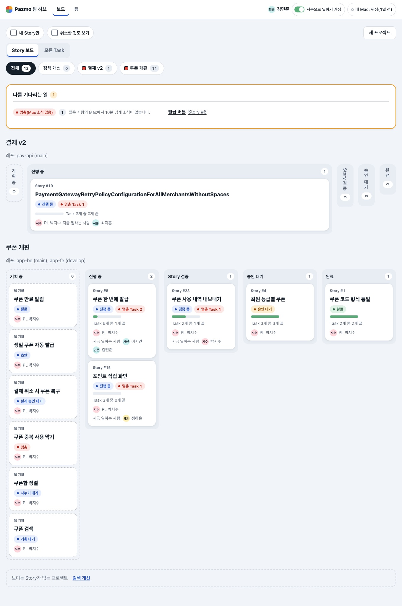
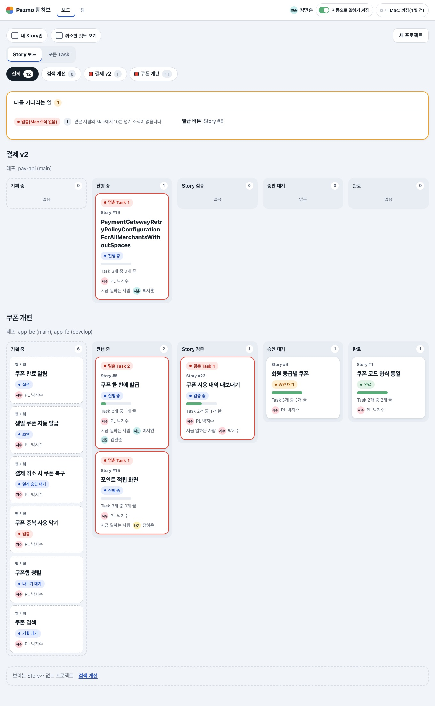
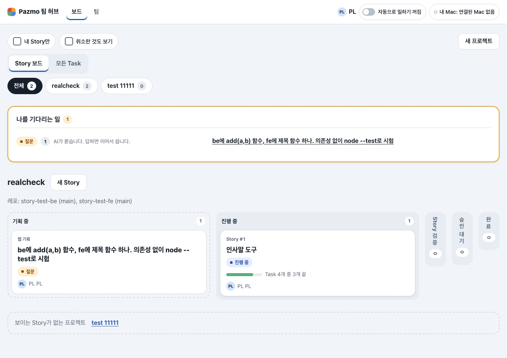
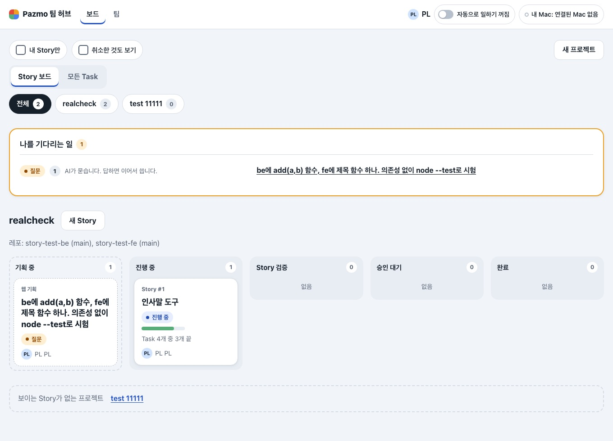
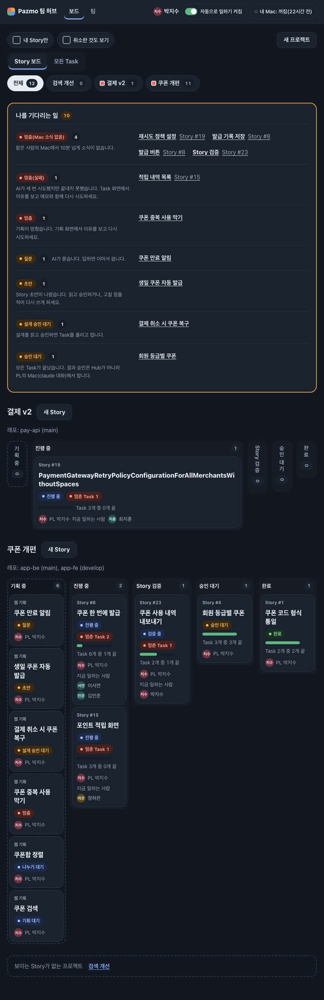
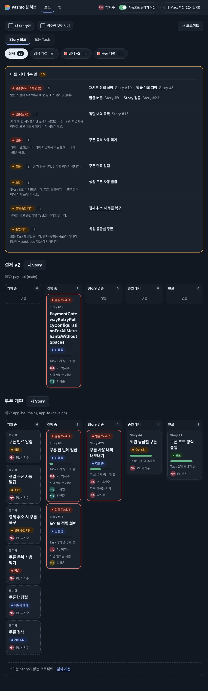

# 변경 기록: Story 보드 다시 보기 — 멈춘 Story는 테두리와 첫 줄로, 단계는 늘 같은 자리에 (U48)

kit 실행은 `.ai-workflow/runs/U48-hub-board-look.json`(작은 변경의 기본 계획: 구현 → 리뷰 → 검증)이다. 이 기록은 kit 증거가 아니라 변경 기록이다.

U46에서 바꾼 Story 보드 두 가지를 사용자가 다시 보자고 했다(상위 세션이 잰 값과 함께).
사용자는 [설명 페이지](https://claude.ai/artifact/KXM76dpF5j3PCBwUdikMeS) 16–17판의 비교에서 골랐다.

- ① 카드 색 띠: **(d)** 멈춘 Story만 네 변 2px 빨간 테두리 + "멈춘 Task N"을 카드 첫 줄로.
- ② 빈 단계: **(c)** 모든 단계가 같은 폭. 빈 단계는 폭은 그대로, 키만 낮다("없음").

Story는 바꾸지 않았다. 보이는 모양만 바뀐다(D41 안).
D43의 칸(Story 단계, 860px보다 넓으면 한 줄)과 D44(나를 기다리는 일)는 그대로다.
주소, 권한, 저절로 업데이트, 스크립트 없이 쓰기도 그대로다. 폰은 전처럼 쌓인다.

## 왜 다시 봤나

- **색 띠:** U46은 디자인 검사기의 "카드에 두꺼운 색 줄 금지" 규칙 하나로 띠를 없앴다. 근거 자료는 없었다.
  - 그 띠는 상태 색이라 점검표 규칙 5가 허용하는 쓰임이었다.
  - 띠가 없어지자 멈춘 Story는 작은 칩 하나로만 보였다.
- **빈 단계 띠:** 같은 단계가 프로젝트마다 다른 자리에 있었다. 예를 들어 1360px에서 "승인 대기"는 x=1212, 724, 822였다.
  - 카드가 단계를 옮기면 그 프로젝트 줄 전체가 다시 배치됐다(저절로 업데이트 중에도).
  - "빈 칸은 접고"의 근거로 든 자료(Notion, 37signals)는 사용자가 켜는 접기였다. Linear도 사용자 옵션이다. 저절로 접는 근거는 없었다.

## 바뀐 것

1. **멈춘 Story 카드:** `.scard.stop{border:2px solid var(--stop-bar)}`. 다른 카드(진행·기다림·끝)는 1px 회색 테두리 그대로다.
   - hover 규칙이 뒤에 있어서, 멈춘 카드도 마우스를 올리면 강조색 테두리가 된다.
2. **첫 줄:** 멈춘 Task가 있으면 카드의 첫 줄이 `
` "멈춘 Task N"이다. 그 아래 Story 번호, 제목, 단계 말이 온다.
   - 단계 말 줄에는 이제 단계 말만 있다.
   - 멀리서는 색으로, 가까이서는 글로 알아본다. 색만으로 말하지 않는다.
3. **같은 폭 단계:** 넓은 화면의 빈 단계 규칙(56px 띠, 세로 글씨, "없음" 숨김)을 뺐다.
   - 모든 단계가 `flex:1 1 0`으로 같은 폭이다. 그래서 모든 프로젝트에서 같은 단계가 같은 자리에 있다.
   - 빈 단계는 키만 낮고 "없음"이라고 쓴다.

## 확인

- 시험부터 썼다: RED 4/10 → GREEN 10/10.
  - 새 시험 셋: 멈춘 카드 테두리와 hover 순서, 첫 줄 칩은 멈춘 카드에만, 빈 단계에 좁히는 규칙 없음.
  - 고친 시험 둘: 보드 카드 모양 시험(칩 자리), 단계 한 줄 시험의 주석.
  - 뺀 시험 하나: U46의 "빈 단계는 좁은 띠" 시험.
  - Hub 시험 파일 43개 전부 **620/620**, 타입 검사 exit 0.
- 화면: 확인용 허브(18444)는 건드리지 않고 그 DB 복사본과 시험 데이터로 쟀다.
  - 범위: 고치기 전(main `b5602d7`)과 후, Story 보드(박지수, 김민준, 한 프로젝트 칩, 복사본) × 320–1360px 일곱 폭 × 두 테마.
  - 후 56번: 가로 넘침·화면 끝 넘음·작은 누름 대상 0. 860px보다 넓은 창에서 단계는 모두 한 줄이다.
  - **같은 자리:** 860px보다 넓은 모든 폭에서 같은 단계의 x가 프로젝트마다 같다. 고치기 전에는 861px부터 어긋났다.
  - **멈춘 카드:** 모두 2px 테두리이고 첫 줄이 칩이다. 고치기 전에는 1px였다.
  - **길이:** 1360px 시험 데이터 보드 2,600 → 2,755px(+155). 861px 2,796 → 3,025px.
  - **복사본:** 한 단계만 찬 프로젝트에서 카드 제목 폭이 490 → 197px로 줄었다(카드가 한 단계 폭에 맞춰짐).

| | 전 | 후 |
|---|---|---|
| Story 보드(박지수) · 1360 |  |  |
| Story 보드(김민준) · 1360 |  |  |
| 복사본 Story 보드 · 1360 |  |  |
| Story 보드 · 900 어두운 테마 |  |  |

## 확인하지 못한 것 · 남긴 것

- Safari·Firefox, 실제 화면 낭독기.
- 비교 페이지의 (d) "단계 이름은 맨 위 한 번"은 고르지 않았다. 단계 이름은 프로젝트마다 반복된다.
- 다섯 단계가 다 차면 1360px에서 단계가 251px라 공백 없는 긴 영어 제목은 4줄로 나뉜다(U46 전과 같음).
- 모든 Task 보드(`/tasks`)의 Task 카드는 바꾸지 않았다.
- 다음: 모든 허브 화면의 의미별 줄바꿈과 ⓘ 설명 PR(사용자 선택, U47 G4).
