# 변경 기록: 모든 허브 화면의 줄바꿈과 ⓘ 설명 (U49)

kit 실행은 `.ai-workflow/runs/U49-hub-line-breaks.json`(작은 변경의 기본 계획: 구현 → 리뷰 → 검증)이다. 이 기록은 kit 증거가 아니라 변경 기록이다.

U47 G4 때 사용자가 준 말에서 시작했다.

> 뭔가 문장들이 계속 나열되어 있어서 읽기 어려운 것 같은데? 의미별로 줄바꿈같은게 있었으면 좋겠어. 그리고 설명 같은건 그 i같은거 누르면 나오는 그런거 뭐지? 그런 형태를 좀 활용해서 부수적인 설명 같은건 따로 유저 액션을 통해서 볼 수 있게 빼는건 어때

[설명 페이지](https://claude.ai/artifact/KXM76dpF5j3PCBwUdikMeS) 20판에서 규칙 셋과 시안을 보인 뒤, 사용자는 "팝오버로 진행"을 골랐다.
같은 말에서 새 프로젝트 화면의 기준 브랜치 칸 정렬도 고치라고 했다.

Story는 바꾸지 않았다(D41 안, 글과 모양만).
단추가 하는 일, 권한, 확인 상자, 주소, CSRF·Origin, POST 뒤 다시 읽기, 스크립트 없이 쓰기는 그대로다.

## 규칙

1. **한 줄에 한 뜻.** "무슨 일인지"와 "무엇을 할지(누가 할 수 있는지)"를 줄로 나눈다. 멈춤 같은 알림은 첫 줄만 굵게.
2. **덧붙인 설명은 ⓘ 뒤로.** 지금 할 일에 꼭 필요하지 않은 결과·배경·한도는 그 단추나 문장 옆 ⓘ를 눌러 본다.
3. **숨기지 않는 것.** 되돌릴 수 없는 일의 결과(Task·Story·기획 취소), 보안 확인(인증서 지문, Mac 코드 확인, 인증서 지문을 함께 전달하라는 말), 합치는 중이었을 수 있다는 경고, 해야 할 일 자체.

## 바뀐 것

1. **도우미 셋(`pages.ts`).**
   - `say(text, lead)`: 문장마다 ``(첫 줄을 굵게 하면 `<b class="ln">`). 문장 사이는 빈칸이라 글로 읽으면 전과 같다.
   - `lns(...)`: 이미 만든 마크업 조각을 한 줄씩.
   - `info(id, label, text)`: ⓘ 단추(`popovertarget`, 낭독기 이름 `label`)와 브라우저 기본 팝오버 상자. 스크립트 없이 열리고, 바깥을 누르거나 Esc로 닫힌다.
2. **모양.**
   - `.ln{display:block}`.
   - ⓘ는 마우스 32px, 터치 44px 원.
   - 상자는 토큰 색만 쓴다. 넓은 화면에서는 ⓘ 옆에 붙는다(`position-area`, 되는 브라우저에서만).
   - 폰(860px 이하)에서는 화면 아래 시트로 뜬다.
3. **저절로 업데이트(live.js).** ⓘ 상자가 열려 있으면 화면을 바꾸지 않는다. `:popover-open`을 모르는 브라우저는 전처럼 바꾼다.
4. **줄로 나눈 곳.**
   - 화면: Task·Story·내 할 일의 멈춘 이유와 Mac 쉬는 이유, 빈 칸 안내, 보드의 나를 기다리는 일과 실패 카드, 기획 화면의 상태·경고·취소, 초대·인증서·내 Office 연결·내 Mac·Mac 허용·코드 만료·로그인 필요 화면.
   - 오류 화면: 메시지를 그리는 곳에서 나눠서 모든 오류 메시지가 저절로 나뉜다.
5. **ⓘ로 뺀 곳.**
   - 풀기 설명(일반 Task와 Story 검증 모두).
   - 초대 링크의 로그인 유지·한 번만.
   - 연결 문자열과 연결 코드의 10분·한 번만.
   - 초대·새 기기 링크의 72시간·한 번만.
   - 새 프로젝트의 "Story는 레포마다 기준 브랜치에서 시작합니다."
   - 새 Story의 "초안을 승인하면 …, 기획 문서도 됩니다, 64KB까지".
   - 설치 명령의 "처음 한 번, 관리자 암호 필요 없음".
6. **보드 실패 문구를 읽는 사람에 맞춤(U47 G4에서 남긴 것).**
   - 맡은 사람에게는 "Task 화면에서 이유를 보고 메모와 함께 다시 시도하세요"를 보인다.
   - 다른 사람에게는 "무엇이 멈췄는지 + 맡은 사람이 다시 시도할 수 있습니다"를 보인다.
   - 실패한 Story 검증은 그 PL에게 하는 말이다.
   - 모든 Task 보드의 카드, Story 화면의 Task 보드, 나를 기다리는 일이 같은 `stoppedReason()`을 쓴다.
7. **기준 브랜치 칸.**
   - 새 프로젝트 화면은 "레포 | 기준 브랜치" 두 칸이고, 칸 이름은 맨 위에 한 번만 쓴다(낭독기는 각 입력 칸의 이름 "app-be 기준 브랜치"를 읽는다).
   - 입력 칸이 레포 이름 길이와 상관없이 같은 자리에 있다.
   - 폰에서는 한 칸으로 쌓인다.

## 확인

- **시험:**
  - 시험부터 썼다: RED 6/7 → GREEN 7/7(새 시험 일곱: 모양, Task 화면의 줄과 풀기 ⓘ와 그대로 보이는 취소, 모든 ⓘ가 자기 상자 하나를 열고 이름이 있음, 보드 문구를 읽는 사람별로, 기준 브랜치 두 칸, live.js가 열린 상자 동안 기다림, 오래된 브라우저).
  - 여러 문장을 통째로 비교하던 기존 시험은 줄 표시를 걷어낸 글로 비교한다(`unline`). 기획·Story 화면 시험은 받아 온 화면 전체를, 보드 시험은 줄마다 그렇게 한다.
  - 기존 시험 몇은 바뀐 뜻을 기대하도록 고쳤다: 보드 실패 문구를 읽는 사람별로, 풀기 설명이 ⓘ 안에, 멈춤 알림은 첫 줄만 굵게.
  - Hub 시험 파일 43개 전부 **627/627**, 타입 검사 exit 0.
- **화면:** 확인용 허브는 건드리지 않고 그 DB 복사본과 시험 데이터로 쟀다.
  - 범위: 고치기 전(main `add28e9`)과 후, 15화면 × 320·390·861·1360px × 두 테마.
  - 후 120번: 가로 넘침·화면 끝 넘음(접힘을 연 채)·작은 누름 대상 0, 모든 화면 200.
  - 폰(390)과 넓은 화면(1360)에서 ⓘ 10개를 하나씩 열었다. 상자는 모두 화면 안에 들어왔고 Esc로 닫혔다.
  - 이 미리보기 허브는 Mac 한 줄 설치를 쓰지 않아 내 Mac 화면의 설치 ⓘ는 보이지 않았다(시험으로만 확인).
- 미리보기 데이터의 세션 파일이 임시 폴더 정리로 지워져, 복사본 DB에 같은 팀원의 새 세션을 만들어 쟀다(원본·확인용 허브는 그대로).

| | 전 | 후 |
|---|---|---|
| Task(실패, PL) · 1360 | 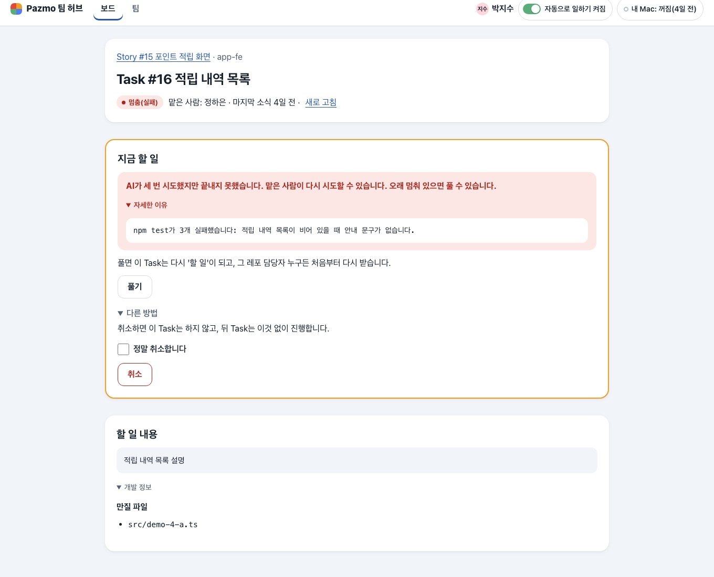 | 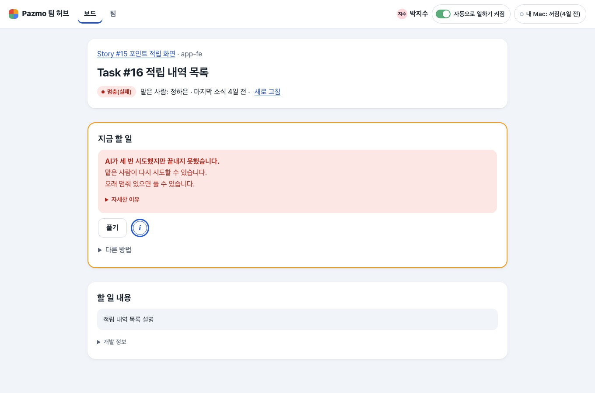 |
| Task(실패, PL) · 390, ⓘ 열림 | 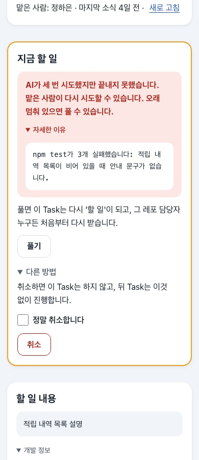 | 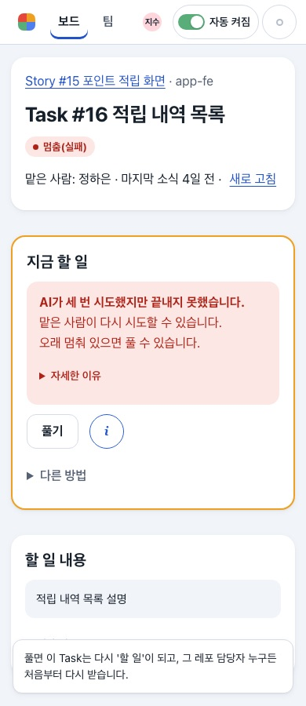 |
| Story 보드(PL) · 1360 | 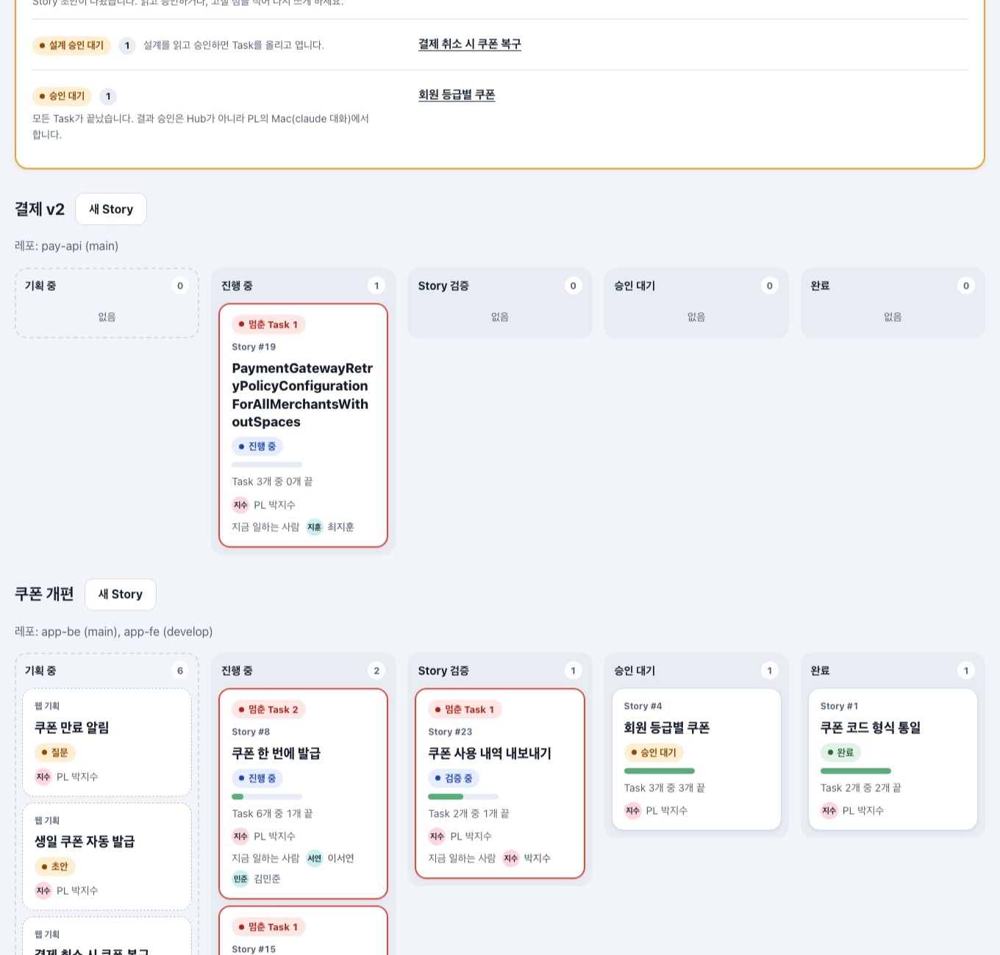 | 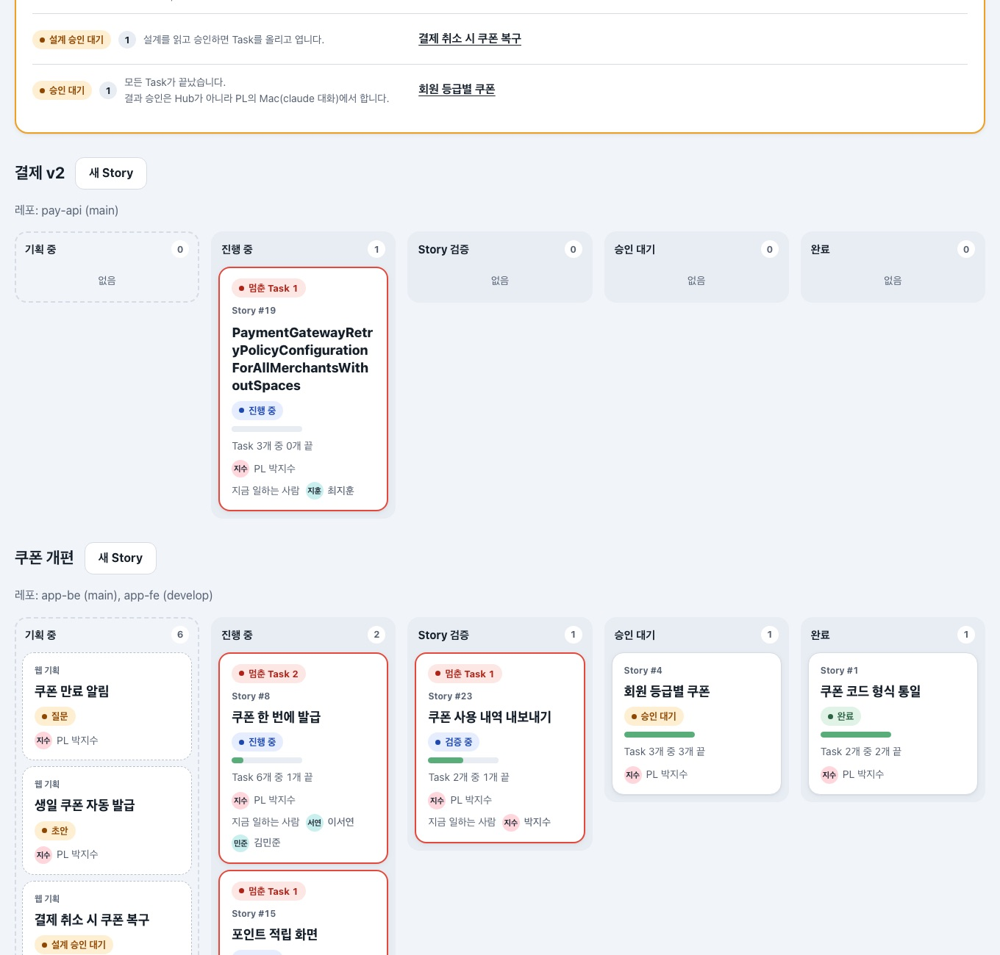 |
| 새 프로젝트 · 1360, ⓘ 열림 | 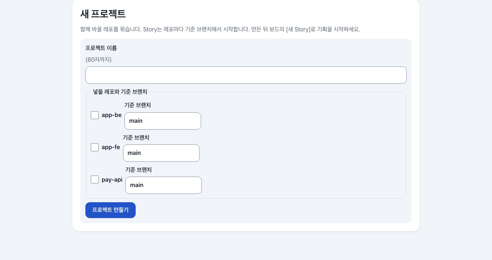 | 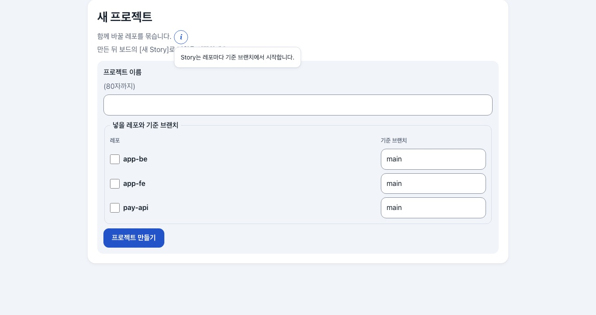 |
| 새 Story · 1360 | 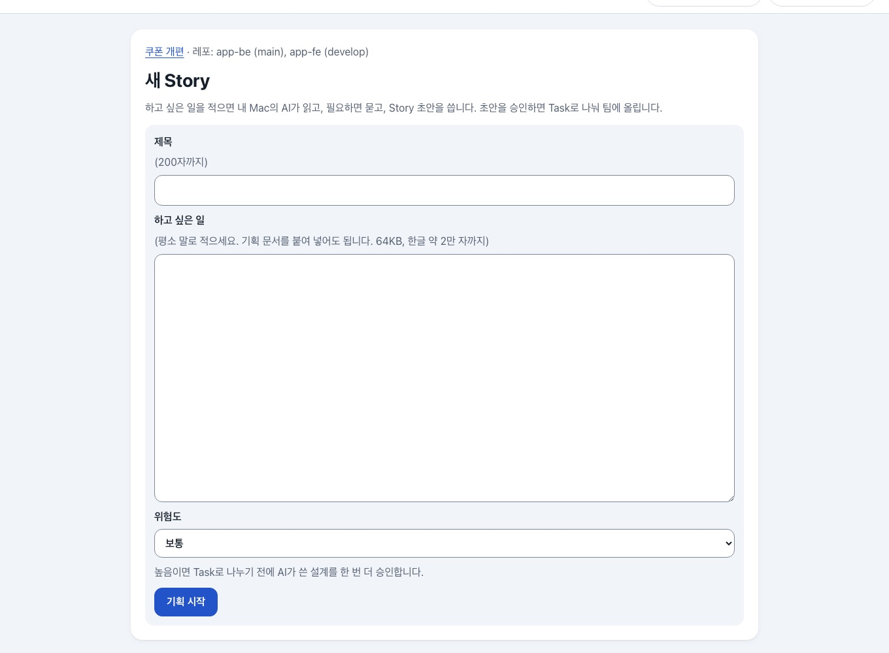 | 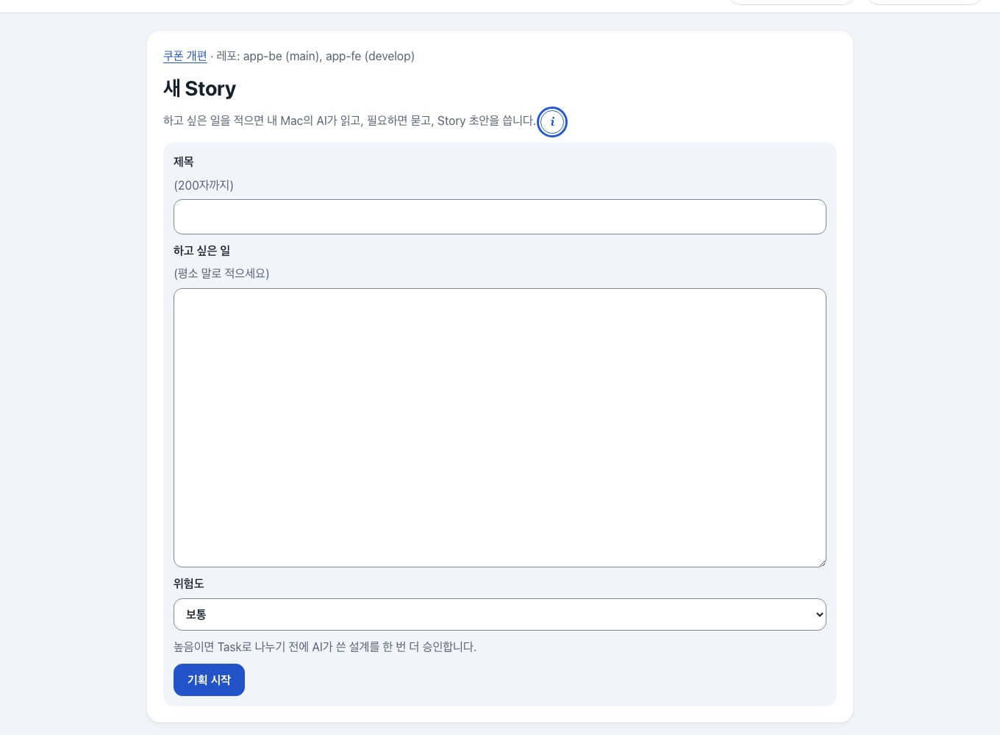 |
| 내 할 일(정하은) · 390 | 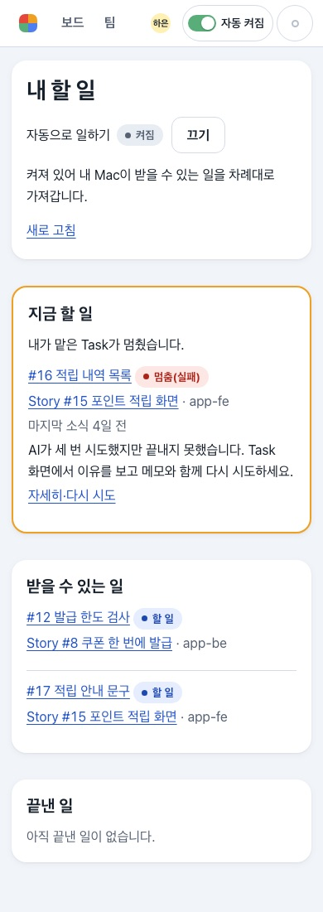 | 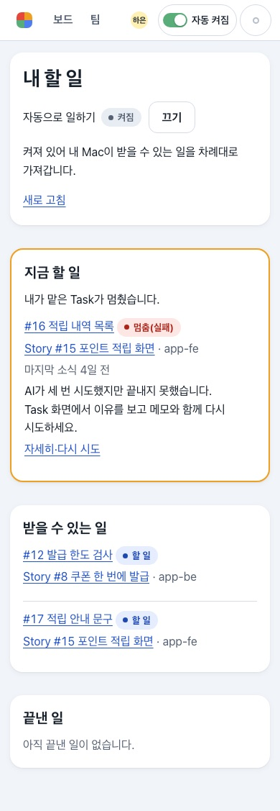 |

## 확인하지 못한 것 · 남긴 것

- Safari·Firefox, 실제 화면 낭독기.
  - ⓘ를 옆에 붙이는 기능이 없는 브라우저에서는 상자가 화면 가운데에 뜬다.
- 요청 게시판(옛 화면)의 " — 질문이 바뀌었어요. 새 질문에 다시 답해주세요."는 줄 안의 짧은 표시라 그대로 두었다.
- 캡처의 ⓘ 둘레 진한 선은 측정 중 ⓘ를 열고 닫은 뒤 남은 키보드 포커스 표시다.
