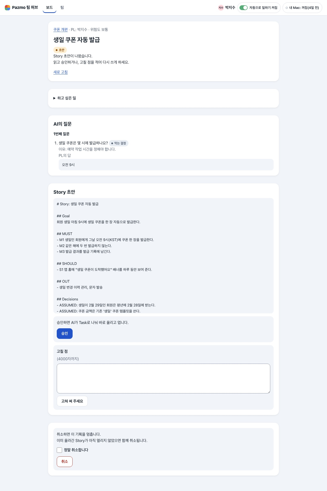
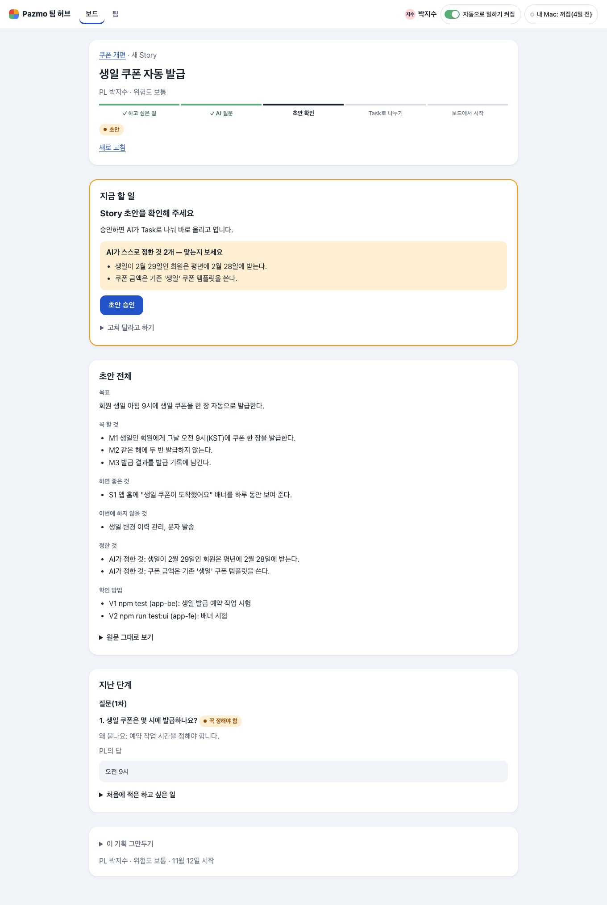
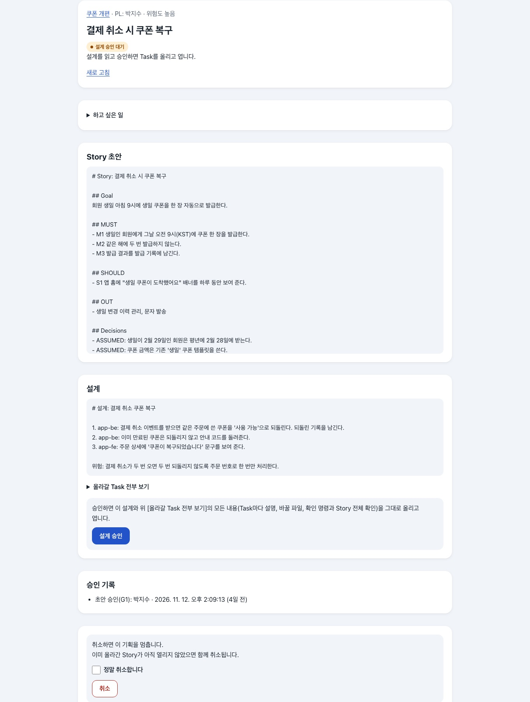
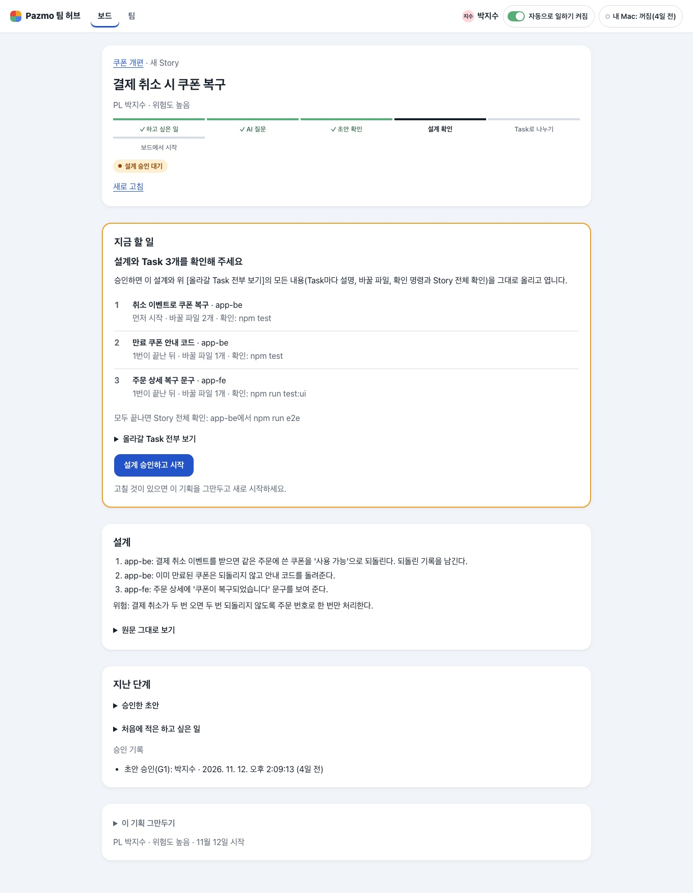
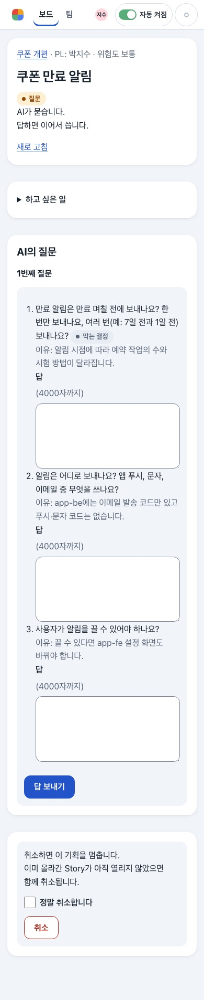
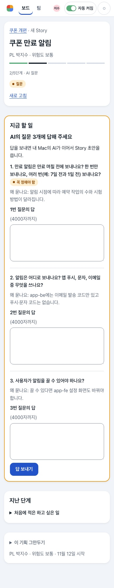
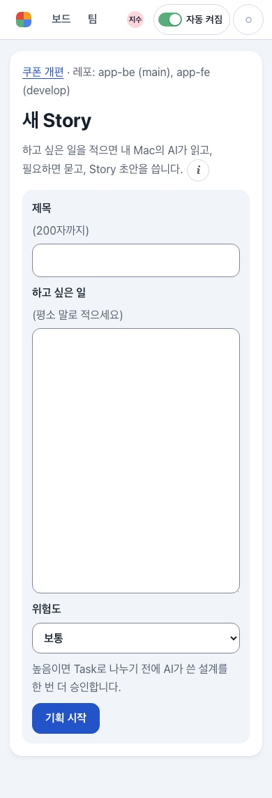
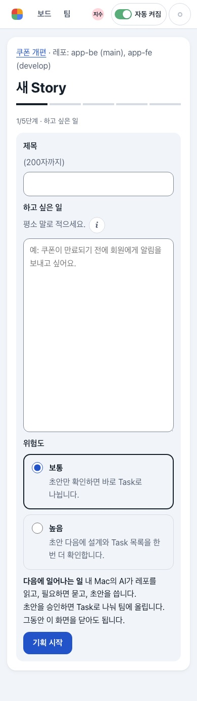
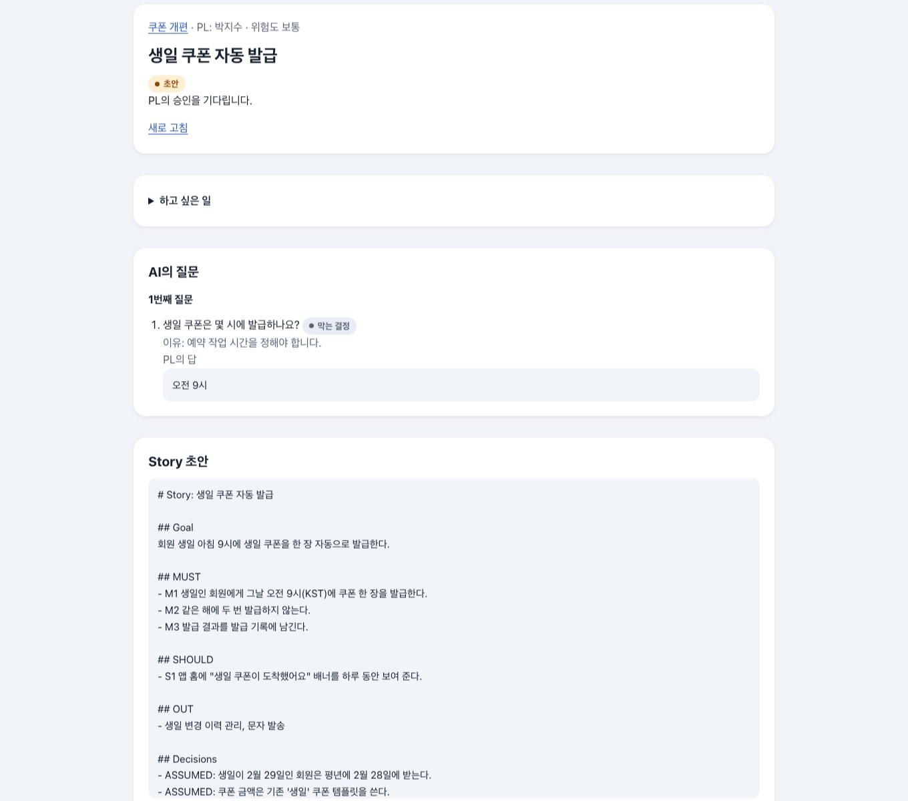
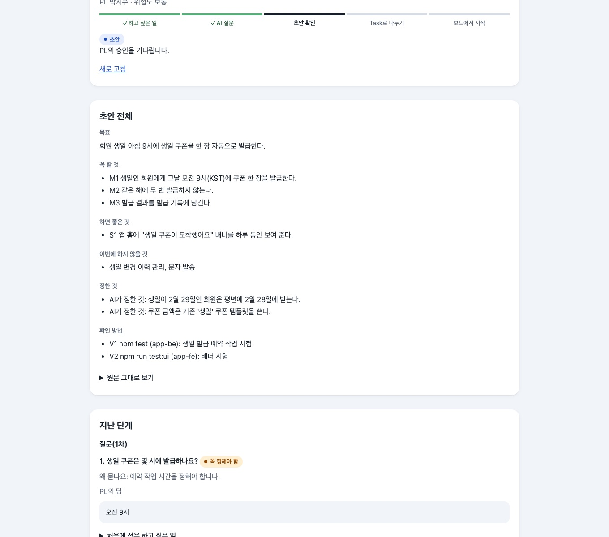

# 변경 기록: Hub 화면 다시 디자인 "나 결정 카드" PR 4 — Story 만들기 흐름 (U50)

kit 실행은 `.ai-workflow/runs/U50-hub-plan-flow.json`(작은 변경의 기본 계획: 구현 → 리뷰 → 검증)이다. 이 기록은 kit 증거가 아니라 변경 기록이다.

사용자가 [설명 페이지](https://claude.ai/artifact/KXM76dpF5j3PCBwUdikMeS) 7판에서 고른 "나 결정 카드"의 마지막 PR이다.
- 순서: ① U45 공통 틀, ② U46 두 보드, ③ U47 Task·Story·내 할 일, (U48 Story 보드 다시 보기, U49 줄바꿈과 ⓘ), ④ 이것.
- 1단계 시안(설명 페이지의 "나" 그림: 초안, 질문, 설계, 새 Story)과 그때 세운 계획을 따랐다.
- 사용자는 "PR 4 시작"이라고 했다.

Story는 바꾸지 않았다(D41 안, 보이는 모양과 글만).
- 기획의 상태와 단추가 하는 일, 권한, 승인 해시·revision 확인, 질문에 모두 답해야 하는 것, 주소, CSRF·Origin, POST 뒤 다시 읽기, 스크립트 없이 쓰기는 그대로다.
- G3에 고쳐 쓰기를 더하지 않았다(동작 변경이라 범위 밖).

독립 리뷰 1(`.ai-workflow/runs/U50-hub-plan-flow-review-1.md`)은 동작이 그대로임을 확인했다. 그리고 두 가지를 고치라고 했다. 아래 내용은 고친 뒤의 모습이다.
- 위험도 높음의 단계 막대가 두 줄로 나뉨.
- 초안 화면이 날짜로 시작하는 줄을 목록으로 바꾸거나 본문의 `#` 줄을 지움.

## 바뀐 것

1. **단계 막대.** 기획 화면과 새 Story 화면 맨 위에 단계가 보인다.
   - 단계: 하고 싶은 일 → AI 질문 → 초안 확인 → (위험도 높음이면 설계 확인) → Task로 나누기 → 보드에서 시작.
   - 지난 단계는 초록 막대와 ✓, 지금 단계는 진한 막대와 굵은 글씨다(U47 Story 단계와 같은 모양).
   - 위험도 높음의 여섯 단계도 한 줄이다(리뷰 1에서 두 줄로 나뉜 것을 고침).
   - 멈춘 기획은 멈춘 곳(`failure.from`)에, 취소된 기획은 승인이 데려간 곳(G1 뒤면 설계 확인이나 Task로 나누기)에 표시한다.
   - 폰에서는 막대만 보이고 그 아래 "2/5단계 · AI 질문"이 나온다. 단계 이름은 낭독기가 읽는다.
2. **"지금 할 일" 카드(PL만).** 할 일이 있는 상태마다 카드 하나다. 카드가 있으면 머리에는 상태 표시만 남긴다.
   - **질문:** "AI의 질문 N개에 답해 주세요"와 "답을 보내면 내 Mac의 AI가 이어서 Story 초안을 씁니다."
     - 질문마다 번호, "꼭 정해야 함"(전 "막는 결정"), "왜 묻나요: …"(전 "이유: …")가 붙는다.
     - 질문 사이는 줄로 나눈다.
     - 답 칸 이름은 "1번 질문의 답 (4000자까지)"처럼 어느 질문의 답인지 말한다.
   - **초안:** "Story 초안을 확인해 주세요"와 승인하면 일어나는 일, "AI가 스스로 정한 것 N개 — 맞는지 보세요" 상자, "초안 승인" 단추가 있다.
     - "고쳐 달라고 하기"는 접혀 있다.
     - 막는 결정이 남으면 "Story 초안을 고쳐야 합니다"와 이유, 고쳐 쓰기 양식이 보인다.
     - 담당자·레포 문제면 "지금은 승인할 수 없습니다"와 이유가 나온다.
   - **설계(G3):** "설계와 Task N개를 확인해 주세요"와 올라갈 Task의 요약이 있다.
     - 요약은 번호, 제목·레포, 몇 번이 끝난 뒤인지, 바꿀 파일 수, 확인 명령이고, 그다음 "모두 끝나면 Story 전체 확인: …"이 나온다.
     - 카드 안 "올라갈 Task 전부 보기"에 설명·파일·확인 명령이 모두 있다.
     - "설계 승인하고 시작" 아래에 "고칠 것이 있으면 이 기획을 그만두고 새로 시작하세요."가 있다.
   - **멈춤:** "기획이 멈췄습니다"와 이유, "다시 시도"가 있다.
3. **초안을 한국어 머리로.** 초안 원문의 머리를 그릴 때만 한국어로 바꾼다.
   - 바뀌는 머리: `## Goal / Domain / MUST / SHOULD / OUT / Decisions / Verify` → 목표·영역·꼭 할 것·하면 좋은 것·이번에 하지 않을 것·정한 것·확인 방법. 모르는 머리는 그대로 둔다.
   - 그 밖의 처리:
     - M1·V1 [M1]·D1 같은 번호는 옅게 앞에 둔다.
     - `ASSUMED:`는 "AI가 정한 것:"으로 쓴다. `OPEN BLOCKING:`은 저장소가 막는 결정으로 세는 곳(목록 줄의 맨 앞)에서만 "꼭 정해야 함:"으로 쓴다.
     - 맨 위의 kit 머리 줄(`# Story`, Status, Owner, Understanding gate)만 뺀다. 본문 안에서 `#`나 `Status:`로 시작하는 줄은 그대로 보인다.
     - Office가 설계의 Task 목록 뒤에 적는 `Understanding gate (G3): pending` 줄도 뺀다(리뷰 2). 원문 그대로 보기에는 남는다.
     - 번호 줄은 적힌 번호 그대로 보인다(3., 4.로 시작하면 3, 4). 번호 줄이 하나뿐이거나 연도처럼 네 자리면 목록이 아니라 문장이다. 그래서 "2026. 12. 1.부터 …"가 그대로 보인다.
     - 들여 쓴 목록 줄은 들여 쓴 채 보인다.
     - 480px 안쪽 스크롤 상자를 없앴다.
   - **원문:** 승인이 묶이는 원문은 "원문 그대로 보기"에 그대로 있다. 시험이 그 글의 해시가 "초안 승인"의 해시와 같음을 확인한다.
   - 설계 글도 같은 방법으로 그린다.
4. **기다리는 동안.**
   - AI가 일하는 상태에서 PL에게 "이 화면을 닫아도 됩니다. 답하거나 확인할 차례가 오면 보드의 나를 기다리는 일에 뜹니다."를 보인다.
   - PL의 Office가 Task를 쥐고 있으면 상태 줄이 그 Task를 말한다. 전에는 "PL의 Mac이 가져가기를 기다립니다"와 "Office가 Task를 맡고 있어"가 함께 나와 서로 어긋났다.
5. **지난 단계.** 답한 질문(질문(N차)과 PL의 답), 승인한 초안(접힘), 고쳐 달라고 한 점, 처음에 적은 하고 싶은 일(접힘), 승인 기록을 한곳에 모았다.
6. **그만두기.** 맨 아래 접힌 "이 기획 그만두기" 안에 확인 상자와 취소 단추가 있다. 취소 결과 문장은 단추 옆에 그대로 있다(U49 규칙 3).
   - 그 아래 "PL · 위험도 · 11월 12일 시작"이 있다.
7. **보는 사람별 색.** 기획의 상태 표시는 PL에게만 "답해 주세요"(주황)이다. 다른 사람에게는 같은 글이 파랑(진행 중)이다(U46의 보드와 같다).
8. **새 Story.**
   - 위험도가 select 대신 설명이 붙은 라디오 두 장이다. 값은 그대로 normal/high다.
     - 보통: 초안만 확인하면 바로 Task로 나뉩니다.
     - 높음: 초안 다음에 설계와 Task 목록을 한 번 더 확인합니다.
   - "다음에 일어나는 일"을 단추 바로 위에 둔다.
   - 하고 싶은 일 칸에 보기 글을 넣었고, 기획 문서와 64KB 안내는 ⓘ에 있다.
   - 칸의 설명(`aria-describedby`)은 "평소 말로 적으세요."뿐이다. ⓘ 단추 이름은 들어가지 않는다.
9. **새 프로젝트.** 기준 브랜치 칸은 폰 키보드의 자동 대문자·자동 고침·맞춤법 표시를 끈다.

## 확인

- **시험:**
  - 시험부터 썼다: RED 8/8 → GREEN 8/8. 새 시험 여덟: 단계, 질문 카드, 초안 카드, 한국어 머리와 원문·해시, 설계 카드, 기다리는 동안, 그만두기와 색, 새 Story·브랜치 칸.
  - 리뷰 1 뒤 시험 다섯을 더했다. RED는 5/6이다. 남은 하나는 이미 맞던 동작을 지키는 시험이다. GREEN은 6/6이다.
    - 여섯 단계가 한 줄인지, 폰에서 단계 이름이 낭독기용으로 남는지
    - 맨 위 머리만 빠지는지, 번호나 `#`로 시작하는 줄이 그대로인지, OPEN BLOCKING이 어디서 바뀌는지
    - 멈춘·취소된·나누는·열린 기획의 단계
    - 막힌 G3의 이유, 다른 사람이 보는 멈춘 이유·질문·설계, 펼침이 하나인지
    - 칸 설명과 답 칸 이름
  - 리뷰 2("준비됨")의 작은 지적 두 개도 고쳤다. 시험 하나를 더했다(RED 1/1 → GREEN 1/1).
    - 시험은 Office가 실제로 쓰는 초안과 설계를 그린다. 설계 칸에 kit 줄이 없는지 본다.
    - 연도 줄 바로 뒤에 번호 목록이 와도 연도 줄은 문장으로 남는지 본다.
  - 기존 시험을 이 변경의 뜻에 맞게 고쳤다:
    - 위험도 라디오, "왜 묻나요", "꼭 정해야 함", "초안 승인"·"설계 승인하고 시작"
    - 승인 기록과 처음에 적은 하고 싶은 일의 자리
    - 맡은 Task가 상태 줄로 들어감
    - 다른 사람에게 파랑
    - 카드가 있으면 머리에 상태 표시만
  - U44 강조색 시험은 고른 라디오 표시도 허용한다(점검표 규칙 5의 "고른 것").
  - Hub 시험 파일 43개 전부 **646/646**, 타입 검사 exit 0.
- **리뷰(같은 독립 리뷰어 세 번):**
  - 1차는 머지 불가였고, 위에 적은 대로 고쳤다.
  - 2차는 머지 가능이었다. 설계 칸에 보이던 영어 kit 줄과 연도 줄 시험의 빈틈도 함께 고쳤다.
  - 3차는 머지 가능이었다. 양식은 main과 18/18 같고, 고친 것을 하나씩 되돌리면 시험이 실패한다.
  - Minor(내보내도 됨): 코드 블록 안의 `##` 줄은 머리로 그려진다. 다만 AI가 쓰는 칸은 한 줄이라 지금은 생기지 않는다.
- **kit 검증(`b1a0018`):** 673/673 + 600/600 + 677/677 = **1950/1950**, 타입 검사·Story 검사 exit 0.
- **G4(2026-11-17):** 사용자는 설명 페이지 23판의 U50 상자를 본 뒤 "승인 후 머지"를 골랐다. [G4 기록](../../.ai-workflow/approvals/hub-plan-flow-g4.md)
- **화면:** 확인용 허브는 건드리지 않고 그 DB 복사본의 시험 데이터로 쟀다.
  - 범위: 고치기 전(main `4a4aa8a`)과 후, 기획 여섯 상태(질문, 초안, 설계 승인 대기, 멈춤, 나누기, 기획 대기, 질문·초안은 다른 사람으로도)·새 Story·새 프로젝트 × 320·390·861·1360px × 두 테마.
  - 후 80번: 모두 200이다. 가로 넘침, 화면 끝 넘음(접힘을 연 채), 작은 누름 대상, 단계 막대가 두 줄인 화면은 모두 0이다.
  - 화면은 길어진다. 1360px에서 접힘을 연 채 설계 승인 대기 화면은 2,795 → 3,949px다. 초안을 스크롤 상자에 넣지 않고 다 펼쳤고, 지난 단계를 한곳에 모았기 때문이다.
  - 아래 그림은 접힘을 닫은 채 찍은 쪽 전체다.

| | 전 | 후 |
|---|---|---|
| 초안(PL) · 1360 |  |  |
| 설계 승인 대기(PL) · 1360 |  |  |
| 질문(PL) · 390 |  |  |
| 새 Story · 390 |  |  |
| 초안(다른 사람) · 1360 |  |  |

## 확인하지 못한 것 · 남긴 것

- Safari·Firefox, 실제 화면 낭독기.
- 질문의 답 칸에는 시안과 달리 "1번 질문의 답 (4000자까지)" 이름이 보인다(낭독기와 글자 수 안내 때문).
- 들여 쓴 목록은 한 단계 들여 쓰기로만 보인다(여러 단계는 구분하지 않는다).
- 열린 기획의 "Story #N이 열렸습니다 · Task M개" 요약에서 Task 수는 넣지 않았다. 기획 화면이 가진 정보에 열린 Story의 Task 수가 없다. 대신 "Story #N 보기" 링크가 있다.
- G3 고쳐 쓰기와 "바뀐 곳 보기"는 동작 변경이라 하지 않았다(1단계의 "다 대화형 기획" 몫).
