# 변경 기록: 기획 화면 읽기 쉽게, 팀 PM의 질문 쓰기, 다크 모드 스위치 (U51, D45)

kit 실행은 `.ai-workflow/runs/U51-hub-questions-theme.json`이다. 작은 변경의 기본 계획(구현 → 리뷰 → 검증)을 따랐다. 이 문서는 kit 증거가 아니라 변경 기록이다.

## 계기

사용자는 확인용 허브에서 기획 화면의 AI 질문과 지난 질문을 찍어 보내며 "너무 읽기 어렵다"고 했다.
- 설명 페이지 25판에서 ③을 골랐다. 화면도 바꾸고 AI가 질문을 쓰는 방식도 바꾸는 안이다.
- 같은 때에 두 가지를 더 요청했다.
  - "AI틱한 말투"를 줄이기(예: "왜 묻나요" → "Why").
  - "자동으로 일하기"와 같은 모양의 다크 모드 스위치.
- 이어서 "지금 할 일"과 "초안 전체"도 같은 느낌으로 바꿔 달라고 했다.
- G1(27판)에 "맞아, 진행해"로 답했다.

Story에는 D45를 더하고 V20 끝에 한 줄을 붙였다. G1 기록은 `.ai-workflow/approvals/pazmo-agent-office-g1.json`에 있다.

## 바뀐 것

1. **질문 상자.** 질문마다 상자 하나다.
   - 맨 위 줄: "질문 N"과 필수 표시.
   - 질문 글은 한 줄에 한 문장이다. "?"로 끝나는 문장만 굵고, 그 앞 배경 문장은 옅다. "?"가 없으면 마지막 문장을 굵게 쓴다.
   - "(a) … (b) …"처럼 차례로 붙은 표시가 둘 이상이면 한 줄씩 들여 쓴다. 표시가 하나면 그대로 둔다.
   - Why는 질문 상자 안에서 옅은 바탕의 칸으로 본문과 나눈다. 처음 구현에서는 왼쪽 굵은 선이었는데, 디자인 점검 훅이 "한쪽 굵은 테두리" 패턴으로 짚어 바꿨다.
   - 선택지를 줄로 나눠도 그 사이의 띄어쓰기는 남는다(리뷰 1). 그래서 낭독기와 복사에는 AI가 쓴 그대로 읽힌다.
   - 답 칸 이름은 "답 (4000자)" 한 줄이다. 전에는 라벨의 grid 때문에 두 줄로 나뉘었다. 화면 낭독기는 "질문 N의 답"으로 읽는다.
   - 다른 팀원도 같은 상자로 보되, 답 칸은 없다.
2. **지난 질문.**
   - 머리는 "질문(N차) · M개 모두 답함"이다.
   - 질문 글은 보통 굵기로 쓰고, 답은 굵게 눈에 띄게 둔다.
   - Why는 "질문 N" 옆 ⓘ 뒤에 접는다.
3. **말투.**
   - 질문 카드: "질문 N개", "답을 보내면 AI가 초안을 씁니다."
   - 초안 카드: "초안 확인", "AI가 정한 것 N개"
   - 설계 카드: "설계 확인 · Task N개"
   - 멈춘 기획 카드: "멈춤"
   - 기다리는 동안: "닫아도 됩니다. 내 차례가 되면 보드에 뜹니다."
   - 표시와 머리: "필수"(OPEN BLOCKING 줄도 "필수:"), "Why", "답"
4. **초안 카드.** "초안 승인" 위에 "꼭 할 것 N · 하면 좋은 것 N · 하지 않을 것 N · 확인 방법 N"이 있다.
   - "AI가 정한 것"도 한 줄에 한 문장이다.
5. **초안·설계 본문.**
   - 초안의 Story 제목을 보인다. 전에는 kit 머리 줄과 같이 빠졌다. 설계의 kit 제목("Decision requiring human G3")은 보이지 않는다.
   - 섹션 머리는 굵고 밑줄이 있으며, 옆에 항목 수가 있다.
   - 번호(M1, D6, V1)는 왼쪽 칸에 맞춘다. V1이 덮는 [M1, M2]는 본문 앞에 옅게 둔다.
   - 항목과 문단은 한 줄에 한 문장이다.
   - Office가 쓰는 "PL 답: 질문 → 답" 결정은 답을 먼저 굵게 보이고, 질문은 "질문 보기"에 접는다.
     - 나누는 곳은 이 기획이 실제로 물은 질문 바로 뒤다(리뷰 1).
     - 그래서 답이 "결제 → 환불 순서로"처럼 화살표를 품어도, 질문이 "상태 흐름(대기 → 완료)…"처럼 화살표를 품어도 제자리에 남는다.
     - 물은 질문으로 시작하지 않는 줄은 적힌 그대로 둔다. 500자에서 잘린 줄이 그런 예다.
   - AI가 쓴 낱말은 바꾸지 않고 줄만 나눈다. 원문은 그대로 "원문 그대로 보기"에 있다. 초안 승인 해시는 그 원문의 해시와 같고, 기존 시험이 이것을 확인한다.
6. **팀 PM의 질문 쓰기.** Hub 기획(팀)의 PM 지시에 한 문장을 더했다.
   - text는 정할 것을 짧게 쓰고 묻는 문장으로 끝낸다.
   - 배경과 그 답에 달린 것은 reason에 쓴다.
   - 고를 것은 (a), (b)로 쓴다.
   - 앞의 답을 길게 되풀이하지 않는다.
   - Lead와 개인 Office의 지시는 그대로다.
7. **다크 모드 스위치.** Story 보드가 있는 허브의 머리에서 "자동으로 일하기" 옆에 있다.
   - 모든 폭에서 "다크"로 보이고, 낭독기는 "다크 모드 켜짐/꺼짐"으로 읽는다.
   - 누르면 `POST /me/theme`가 쿠키 `pazmo_theme=dark|light`를 남긴다. 쿠키는 1년, HttpOnly, Secure, SameSite=Strict다. 그 뒤 보던 화면으로 돌아간다. CSRF·Origin 확인은 다른 POST와 같고, 돌아갈 주소는 허브 안만 받는다.
   - 쿠키가 있으면 모든 HTML 응답의 `<html>`에 `data-theme`가 붙는다. 오류 화면에도 붙는다. 테마마다 저절로 업데이트 태그(etag)가 다르다.
   - 스위치는 두 개를 그리고, 지금 테마에 맞는 하나만 CSS로 보인다. 그래서 스크립트 없이 동작한다. 쿠키가 없으면 기기 설정을 따르고, 스위치도 그에 맞게 보인다.
   - 어두운 색 값은 한 벌만 둔다. 이 한 벌을 두 경우에 쓴다. 하나는 기기 설정이 어둡고 브라우저가 밝은 테마를 고르지 않았을 때다. 다른 하나는 브라우저가 어두운 테마를 골랐을 때다.

## 확인

- **시험:**
  - 시험부터 썼다: RED 6/6 → GREEN 6/6.
  - 새 시험은 여섯이다.
    - 질문 상자
    - 지난 질문과 다른 팀원의 질문
    - 말투와 초안 카드의 개수 줄
    - 초안 본문
    - 다크 모드 스위치(쿠키, 모든 화면, 잘못된 값 400, Origin·CSRF 403, 테마마다 다른 etag)
    - 팀 PM 지시
  - 기존 시험은 이 변경의 뜻에 맞게 고쳤다.
    - 말투
    - 질문과 답 칸의 id
    - 머리 수와 번호 칸
    - 어두운 색 값의 두 블록. 디자인 불변식 시험은 두 블록의 값이 같은지도 본다.
    - 머리에 새로 생긴 "꺼짐" 낱말을 Mac 상태 시험에서 뺐다.
  - 기획 화면이 보드의 `.why`(빨간 멈춤 이유 상자)·`.stitle`(Story 카드 제목) 클래스를 쓰지 않는지 시험이 지킨다. 처음 구현에서는 이 두 이름이 겹쳐 Why가 빨간 상자로 그려졌다.
  - 리뷰 1 뒤 시험을 하나 더했다. 답이나 질문에 화살표가 있는 PL 답, 물은 질문이 없는 줄, 선택지의 띄어쓰기를 본다. 이 시험과 기존 시험 둘이 RED였다가 GREEN이 됐다(RED 3/6 → GREEN 6/6).
  - Hub 시험 파일과 기획 시험(team-planning, team-planner, planning)은 **702/702**, 타입 검사는 exit 0이다.
- **화면:** 확인용 허브는 건드리지 않았다. 그 DB 복사본(실제 "테스트 스토리" 기획)과 데모 복사본으로 쟀다.
  - 범위: 고치기 전(main 코드)과 후. 기획(질문·초안, PL과 A로), 설계 승인 대기, 멈춤, 새 Story, 보드 두 개, 팀을 320·390·861·1360px × 두 테마로 쟀다. 쿠키 네 경우도 더했다.
  - 후 88번은 모두 200이다. 가로 넘침, 화면 끝 넘음(접힘을 연 채), 작은 누름 대상, 중복 id는 모두 0이다.
  - 다크 모드 스위치는 언제나 하나만 보이고 지금 테마와 맞는다. 쿠키 dark는 밝은 기기에서 어둡게, 쿠키 light는 어두운 기기에서 밝게 보인다.
  - **화면이 길어진다.** 한 줄 한 문장과 번호 칸 때문이다. 접힘을 연 채 쟀다.

    | 화면 | 폭 | 전 | 후 |
    |---|---|---|---|
    | 초안 | 1360 | 5,501px | 6,808px |
    | 초안 | 390 | 8,817px | 10,087px |
    | 질문 | 1360 | 1,485px | 1,545px |
  - **폰 머리가 두 줄이 된다.** 390px 보드의 머리가 57 → 105px이다. 320px는 전에도 두 줄(105px)이었다. 861px 이상은 그대로 한 줄이다(65px).

| | 전 | 후 |
|---|---|---|
| 질문 카드 · 1360 | 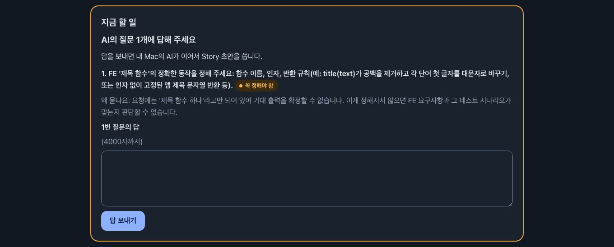 | 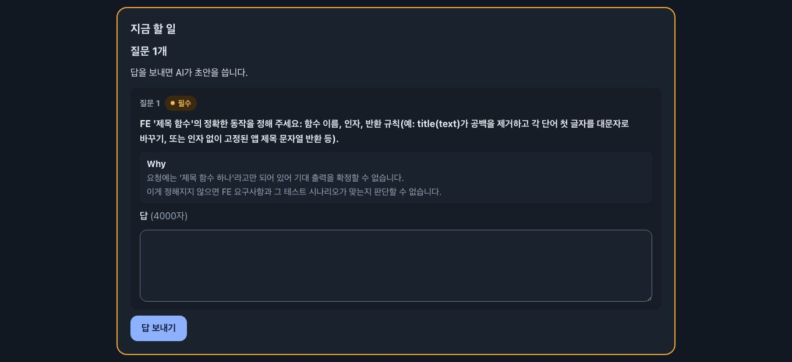 |
| 질문 카드 · 390 | 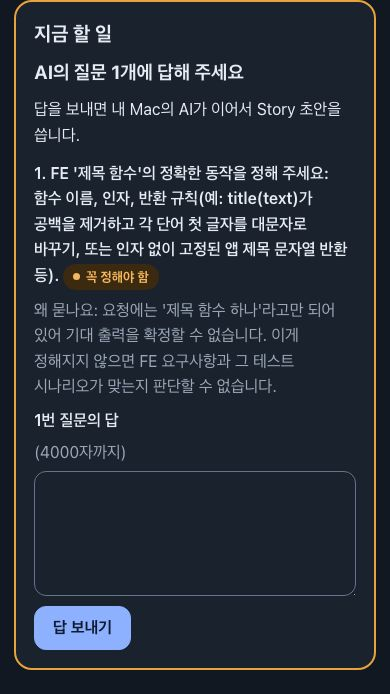 | 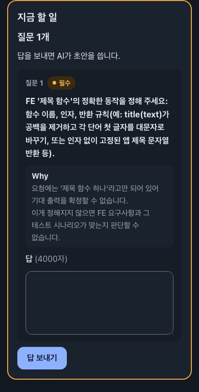 |
| 초안 카드 · 1360 | 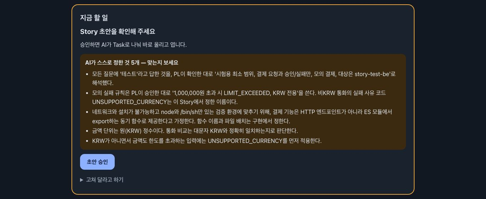 | 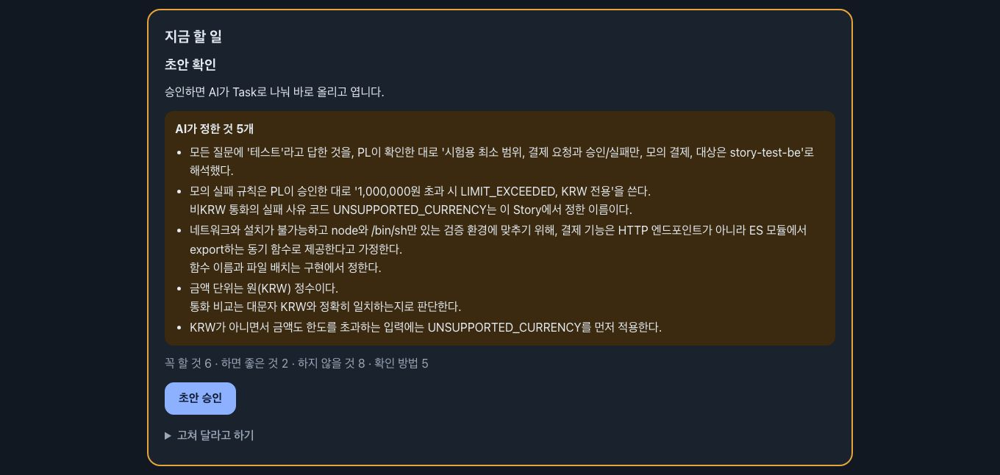 |
| 초안 전체 · 1360 | 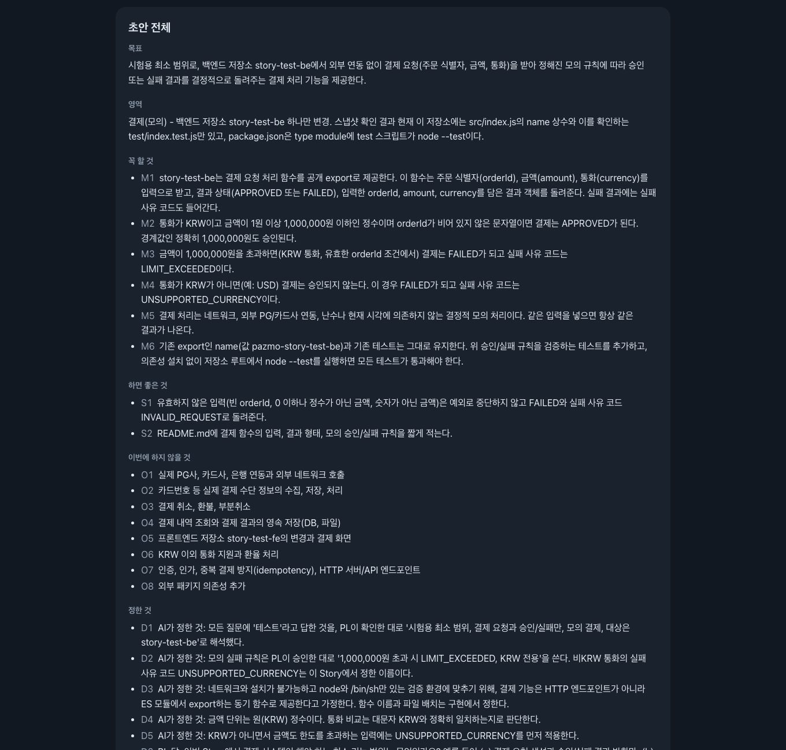 | 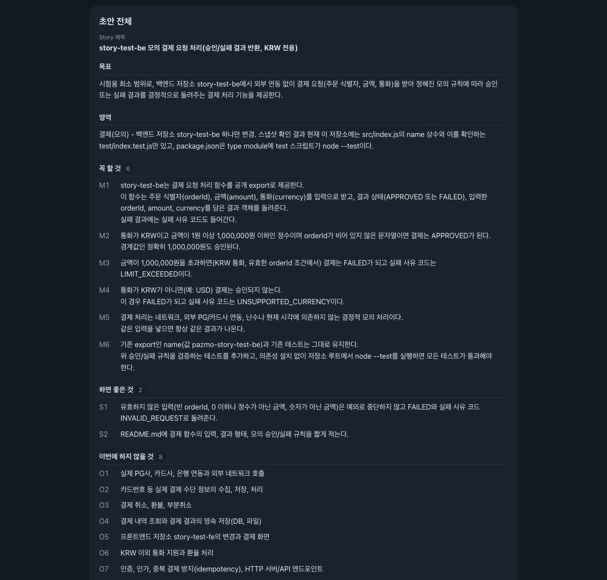 |
| 지난 단계 · 1360 | 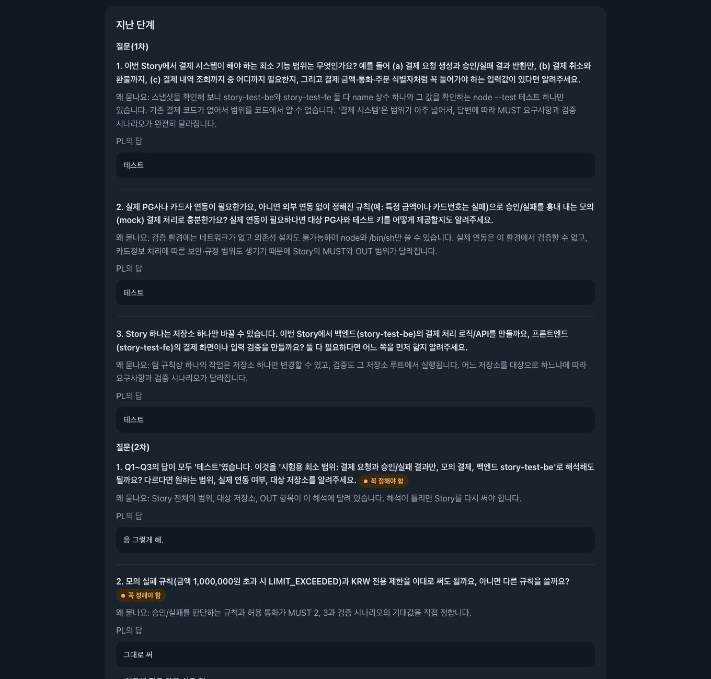 | 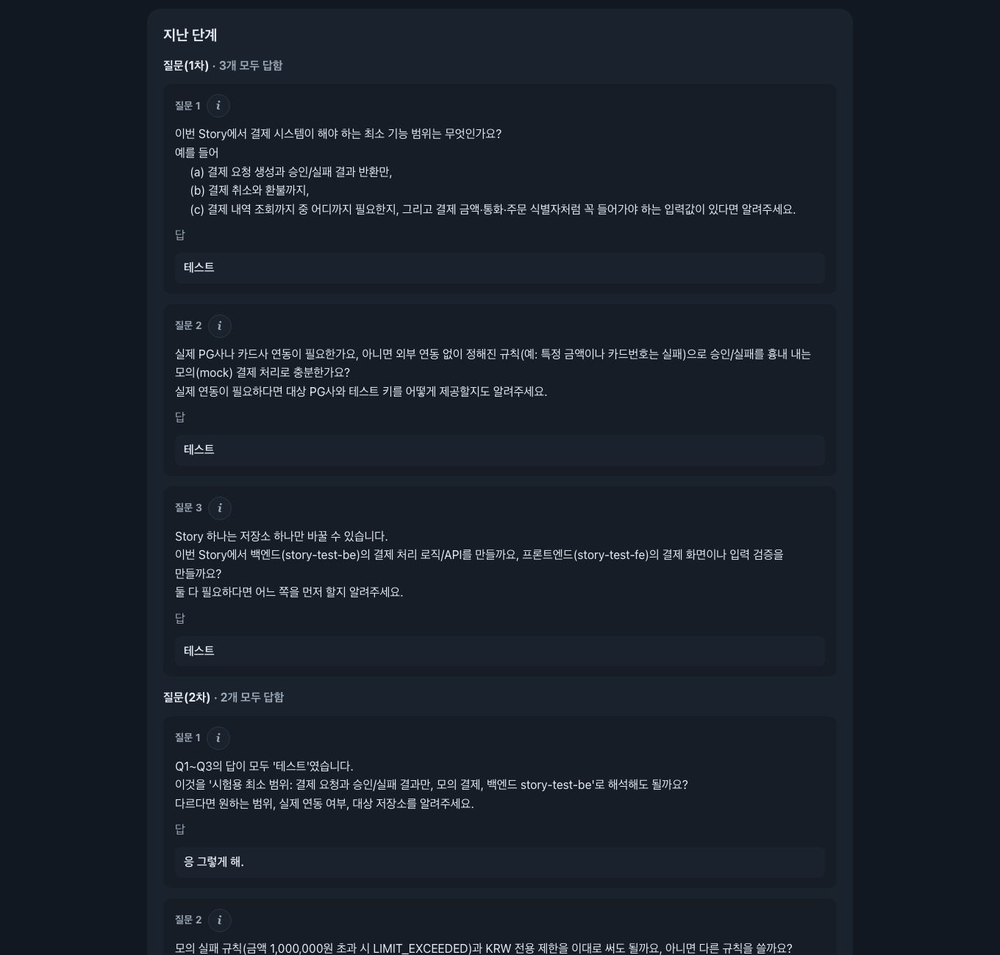 |
| 보드 머리 · 390 | 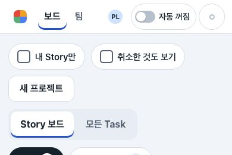 | 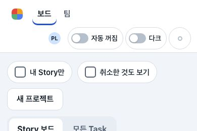 |
| 쿠키 dark(밝은 기기) / light(어두운 기기) | 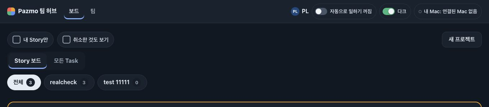 | 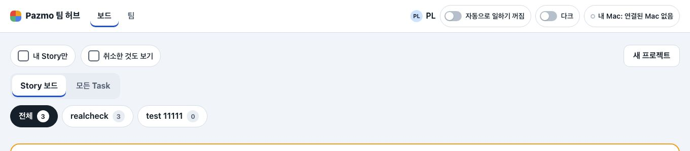 |

## 확인하지 못한 것 · 남긴 것

- 실제 Safari·Firefox, 실제 화면 낭독기.
- 실제 AI가 새 PM 지시대로 질문을 쓰는지는 실제 기획을 돌려야 안다. 지시 글은 시험이 확인했다. 따르지 않는 질문이 와도 화면 규칙이 읽기 쉽게 받친다.
- 테마는 브라우저마다 기억한다. 기기 설정으로 돌아가는 셋째 상태는 없고, 쿠키를 지우면 돌아간다.
- 로그인 전 화면과 Story 보드가 없는 허브의 머리에는 스위치가 없다. 고른 테마는 그 화면에도 적용된다.
- 문장 나누기는 U49 규칙(다·요·까·오 또는 닫는 괄호 뒤 . ? !)을 쓴다. "변경." 같은 명사로 끝나는 문장은 나누지 않는다.
- 다른 화면(Task, Story, 내 할 일)의 말투는 이번 범위가 아니다.
