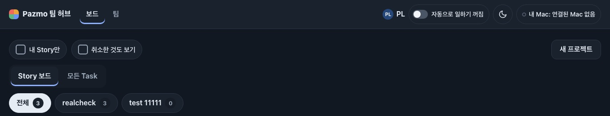
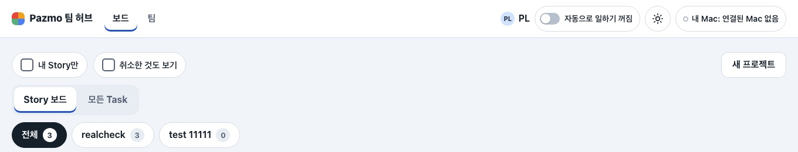
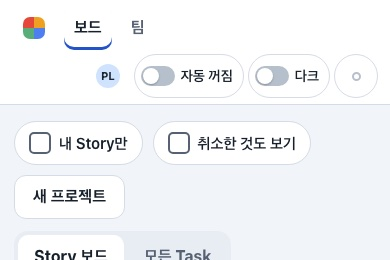
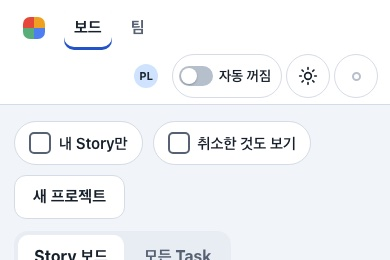
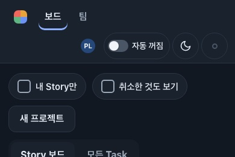

# 변경 기록: 다크 모드를 해·달 아이콘 단추로 (U52, D46)

kit 실행은 `.ai-workflow/runs/U52-hub-theme-icon.json`이다. 작은 변경의 기본 계획(구현 → 리뷰 → 검증)을 따랐다. 이 문서는 kit 증거가 아니라 변경 기록이다.

## 계기

U51(D45)을 머지하기 직전에 사용자가 이렇게 물었다. "다크모드는 일반적으로 그 달모양이랑 햇빛모양...? 그걸로 하지 않아? 그거 레퍼런스 찾아봐주고 그걸로 적용해" U51은 승인대로 머지(#95)하고, 이 변경은 이어서 따로 했다. Story에는 D46을 더했다. G1은 이 지시로 기록했다(`.ai-workflow/approvals/pazmo-agent-office-g1.json`).

레퍼런스는 다음 셋을 봤다.
- [web.dev 테마 스위치](https://web.dev/articles/building/a-theme-switch-component): 해·달 아이콘이 지금 테마를 보인다.
- [Chrome 다크 모드 토글 안내](https://developer.chrome.com/docs/modern-web-guidance/guides/ui-components/dark-mode-toggle): 지금 정해진 값을 보인다.
- [Lea Verou, Dark mode toggles](https://lea.verou.me/blog/2026/dark-mode-toggles/): 두 상태면 충분하다.

아이콘이 "지금 상태"를 보일지 "누르면 될 상태"를 보일지는 하나로 정해진 표준이 없다. 공통된 조언은 아이콘, 이름, 눌림 상태가 서로 맞아야 한다는 것이다.

## 바뀐 것

- "자동으로 일하기" 옆의 "다크" 스위치를 44px 둥근 아이콘 단추로 바꿨다. 크기는 Mac 칩과 같다.
  - 지금 테마가 밝으면 해, 어두우면 달이 보인다.
  - 이름은 늘 "다크 모드"다. 눌림 상태(`aria-pressed`)가 다크 모드가 켜졌는지를 말한다.
  - 마우스를 올리면 "다크 모드 켜짐/꺼짐"이 뜬다.
- 아이콘은 인라인 SVG이고, 색은 글자색(`currentColor`)을 따른다. 스크립트나 파일을 쓰지 않으므로 CSP에 걸리지 않는다.
- 누르면 하는 일은 D45(U51) 그대로다: `POST /me/theme`, 브라우저 쿠키, 쿠키가 없으면 기기 설정을 따름, CSRF·Origin 확인.
- 두 단추를 그려 두고, 지금 테마에 맞는 하나만 CSS로 보인다. 이 방식도 U51 그대로다.

## 확인

- **시험:** 시험부터 썼다. 다크 모드 시험과 Mac 상태 시험이 RED 2/2에서 GREEN 2/2가 됐다.
  - 다크 모드 시험은 아이콘(켜짐은 달, 꺼짐은 해), 이름, 눌림 상태, 마우스를 올렸을 때의 글, 44px 둥근 단추를 확인한다.
  - Mac 상태 시험은 새 단추의 마우스 글("꺼짐")을 빼고 Mac 글만 본다.
  - Hub 시험 파일과 기획 시험은 **702/702**, 타입 검사는 exit 0이다.
- **화면:** 확인용 허브는 건드리지 않았다. 그 DB 복사본과 데모 복사본으로, 고치기 전(main `b330e22`, U51)과 후를 쟀다. 범위는 10화면 × 4폭 × 두 테마에 쿠키 경우 8번을 더한 것이다.
  - 후 88번: 모두 200이다. 가로 넘침, 화면 끝 넘음, 작은 누름 대상, 중복 id는 모두 0이다.
  - 단추는 늘 하나만 보이고 지금 테마와 맞는다. 쿠키 dark는 밝은 기기에서 달, 쿠키 light는 어두운 기기에서 해를 보인다.
  - 머리 높이는 U51과 같다. 390px은 두 줄(105px)이다. 861·1360px은 한 줄(65px)이다.

| | 그림 |
|---|---|
| 1360 · 밝은 기기에서 다크 켬(달) |  |
| 1360 · 어두운 기기에서 다크 끔(해) |  |
| 390 · 전(U51 "다크" 스위치) |  |
| 390 · 후(밝음) |  |
| 390 · 후(어두움) |  |

- **리뷰:** 독립 리뷰 1차는 머지 가능이었다. 162번 돌렸고, 일부러 깬 다섯 가지가 모두 시험에 걸렸다. Minor로 남긴 것은 둘이다: 옅은 테두리, 폰 머리 두 줄.
- **kit 검증(`5341fa1`):** 674/674 + 605/605 + 678/678 = **1957/1957**, 타입 검사·Story 검사 exit 0.
- **G4(2026-11-18):** 사용자는 설명 페이지 29판의 U52 상자를 본 뒤 "승인 후 머지"를 골랐다. [G4 기록](../../.ai-workflow/approvals/hub-theme-icon-g4.md)

## 확인하지 못한 것 · 남긴 것

- 실제 Safari·Firefox, 실제 화면 낭독기.
- 폰 390px 머리는 U51처럼 두 줄이다.
- 아이콘이 "누르면 될 테마"가 아니라 "지금 테마"를 보이는 것은 ASSUMED(D46)다. G4에서 사용자가 바꿀 수 있다.
