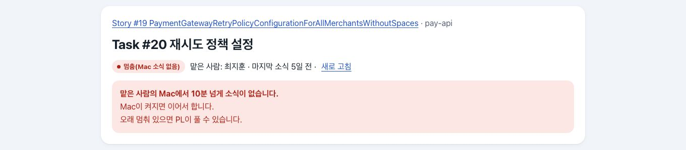
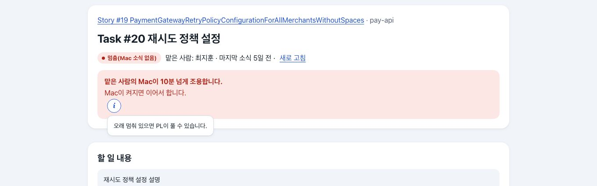
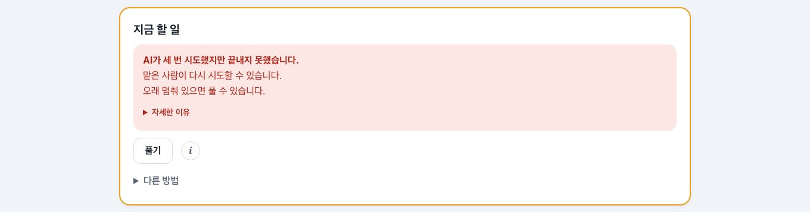
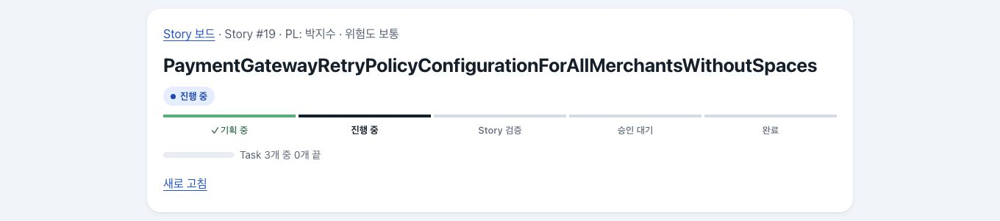
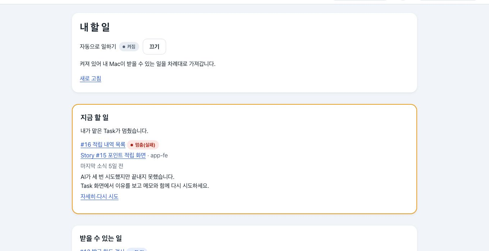
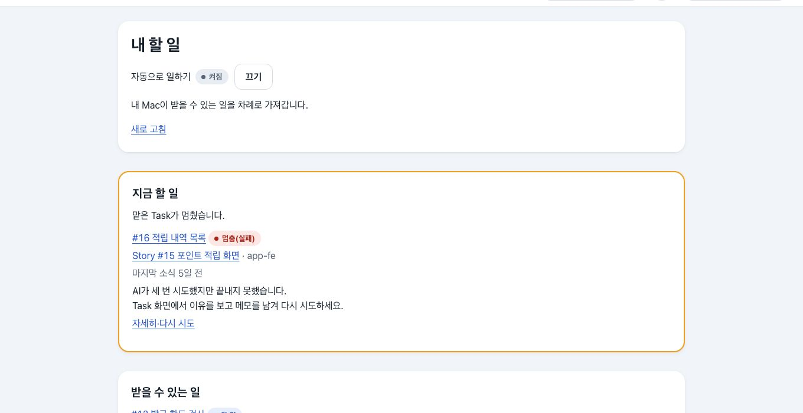

# 변경 기록: Task·Story·내 할 일·보드 화면 말투 (U53, D41)

kit 실행은 `.ai-workflow/runs/U53-hub-wording.json`이다. 이 기록은 kit 증거가 아니라 변경 기록이다.

U51에서 기획 화면의 말투를 줄였고, 사용자가 다른 화면에도 같은 기준을 쓰자고 했다.
- 설명 페이지 31판에 "지금 → 바꾼 뒤" 표 19줄을 올렸다.
- 사용자는 "표대로 진행"을 골랐다.

글만 바뀐다(D41 범위). Story는 그대로다. 단추가 하는 일, 권한, 주소도 그대로다.

## 바뀐 것 (표대로)

- **내 할 일**
  - "맡은 Task가 멈췄습니다."
  - 스위치 줄: "내 Mac이 받을 수 있는 일을 차례로 가져갑니다." / "새 일을 받지 않습니다. 아래에서 직접 고르세요."
  - 빈 칸: "받을 수 있는 일이 없습니다." 뒤에 ⓘ "내 레포에 일이 생기면 여기에 보입니다."를 둔다. 끝낸 일이 없으면 "아직 없습니다."
- **Task**
  - "자동으로 일하기가 켜져 있어 내 Mac이 가져갑니다."
  - 메모 칸: "(선택, 2000자)"
  - 취소: "취소하면 이 Task를 건너뛰고 뒤 Task만 진행합니다." 결과 문장이라 늘 보인다.
  - Mac 소식이 없을 때: "맡은 사람의 Mac이 10분 넘게 조용합니다. Mac이 켜지면 이어서 합니다." 맡은 사람이 아니고 Mac이 꺼져 있으면 ⓘ "오래 멈춰 있으면 PL이 풀 수 있습니다."를 둔다.
  - 내 Task이면 "내 Mac이 10분 넘게 조용합니다."
  - 보드의 "멈춤(Mac 소식 없음)" 줄도 같은 문장이다.
- **멈춤 이유**
  - "AI가 세 번 시도했지만 끝내지 못했습니다. 이유를 보고 메모를 남겨 다시 시도하세요."
  - "90분 안에 끝나지 않았습니다. …"
  - "Mac에서 git·GitHub 단계가 … 이유를 확인한 뒤 다시 시도하세요."
  - Task 화면 밖(보드·내 할 일)에서는 "이유를" 앞에 "Task 화면에서"가 붙는다.
- **Story**
  - "멈춘 Task N개". 목록에 Task마다 이유가 있다.
  - "모든 Task가 끝났습니다. 결과 승인은 PL의 Mac(claude 대화)에서 합니다."
  - "Story 검증 실패. PL이 고칠 Task를 더하면 다시 검증합니다."
- **보드**
  - "기획이 멈췄습니다. 기획 화면에서 다시 시도하세요."
  - 프로젝트 칩 아래: "모든 프로젝트의 일입니다."
  - Story가 없는 프로젝트: Story를 만들 수 있는 사람에게는 "아직 Story가 없습니다. [새 Story]로 시작하세요." 다른 사람에게는 "아직 Story가 없습니다." 뒤에 ⓘ "이 프로젝트의 레포를 모두 맡은 사람이 Story를 올립니다."
  - 내 Story만 볼 때: "내 Story가 없습니다."

## 확인

- **시험**
  - 이 문장들을 확인하던 기존 시험의 기대값을 먼저 표대로 바꿨다. 세 화면 시험 파일 166개 중 25개가 RED였고, 모두 GREEN이 됐다(166/166).
  - 시험 하나를 새로 더했다. Task 화면 밖에서는 "Task 화면에서 이유를"로 바뀌는 문장, 결과 승인 문장, 짧은 Mac 문장을 본다.
  - ⓘ 세 개 중 빈 받을 일과 빈 프로젝트의 ⓘ는 기존 시험이 확인한다.
  - 오래 멈춘 Task의 ⓘ는 처음에 시험이 없었다(리뷰 1). 그래서 두 줄을 더했다.
    - PL에게는 Mac이 꺼져 있을 때 보인다.
    - 맡은 사람에게는 보이지 않는다.
  - 맡은 사람에게도 ⓘ가 보이게 일부러 깨면 시험이 실패한다.
  - Hub 시험 파일과 기획 시험은 **703/703**이고, 타입 검사는 exit 0이다.
- **화면**
  - 확인용 허브는 건드리지 않았다. 복사본으로 쟀다.
  - 고치기 전(main `c3b50e6`)과 후를 Task(멈춤·Mac 소식 없음, PL·맡은 사람·다른 사람), Story, 내 할 일 둘, 보드 셋에서 4폭 × 두 테마로 쟀다.
  - 후 80번은 모두 200이다. 가로 넘침, 화면 끝 넘음, 작은 누름 대상, 중복 id는 모두 0이다.

| | 전 | 후 |
|---|---|---|
| Task · Mac 소식 없음(다른 사람) |  |  |
| Task · 멈춤(PL) |  |  |
| Story(PL) |  |  |
| 내 할 일 |  |  |

## 확인하지 못한 것 · 남긴 것

- 실제 Safari·Firefox, 실제 화면 낭독기.
- 오래 멈춘 Task의 ⓘ는 두 문장 아래 줄에 따로 있다. U49의 다른 ⓘ와 같은 자리다.
- "Mac은 켜져 있지만 10분 넘게 이 Task 소식이 없습니다. 오래 멈춰 있으면 PL이 풀 수 있습니다."(Mac이 켜진 경우)는 표에 없어 그대로 뒀다.
- 초대·인증서·Mac 연결처럼 한 번 쓰는 화면의 말투는 이번 범위가 아니다.
