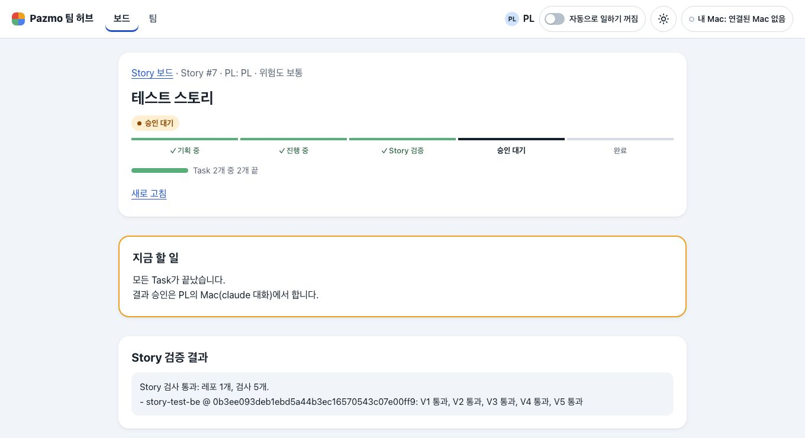
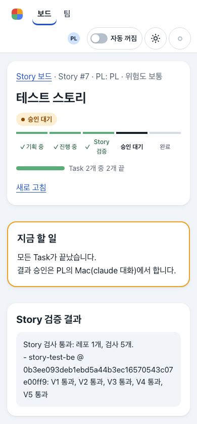
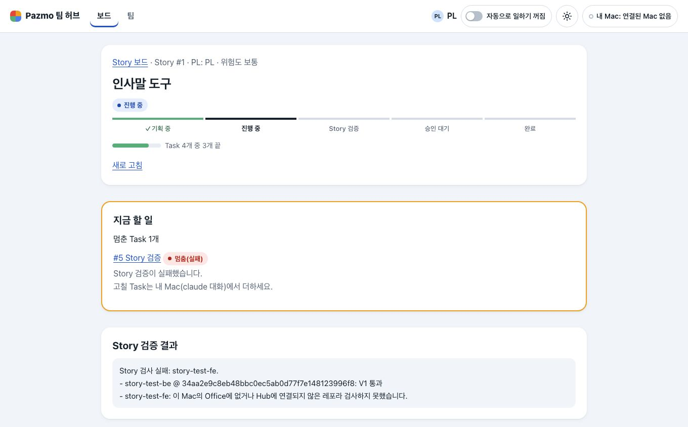

# 변경 기록: PL Office의 자동 Story 검증 (U54, D47 4a)

kit 실행은 `.ai-workflow/runs/U54-story-check.json`이다. 이 기록은 kit 증거가 아니라 변경 기록이다.

"테스트 스토리"(#7)는 작업 Task가 3분 만에 머지됐지만, Story 검증이 몇 시간째 준비 상태로 남아 있었다.
- 허브에는 검증 시작(`claim-verify`), 결과 보고(`verified`), 완료(`complete`)가 있었다.
- 이것을 부르는 Office 코드는 없었다.

사용자는 설명 페이지 35판의 묶음 4 설계를 보고 "추천대로 진행"을 골랐고, 36판의 D47에 "맞아, 진행해"로 G1을 줬다. 이번 PR은 4a(자동 검증과 화면)다. 승인, main 머지, 완료는 4b다.

## 바뀐 것

- **가져가기** (`src/team/story-check.ts`, `office.ts`)
  - PL의 Office가 일 가져가기 주기(30초)에 허브의 수신함을 본다. 순서는 기획 일 다음, 작업 Task 가져가기 앞이다.
  - 검증이 준비된 Story가 있으면 PL의 "자동으로 일하기"와 상관없이 가져간다. 허브는 원래 이것을 허용했다.
  - 진행 중인 Task 기록이 있거나, 실행할 수 없거나(잠김·실행기 준비 안 됨), "가져가기 멈춤"이면 새로 가져가지 않는다.
  - 멈춤이어도 이미 가진 검증은 이어 한다. 끊으면 하트비트가 멈춰 허브에 "멈춤"으로 남기 때문이다.
  - 다시 켜진 Office는 가진 검증을 처음부터 다시 한다.
- **검사**
  - 레포마다 Story base의 최신 커밋을 그 레포의 Office 전용 체크아웃에 받는다(`checkoutStoryBase`, 브랜치 없이 detached).
  - 사람의 레포 폴더와 다른 Story의 base는 받지 않는다.
  - 모든 레포를 받은 뒤 작업 Task와 같은 VM에서 그 레포의 Story 검사를 돌린다.
  - gh 로그인이 풀린 레포도 검사한다. 검사에는 gh가 필요 없다.
- **보고**
  - 모두 통과하면 "승인 대기"가 된다. 하나라도 실패하면 Story가 "진행 중"으로 돌아가고, 멈춘 검증으로 보인다.
  - 요약에는 레포마다 검사한 커밋 전체 값과 검사별 결과를 쓰고, 실패한 검사의 출력 끝부분을 붙인다(4000자 안).
  - git 오류 속 URL의 `user:비밀번호@`는 지운다.
  - 허브가 보고를 받지 못하면 같은 결과를 다시 보낸다. VM은 다시 돌리지 않는다.
  - git·VM 실패는 같은 검증에서 3번 이상, 10분 넘게 이어져야 실패로 보고한다.
  - PL이 검증을 풀거나 Story를 취소하면 VM을 끊고 아무것도 보고하지 않는다.
- **허브** (`story-store.ts`, `story-pages.ts`)
  - 검증 Task의 Story base마다 레포 이름을 더해 보낸다. 더하기만 한 필드다.
  - Story 화면의 "지금 할 일" 아래에 "Story 검증 결과"가 보인다. 통과했거나 실패한 채일 때만 보이고, 푼 뒤에는 보이지 않는다.

## 그림 (확인용 허브의 사본, 최종 코드)

확인용 허브의 sqlite를 사본으로 떠서 18575에 띄웠다. PL의 be 클론 사본을 새 PL Office에 등록해 live로 돌렸다. 확인용 허브(18444)와 그 Office들은 건드리지 않았다.

- Story #7, PL, 1360폭: 누르는 일 없이 V1–V5 통과, "승인 대기"와 검증 결과
  
- 같은 화면, 390폭: 40자 커밋도 칸 안에서 줄바꿈된다.
  
- Story #1: 사본 Office에 fe 레포가 없어서 이름과 이유를 단 실패로 보고됐다.
  

## 확인

- **구현:** 3번 했다. RED는 4/5, 6/10, 3/22였고 GREEN은 1976, 1985, 1988이었다.
- **리뷰:** 같은 독립 리뷰어가 세 번 봤다.
  - 1차: Important 1(gh 풀린 레포를 없는 레포로 실패), Minor 8
  - 2차: Minor 7
  - 3차: 검증 가능
- **kit 검증(`e122556`):** 597/597 + 676/676 + 715/715 = **1988/1988**, 타입 검사·Story 검사 exit 0.
- **G4(2026-11-19):** 사용자는 설명 페이지 37판의 U54 상자를 본 뒤 "승인 후 머지"를 골랐다. [G4 기록](../../.ai-workflow/approvals/story-check-g4.md)

## 확인하지 못한 것 · 남긴 것

- D41의 AI 리뷰(지적은 보이기만)는 4a에 없다(D47 ASSUMED). 실행기에 Story 리뷰 역할을 새로 두어야 한다.
- 승인 기록, `team finish`, main 머지, 완료는 4b다. 4b의 `finish`는 검증한 커밋이 지금 Story base의 최신과 같은지 비교해야 한다.
- PL의 Mac 두 대가 같은 검증을 함께 돌 수 있다. 드물고, 허브는 먼저 온 결과만 받는다.
- 허브가 보고를 INVALID로 거절하면 Office는 같은 결과를 계속 보내고, 그동안 검증은 "멈춤"이 되지 않는다. 그런데 로그는 "PL이 풀 수 있다"고 말해 사실과 다르다. 지금 허브에서는 일어날 수 없는 경우라 4b에서 고친다.
- 확인용 허브(18444)는 머지 뒤 다시 띄울 때 새 코드로 #7·#1을 검증한다.
