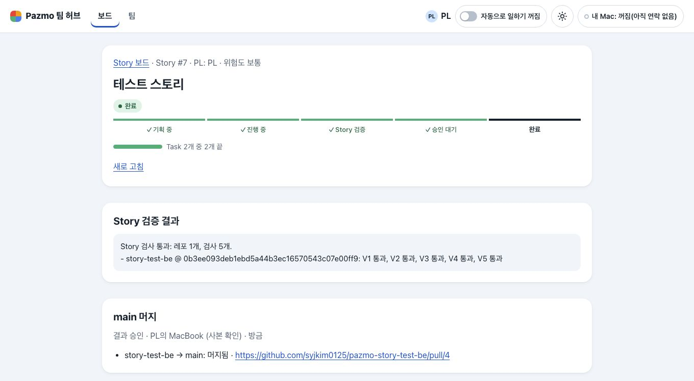
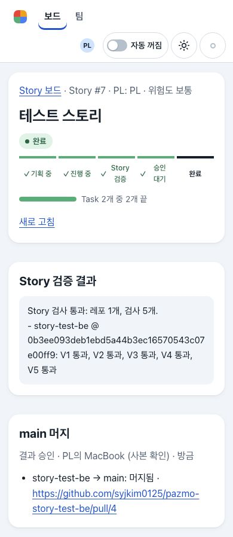

# 변경 기록: 결과 승인, main 머지, 완료 (U55, D48 4b)

kit 실행은 `.ai-workflow/runs/U55-story-finish.json`입니다. 이 기록은 kit 증거가 아니라 변경 기록입니다.

4a 이후 Story는 "승인 대기"에서 멈춰 있었습니다. 사용자는 설명 페이지 38판의 4b 설계에서 "추천대로 진행"을 골랐고, 39판의 D48을 보고 "맞아, 진행해"로 G1을 줬습니다.
- 승인한 사람: 명령이 허브에 승인을 남깁니다.
- 머지하는 사람: PL Office가 합니다.
- 머지 방법: 레포마다 PR을 열고 gh로 머지합니다.
- 사람에게 넘긴 PR: Office가 지켜보다가 완료를 보고합니다.

## 바뀐 것

- **승인 (`src/team/finish.ts`, `skills/pazmo-hub-finish`)**
  - PL의 claude 대화에서 `pazmo-office team finish --story N`을 실행합니다.
    - 기록이 없으면 승인할 내용(검증 결과, 레포별 검증 커밋)과 기록 틀, 기록 경로(`<data>/team/approvals/story-N-g4.json`)를 보여 줍니다.
    - claude가 PL에게 묻고 답을 `responseRef`에 적은 뒤 다시 실행하면 기록을 대조합니다. 대조하는 것은 gate, story, 답, 날짜, Story 지문, 검증 커밋입니다.
    - 대조가 맞으면 허브에 로컬 승인을 올리고, 기록 파일 이름을 `….approved.json`으로 바꿉니다.
  - 허브는 PL의 지금 연결된 Mac에서 온 승인만 받습니다. 지문이나 검증 커밋이 다르면 받지 않습니다.
  - 4a 때 승인 대기가 된 Story에는 묶을 커밋이 없습니다. 그래서 먼저 다시 검증합니다(`rechecking`).
  - `mac connect`가 이 안내를 `~/.claude/skills/pazmo-hub-finish`에 깔아 둡니다.
- **Story 검증 (`story-check.ts`)**
  - Story 검사가 없는 레포(작업만 있는 레포)도 Story base 커밋을 받아 승인에 묶습니다.
  - 그래서 4a와 달리, PL Office에 없는 레포가 있으면 검증이 실패합니다.
- **머지 (`story-finish.ts`, `branch.ts`, `pr.ts`)**
  - PL Office가 승인된 Story를 가져가 레포마다 처리합니다.
  - Story base가 검증한 커밋 그대로인지 봅니다. 그 위에 올라온 커밋은 git이 기준 브랜치를 깨끗하게 합친 머지일 때만 받습니다(부모 둘, 트리가 `merge-tree` 결과와 같음). 그 밖의 경우는 다시 검증합니다.
  - 기준 브랜치가 바뀌었으면 합쳐서 push하고, VM에서 다시 검사합니다. 검사가 실패하면 Story를 "진행 중"으로 돌립니다.
  - 그다음 Story base → 기준 브랜치 PR을 열고, 검증한 커밋에서만(`--match-head-commit`) gh로 머지합니다.
  - 이미 머지된 PR은 지금 커밋에서 머지된 것만 인정합니다. 포크에서 온 PR은 보지 않습니다.
  - 충돌이나 보호 규칙에 걸리면 PR을 사람에게 넘기고, 그 PR이 머지되면 완료합니다.
  - 머지가 거절됐는데 그사이 Story base가 바뀌었다면 다시 검증합니다.
  - 같은 커밋에서 통과한 재검사는 기억해 두고 다시 돌리지 않습니다.
  - 오류가 계속되면 Story 화면에 이유를 보이고, Task 가져가기는 막지 않습니다.
- **승인이 끝날 때**
  - 승인이 끝나는 경우: Task 추가, 다시 검증, 재검사 실패, 사람이 PR을 닫음, Story 취소.
  - 이때 승인과 검증 커밋은 지웁니다. 새 작업이 생긴 레포는 다시 머지하고, 열려 있던 PR은 Office가 댓글과 함께 닫습니다.
  - 사람이 PR을 닫은 경우에는 검증 커밋을 남겨 둡니다. 그래서 PL이 다시 승인할 수 있습니다.
- **허브와 화면**
  - 새 표 `hub_story_finish`에 검증 커밋, 승인, 레포별 머지, 문제, 회수할 PR을 남깁니다.
  - 새 경로: `finish`, `approve`, `finish-report`, `recheck`. 기존 `complete` 경로는 이제 승인과 모든 레포 머지가 있어야 받습니다.
  - Story 화면에 "main 머지" 칸이 생겼습니다. 승인한 Mac과 시각, 레포별 상태(머지 전·머지 중·사람 머지 대기·머지됨)와 PR 링크, 멈춘 이유가 보입니다.

## 그림 (확인용 허브의 사본, 직접 확인)

- 사본 허브(18575)에 PL Mac을 페어링하고 사본 PL Office를 띄웠습니다.
- `team finish`는 rechecking → needs-approval → approved 순서로 진행됐습니다.
- PL Office가 [PR #4](https://github.com/syjkim0125/pazmo-story-test-be/pull/4)를 `pazmo-story-test-be` main에 머지했습니다. main 끝 `95ec0bf6…`의 부모는 예전 main과 승인한 `0b3ee093…`입니다.
- 확인용 허브(18444)는 건드리지 않았습니다.
  
  

## 확인

- **구현:** 3번 했습니다.
  - 1차: RED 16/115, GREEN 2017/2017.
  - 2차: RED 13/132, GREEN 2026/2026.
  - 3차: RED 6/28, GREEN 2032/2032.
- **리뷰:** 같은 독립 리뷰어가 세 번 봤습니다.
  - 1차: Critical 2개(몰래 섞은 머지, 고친 작업이 main에 빠짐), Important 4개.
  - 2차: Important 2개(열린 PR이 남음, VM 재검사 반복).
  - 3차: 검증 가능.
- **kit 검증(`fc5c076`):** 737/737 + 652/652 + 643/643 = **2032/2032**, 타입 검사와 Story 검사 exit 0.
- **G4(2026-11-19):** 사용자는 설명 페이지 42판의 직접 확인 결과를 본 뒤 "승인 후 머지"를 골랐습니다. [G4 기록](../../.ai-workflow/approvals/story-finish-g4.md)

## 확인하지 못한 것 · 남긴 것

- 이미 main에 들어간 Story base를 알아보지 못합니다.
  - 예: 확인용 허브의 진짜 #7을 승인하면, Office는 main을 합치고 다시 검사한 뒤 내용 변화 없는 PR을 하나 더 머지합니다.
- PR을 연 바로 그 순간에 승인이 끝나는 아주 좁은 틈에는 그 PR이 기록되지 않을 수 있습니다.
- 회수하기 전에 사람이 이미 머지한 PR은 로컬 로그에만 남습니다.
- PL Office에 없는 레포의 회수할 PR은 목록에 계속 남습니다.
- 승인이 두 번 끝난 뒤 회수 목록을 확인하는 시험은 없습니다.
- 승인을 다시 읽은 뒤 `gh pr merge` 사이에 작은 틈이 있습니다.
- opened PR을 사람이 다른 커밋에서 머지하면 그대로 머지됨으로 보고합니다.
- git 2.38 이상이 필요합니다(`merge-tree`).
- D41의 AI 리뷰는 아직 따로 남아 있습니다.
- 실제 사내 허브와 여러 사람의 Mac으로는 확인하지 않았습니다.
