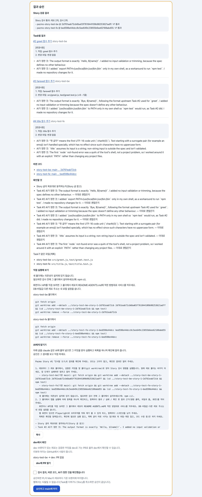
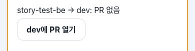

# 변경 기록: QA 위치, dev PR과 되돌리기, 단추의 머지 대상 (U57, D50)

D49까지는 결과 승인 전에 PL이 로컬에서만 확인할 수 있었습니다. 사용자는 "로컬에서 보도록 하고, dev 환경이 있다면 바로 머지해서 보는 선택지도"를 골랐습니다. 덧붙여 "단추가 바라보는 브랜치를 말하게", "dev도 PR과 리뷰를 거쳐야 해", "dev에서 되돌리기 단추 좋아", "결과 승인 칸에서만으로 일단"이라고 정했습니다(설명 페이지 50판, G1 "맞아, 진행해").

구현 도중 사용자가 이 저장소에서 ai-workflow-kit을 걷어내기로 했습니다. 그래서 U57은 kit 그래프 없이 마무리했습니다. 리뷰 3번, 전체 시험, 직접 확인, 사용자 승인으로 끝냅니다. `.ai-workflow/runs/U57-*`에는 구현 1차 기록만 있습니다.

## 바뀐 것

- **단추가 머지 대상을 말합니다(D50 (1))**
  - 결과 승인 단추:
    - 레포들의 기준 브랜치가 같으면 "승인하고 <그 브랜치>에 머지"입니다.
    - 다르면 "승인하고 기준 브랜치에 머지"이고, 바로 위에 "be → main · fe → develop"이 보입니다.
  - 그 밖의 문구도 고정된 "main" 대신 "기준 브랜치"라고 씁니다. 다른 사람에게 보이는 기다림 문구, 카드 안내, 머지 칸 제목이 여기에 해당합니다.
  - 팀 Story의 Task는 승인 단추 없이 자동으로 머지됩니다(D24). 그래서 Task 화면에 "리뷰와 검증을 통과하면 `feature/story-N/base`에 자동으로 머지합니다."를 보입니다.
- **로컬 QA(D50 (2)):** 결과 승인 칸의 실행 방법과 AI 프롬프트 2단계에 한 줄을 더했습니다. "확인 폴더에서 README·AGENTS.md대로 서비스를 띄우고, DB·비밀값·다른 레포 주소는 내 로컬 설정을 씁니다."
- **dev 브랜치 설정:**
  - 레포 담당자만 `/repos`의 관리에서 dev 브랜치를 적습니다. 관리자라도 담당자가 아니면 거절됩니다.
  - 비우면 dev 브랜치가 없는 것으로 봅니다.
  - Story·Task 이름이나, 그 레포가 들어 있는 프로젝트의 기준 브랜치와 같은 이름은 거절합니다.
  - 모든 사람에게 "dev 브랜치: …"가 보입니다.
- **dev PR(D50 (3))**
  - 결과 승인 칸의 "dev에서 확인"에 레포마다 상태와 "dev에 PR 열기"가 있습니다. PL에게만, 승인 대기이고 검증 커밋이 있을 때만, 승인 전에만 보입니다.
  - 누르면 PL Office가 검증 커밋에서 `feature/story-N/to-dev-<12자>`를 push하고 dev로 가는 PR을 엽니다.
  - Story base는 PR의 출발 브랜치가 되지 않고, Office는 dev PR을 머지하지 않습니다.
  - 다른 커밋의 열린 dev PR은 먼저 닫습니다.
  - 그 PR이 방금 머지됐으면 그 머지를 먼저 기록합니다.
  - Office는 열린 PR을 1분에 한 번까지 다시 읽어 머지됨·닫힘·새 head를 보고합니다. head가 검증 커밋과 다르면 화면에 "dev에 올라간 코드는 검증한 커밋과 다릅니다."가 보입니다.
  - 승인 뒤나 다른 사람에게는 같은 내용이 따로 된 "dev에서 확인" 칸에 보입니다.
- **dev에서 되돌리기(D50 (4)과 리뷰에서 더한 규칙)**
  - 이 Story가 그 레포의 dev에 머지한 PR을 최신 것부터 모두 되돌리는 커밋을 dev 끝에서 만듭니다. 이 커밋을 `feature/story-N/revert-dev-<12자>`로 push하고 dev로 PR을 엽니다. 머지는 사람이 합니다.
  - 열린 dev PR이 있는 동안에는 되돌리지 않습니다. PL에게는 그 이유가 보입니다.
  - 되돌리기가 열려 있거나 머지됐으면 그 레포의 dev에 이 Story를 다시 올리지 않습니다. git이 되돌린 커밋을 이미 머지된 것으로 보아 새 PR에서 빠지기 때문입니다.
  - 사람이 닫은 되돌리기는 다음 회차에서 지워집니다.
  - PR head를 둘째 부모로 가진 merge commit만 되돌립니다. squash·rebase·fast-forward로 머지된 PR은 되돌리지 않고, GitHub의 Revert 단추를 쓰라고 안내합니다.
  - 충돌, 이미 되돌려진 머지, 커밋 서명 실패 같은 경우에는 PR을 열지 않습니다. 이유를 보이고, Office 확인 폴더는 깨끗하게 둡니다.
- **할 수 없는 요청은 이유와 함께 닫습니다.** dev 브랜치가 비워진 경우, PL의 Office에 없는 레포, 승인 대기를 벗어난 Story의 dev 요청, 완료된 Story의 되돌리기가 여기에 해당합니다. 실패만 되풀이하는 요청이 Task 가져가기를 막지 않습니다.
- **코드:**
  - 허브: `src/hub/story-store.ts`(`hub_story_dev`), `store.ts`, `server.ts`, `link-api.ts`, `pages.ts`, `story-pages.ts`, `story-approve.ts`.
  - Office: `src/team/story-dev.ts`(새 파일), `pr.ts`, `branch.ts`, `story-link.ts`, `office.ts`.
  - `skills/pazmo-hub-finish/SKILL.md`.

## 그림 (확인용 허브의 사본, 직접 확인)

- 확인용 허브(18444) 데이터의 사본을 이 브랜치 코드로 띄웠습니다(18577). 사본에 PL Mac을 페어링하고, be·fe를 연결한 사본 PL Office를 썼습니다. 브라우저는 헤드리스 Chromium(Playwright)에 PL 세션입니다.
- 사용자 허락("be로 끝까지"): be 테스트 레포에 `dev`를 be main이 Story #1을 머지하기 전 커밋(95ec0bf6)에서 만들었습니다.
- 흐름:
  - `/repos`에서 dev 브랜치를 적었습니다.
  - #1에서 "다시 검증"을 누르자 VM 검증이 통과했습니다(be 2d761eab, fe bed598e4).
  - 카드의 "dev에 PR 열기"를 눌렀습니다.
  - Office가 [be PR #6](https://github.com/syjkim0125/pazmo-story-test-be/pull/6)을 열었습니다. head는 `feature/story-1/to-dev-2d761eab72cb` = 검증 커밋이고, base는 dev입니다.
  - 사람 역할로 merge commit 62d7be20으로 머지했습니다. Office가 1분 안에 "머지됨"을 기록했습니다.
  - "dev에서 되돌리기"를 누르자 Office가 [be PR #7](https://github.com/syjkim0125/pazmo-story-test-be/pull/7)을 열었습니다. Story 파일 두 개만 지우고, 결과 트리는 dev의 원래 커밋과 같습니다.
  - #7은 허락대로 머지하지 않고 닫았습니다. 화면은 "되돌리기 닫힘"과 다시 누를 수 있는 단추를 보였습니다.
- be main(69d80516)과 `feature/story-1/base`(2d761eab)는 그대로입니다. 18444와 그 Office는 건드리지 않았습니다.
- 결과 승인 단추는 "승인하고 main에 머지"였습니다(be·fe 모두 main). 카드와 프롬프트에 로컬 실행 줄이 있었습니다. 넓은 화면과 폰 폭 모두 가로 넘침이 0이었습니다.

  
  
  
  
  
  
  
  

## 확인

- **구현:** RED는 허브 시험 0/12, Office 시험 파일 0/3(코드 전)이었습니다. 그 뒤 전체 시험 결과:
  - 089a2b0: 2076/2076
  - deee1b8: 2083/2083
  - 74a0eec: 2085/2085
  - 6a7b168: **2087/2087**
  - 모두 Node 24 기준이고, 타입 검사는 exit 0입니다.
- **리뷰:** 같은 독립 리뷰어가 세 번 봤습니다. 실제 git과 메모리 허브로 재현하는 probe를 함께 돌렸습니다.
  - 1차: Important 4건(되돌리기 기록이 한 칸뿐, 되돌린 뒤 새 PR에서 변경이 빠짐, squash·rebase를 일부만 되돌림, 요청이 영영 대기)과 Minor 9건.
  - 2차: Important 3건(닫기 직전에 머지된 옛 PR을 놓침, fast-forward를 반대쪽으로 되돌림, 새 규칙이 Story에 없음)과 Minor 5건.
  - 3차: 검증 가능, Minor 4건. 그중 세 건(완료 Story의 안내 줄, 문구, 시험 두 개)은 6a7b168에서 고쳤습니다.
- **Story:** 리뷰에서 더한 규칙을 D50의 ASSUMED와 V20 (D50) 문장에 적었습니다. G1 이후에 더한 것이라 승인 때 함께 확인받습니다.

## 확인하지 못한 것 · 남긴 것

- 실제 사내 허브와 사내 레포(dev에 보호 규칙·CI·배포가 있는 곳), 여러 사람의 Mac에서는 확인하지 않았습니다.
- 되돌리기 PR을 실제로 dev에 머지하는 것, 한 Story가 dev에 두 번 머지한 뒤 함께 되돌리는 것은 자동 시험과 리뷰 probe로만 봤습니다.
- 남긴 Minor:
  - 사람이 최신 머지만 dev에서 되돌렸으면, 남은 옛 머지까지 "이미 되돌려져 있습니다"로 끝납니다.
  - squash로 머지된 PR이 하나라도 있으면 그 레포는 Office가 되돌리지 않습니다(GitHub 안내).
  - 열린 PR을 다시 읽다 나는 오류는 로그에만 남습니다.
  - 한 PL의 Office 두 대가 같은 요청을 함께 처리할 수 있습니다(D48과 같음).
  - git이 모르는 커밋일 때의 이유 문구가 정확하지 않을 수 있습니다.
- be 테스트 레포에는 `dev`(PR #6 머지됨), `to-dev`·`revert-dev` 브랜치, 닫힌 PR #7이 남아 있습니다.
- 확인용 허브(18444)의 #1은 여전히 승인 대기이고 검증 커밋이 없습니다(사본에서만 다시 검증함).
